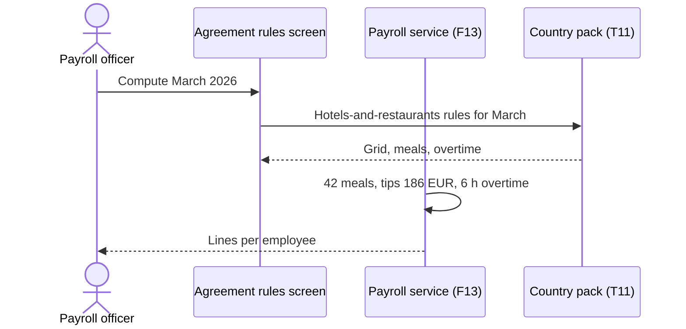

🏠 [Specs](../../../../README.md) › 🧩 [Functional capabilities](../../../README.md) ›
💶 [F13 Payroll (plugin)](../../README.md) › 📝 [Use cases](../README.md) ›
📝 [Use cases: FL-F13-09 Collective agreements by family](README.md) ›
📝 UC-F13-30 Apply the hotels-and-restaurants agreement

# 📝 UC-F13-30 Apply the hotels-and-restaurants agreement

**Status:** ✅ specified, ⚖️ lawyer review before launch (D574)

## Summary

For establishments under the hotels-and-restaurants agreement, SimpleERP applies its grid, the staff meals as a benefit
in kind, the tips paid in full to the staff in contact with customers and the agreement's overtime rules in
the monthly run.

## Personas

- [U45 Payroll officer](../../../../01-users/personas/u45-payroll-officer.md)

## Goal

Restaurant staff paid with the agreement's minimums, meals and tips counted right.

## Trigger

The monthly run of an establishment whose agreement family is hotels and restaurants.

## Frequency

Monthly; the restaurant example company (SC06) has 3 establishments.

## Preconditions

- The establishment's agreement family is set (E-F13-23) with its rules for the period.
- Meals taken and tips collected are recorded in F9 and F10.

## Postconditions

- Success: payslip lines for the grid, meals, tips and overtime.
- Failure: the run stays a draft with the missing rule named (BR-F13-24).

## Main flow

1. The payroll officer starts the run; SimpleERP reads the family's rules for the period (S-F13-05).
2. SimpleERP checks each employee's pay against the grid of their level and echelon.
3. SimpleERP values the meals taken as a benefit in kind (CR-FR-114) and adds the tips, paid in full to the staff
   in contact with customers (CR-FR-113).
4. SimpleERP applies the agreement's overtime rules to the hours from F9.
5. The payroll officer reviews the lines per employee and the run continues (UC-F13-07).

## Alternative flows

- 3a. The employee had a meal allowance instead of meals: the allowance is paid and no benefit is valued.
- 3b. Monthly pay with tips above 1.6 times the minimum wage: the tips lose their exemption from contributions
  (CR-FR-113); the exemption runs until 2028-12-31, and from 2029-01-01 tips carry contributions unless the law
  extends it.

## Error flows

- 1e. The family's rules for the period are missing: the run stays a draft (BR-F13-24).
- 2e. An employee's level is not in the grid: held out, HR asked to fix it in F9.
- Any step: a service does not answer; the call is retried first (BR-F3-32), then the message follows the error pattern
  (D122) and what was typed stays on the screen.

## Business rules

- [BR-F13-05 Collective-agreement rules applied](../../business-rules/br-f13-05-agreement-rules-applied.md)
- [BR-F13-24 Agreement family rules dated and complete](../../business-rules/br-f13-24-agreement-family-rules-dated-and-complete.md)
- [BR-F13-14 Benefits valued](../../business-rules/br-f13-14-benefits-valued.md)

## Entities

- [E-F13-23 Agreement family](../../data/e-f13-23-agreement-family.md)
- [E-F13-04 Payslip line](../../data/e-f13-04-payslip-line.md)

## Permissions

Payroll officer; HR reads the grid and fixes classifications in F9.

## Notifications

- Payroll and the administrator are warned when the family's rules for the period are missing.

## Audit events

Family and rule set used for each run, with the period and the lines produced.

## AI involvement

The AI assistant may explain a meal or tip line to the employee; it never changes the grid.

## API, MCP and A2A exposure

Through the API (T5) and as AI assistant tools (T6), with the caller's rights (BR-F3-34).

## Screens

- [S-F13-05 Agreement rules](../../screens/02-monthly-pay-run/s-f13-05-agreement-rules.md)

## Flowchart

See [FL-F13-09 Collective agreements by family](../../flows/fl-f13-09-collective-agreements-by-family.md#flowchart).

## Sequence diagram

## Acceptance criteria

1. **Given** a cook at level II of the restaurant example company with 22 meals taken in March **when** the run is
   computed **then** 22 meals are valued as a benefit in kind at the country pack's value.
2. **Given** 186.00 EUR of card tips shared to a waiter with a monthly pay of 2 100.00 EUR **when** the run is computed
   **then** the tips are added without employee or employer contributions.
3. **Given** a waiter's pay plus tips above 2 987.22 EUR **when** the run is computed **then** the tips carry
   contributions.
4. **Given** the March rules missing **when** the run starts **then** it stays a draft and the administrator is warned.

## Non-functional notes

D408's targets ([Performance](../../../../05-non-functional/performance.md)): 95 % of screens within 1 second; lists
paged on the server, the first page within 1 second; reports within 5 seconds or in the background.

## Regulatory references

[CR-FR-113 Tips sharing](../../../../10-country-packs/france/labour/cr-fr-113-tips-sharing.md),
[CR-FR-114 Staff meals as a benefit in kind](../../../../10-country-packs/france/labour/cr-fr-114-staff-meals-benefit.md);
the agreement's grid and overtime: (⚖️ lawyer review before launch, D574) to read: the hotels, cafés and
restaurants agreement (IDCC 1979) grid and overtime rules.

## Related use cases

- [UC-F13-05 Apply collective-agreement rules](../02-monthly-pay-run/uc-f13-05-apply-collective-agreement-rules.md)
- [UC-F13-17 Handle benefits](../04-events/uc-f13-17-handle-benefits.md)

## Open questions

None.

---

⬅️ [UC-F13-29 Value paid-leave pay](../08-deductions-savings-and-leave-pay/uc-f13-29-value-paid-leave-pay.md) ·
⬆️ [Up](README.md) · ➡️ [UC-F13-31 Apply the home-help agreement](uc-f13-31-apply-the-home-help-agreement.md)
