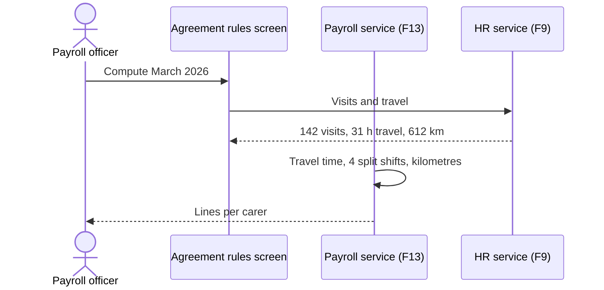

🏠 [Specs](../../../../README.md) › 🧩 [Functional capabilities](../../../README.md) ›
💶 [F13 Payroll (plugin)](../../README.md) › 📝 [Use cases](../README.md) ›
📝 [Use cases: FL-F13-09 Collective agreements by family](README.md) › 📝 UC-F13-31 Apply the home-help agreement

# 📝 UC-F13-31 Apply the home-help agreement

**Status:** 🔄 waiting for the owner

## Summary

For home-care establishments, simple-ERP counts travel time between visits as working time, applies the agreement's
limits on split shifts and its grid, and pays the travel allowances.

## Personas

- [U45 Payroll officer](../../../../01-users/personas/u45-payroll-officer.md)

## Goal

Carers paid for their travel and split shifts as the agreement says.

## Trigger

The monthly run of an establishment whose family is home help.

## Frequency

Monthly; the home-care example company (SC04) has 4 agencies.

## Preconditions

- The visits and travel of the month are closed in F9 and the rounds (SC04).
- The family's rules for the period are in the country pack.

## Postconditions

- Success: lines for travel time, split-shift allowances and kilometres.
- Failure: the run stays a draft (BR-F13-24).

## Main flow

1. The payroll officer starts the run; simple-ERP reads the visits and travel between them from F9 (S-F13-05).
2. simple-ERP adds the travel time between two visits to the worked hours (CR-FR-106).
3. simple-ERP counts the split shifts per day and pays the agreement's allowance for each.
4. simple-ERP pays the kilometres driven with the carer's own car at the rate of the agreement or the mileage scale
   (CR-FR-012).
5. The payroll officer reviews the lines and the run continues (UC-F13-07).

## Alternative flows

- 3a. A carer exceeds the agreement's split-shift limit: the day is flagged for the care coordinator; the pay still
  includes it.

## Error flows

- 1e. Visits are not closed: the inputs step is not finished (BR-F13-03).
- 2e. Travel between two visits is missing its distance: estimated from the addresses and flagged.
- Any step: a service does not answer; the call is retried first (BR-F3-32), then the message follows the error pattern
  (D122) and what was typed stays on the screen.

## Business rules

- [BR-F13-05 Collective-agreement rules applied](../../business-rules/br-f13-05-agreement-rules-applied.md)
- [BR-F13-24 Agreement family rules dated and complete](../../business-rules/br-f13-24-agreement-family-rules-dated-and-complete.md)
- [BR-F13-03 Inputs closed before the run](../../business-rules/br-f13-03-inputs-closed-before-the-run.md)

## Entities

- [E-F13-23 Agreement family](../../data/e-f13-23-agreement-family.md)
- [E-F13-03 Pay input](../../data/e-f13-03-pay-input.md)

## Permissions

Payroll officer; the care coordinator sees the flagged days, never amounts.

## Notifications

- The care coordinator is told of the days above the split-shift limit.

## Audit events

Family and rule set used, the travel time and kilometres counted per carer.

## AI involvement

The AI assistant may explain a carer's travel line to them; it never changes the hours.

## API, MCP and A2A exposure

Through the API (T5) and as AI assistant tools (T6), with the caller's rights (BR-F3-34).

## Screens

- [S-F13-05 Agreement rules](../../screens/02-monthly-pay-run/s-f13-05-agreement-rules.md)

## Flowchart

See [FL-F13-09 Collective agreements by family](../../flows/fl-f13-09-collective-agreements-by-family.md#flowchart).

## Sequence diagram

## Acceptance criteria

1. **Given** Sophie Bernard with 31 hours of travel between visits in March **when** the run is computed **then** 31
   hours are added to her worked hours.
2. **Given** 4 split shifts in March **when** the run is computed **then** 4 split-shift allowances at the agreement's
   amount are paid.
3. **Given** 612 km with her own car **when** the run is computed **then** the kilometres are paid at the rate read from
   the country pack.
4. **Given** a day with one split shift above the agreement's limit **when** the run is computed **then** the day is
   flagged for the care coordinator.

## Non-functional notes

D408's targets ([Performance](../../../../05-non-functional/performance.md)): 95 % of screens within 1 second; lists
paged on the server, the first page within 1 second; reports within 5 seconds or in the background.

## Regulatory references

[CR-FR-106 Home-care travel and split shifts](../../../../10-country-packs/france/labour/cr-fr-106-home-care-travel-and-split-shifts.md),
[CR-FR-012 Mileage scale](../../../../10-country-packs/france/tax-and-vat/cr-fr-012-mileage-scale.md); the agreement's
grid: (Proposed) to read.

## Related use cases

- [UC-F13-05 Apply collective-agreement rules](../02-monthly-pay-run/uc-f13-05-apply-collective-agreement-rules.md)
- [UC-F13-03 Collect pay inputs from F9](../02-monthly-pay-run/uc-f13-03-collect-pay-inputs-from-f9.md)

## Open questions

None.

---

⬅️ [UC-F13-30 Apply the hotels-and-restaurants agreement](uc-f13-30-apply-the-hotels-and-restaurants-agreement.md) ·
⬆️ [Up](README.md) · ➡️ [UC-F13-32 Apply the Syntec agreement](uc-f13-32-apply-the-syntec-agreement.md)
