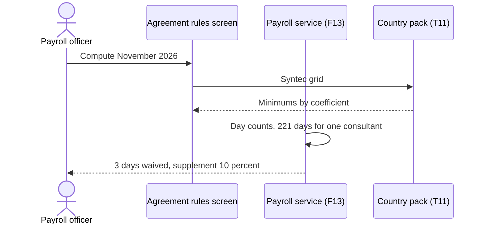

🏠 [Specs](../../../../README.md) › 🧩 [Functional capabilities](../../../README.md) ›
💶 [F13 Payroll (plugin)](../../README.md) › 📝 [Use cases](../README.md) ›
📝 [Use cases: FL-F13-09 Collective agreements by family](README.md) › 📝 UC-F13-32 Apply the Syntec agreement

# 📝 UC-F13-32 Apply the Syntec agreement

**Status:** 🔄 waiting for the owner

## Summary

For engineering and consulting establishments, SimpleERP applies the Syntec grid by position and coefficient and the
day-based working-time conventions with their day count and supplements.

## Personas

- [U45 Payroll officer](../../../../01-users/personas/u45-payroll-officer.md)

## Goal

Consultants and engineers paid at least the Syntec minimum for their coefficient, day-based staff within their day
count.

## Trigger

The monthly run of an establishment whose family is Syntec.

## Frequency

Monthly; the consulting example company (SC03) and the IT example company (SC14).

## Preconditions

- Each employee has a Syntec position and coefficient in F9.
- Day-based staff have a signed individual convention (CR-FR-099).

## Postconditions

- Success: grid checked, day-based staff counted, supplements paid.
- Failure: the run stays a draft (BR-F13-24).

## Main flow

1. The payroll officer starts the run; SimpleERP reads the Syntec grid for the period (S-F13-05).
2. SimpleERP checks each pay against the minimum of the coefficient.
3. For day-based staff, SimpleERP counts the days worked in the year and compares with 218.
4. For days worked beyond 218 under a waiver, SimpleERP pays the supplement of at least 10 % (CR-FR-099).
5. The payroll officer reviews and the run continues (UC-F13-07).

## Alternative flows

- 3a. A day-based employee reaches 235 days: no more days can be waived; HR is told.

## Error flows

- 2e. A pay below the coefficient's minimum: blocked like the minimum wage (BR-F13-05).
- 3e. No signed convention for a day-based employee: flagged, the employee is paid on hours.
- Any step: a service does not answer; the call is retried first (BR-F3-32), then the message follows the error pattern
  (D122) and what was typed stays on the screen.

## Business rules

- [BR-F13-05 Collective-agreement rules applied](../../business-rules/br-f13-05-agreement-rules-applied.md)
- [BR-F13-24 Agreement family rules dated and complete](../../business-rules/br-f13-24-agreement-family-rules-dated-and-complete.md)

## Entities

- [E-F13-23 Agreement family](../../data/e-f13-23-agreement-family.md)
- [E-F13-04 Payslip line](../../data/e-f13-04-payslip-line.md)

## Permissions

Payroll officer; HR reads the day counts.

## Notifications

- HR is told when a day-based employee reaches 218 and 235 days.

## Audit events

Family and rule set used, day counts and supplements per employee.

## AI involvement

The AI assistant may tell an employee their day count; it never changes it.

## API, MCP and A2A exposure

Through the API (T5) and as AI assistant tools (T6), with the caller's rights (BR-F3-34).

## Screens

- [S-F13-05 Agreement rules](../../screens/02-monthly-pay-run/s-f13-05-agreement-rules.md)

## Flowchart

See [FL-F13-09 Collective agreements by family](../../flows/fl-f13-09-collective-agreements-by-family.md#flowchart).

## Sequence diagram

## Acceptance criteria

1. **Given** a consultant at coefficient 130 with a monthly pay above the minimum **when** the run is computed **then**
   no anomaly is raised.
2. **Given** a day-based consultant who worked 221 days by November under a waiver **when** the run is computed **then**
   3 days are paid with a supplement of at least 10 %.
3. **Given** a day-based consultant with no signed convention **when** the run is computed **then** they are flagged and
   paid on hours.
4. **Given** a pay 40.00 EUR below the coefficient's minimum **when** the run is computed **then** the run is blocked
   for that employee.

## Non-functional notes

D408's targets ([Performance](../../../../05-non-functional/performance.md)): 95 % of screens within 1 second; lists
paged on the server, the first page within 1 second; reports within 5 seconds or in the background.

## Regulatory references

[CR-FR-099 Day-based working time](../../../../10-country-packs/france/labour/cr-fr-099-day-based-working-time.md); the
Syntec grid: (Proposed) to read.

## Related use cases

- [UC-F13-05 Apply collective-agreement rules](../02-monthly-pay-run/uc-f13-05-apply-collective-agreement-rules.md)
- [UC-F13-04 Compute gross to net](../02-monthly-pay-run/uc-f13-04-compute-gross-to-net.md)

## Open questions

None.

---

⬅️ [UC-F13-31 Apply the home-help agreement](uc-f13-31-apply-the-home-help-agreement.md) · ⬆️ [Up](README.md) ·
➡️ [UC-F13-33 Apply the construction agreements](uc-f13-33-apply-the-construction-agreements.md)
