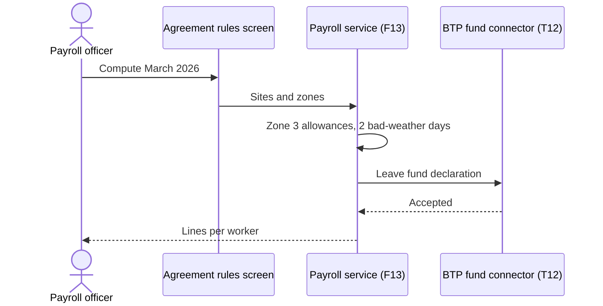

🏠 [Specs](../../../../README.md) › 🧩 [Functional capabilities](../../../README.md) ›
💶 [F13 Payroll (plugin)](../../README.md) › 📝 [Use cases](../README.md) ›
📝 [Use cases: FL-F13-09 Collective agreements by family](README.md) › 📝 UC-F13-33 Apply the construction agreements

# 📝 UC-F13-33 Apply the construction agreements

**Status:** 🔄 waiting for the owner

## Summary

For construction establishments, simple-ERP applies the construction grids, the travel and meal allowances by zone, the
bad-weather scheme and the declarations to the BTP paid-leave fund, which pays the workers' leave.

## Personas

- [U45 Payroll officer](../../../../01-users/personas/u45-payroll-officer.md)
- [U06 Human resources](../../../../01-users/personas/u06-hr.md), who records the site zones and bad-weather days in F9

## Goal

Construction workers paid with their allowances, and their leave declared to the fund.

## Trigger

The monthly run of an establishment whose family is construction.

## Frequency

Monthly; the construction example company (SC01).

## Preconditions

- Each site has its zone in F9; days stopped for bad weather are recorded.
- The company is a member of the BTP paid-leave fund (CR-FR-088).

## Postconditions

- Success: lines for grid, zone allowances, bad weather; the declaration to the fund.
- Failure: the run stays a draft (BR-F13-24).

## Main flow

1. The payroll officer starts the run; simple-ERP reads the construction rules and each worker's sites and zones
   (S-F13-05).
2. simple-ERP pays the travel and meal allowances of each day's zone.
3. simple-ERP pays the bad-weather days by the scheme and records them for the claim.
4. simple-ERP builds the declaration to the BTP paid-leave fund within its delay and does not compute leave pay itself.
5. The payroll officer reviews and the run continues (UC-F13-07).

## Alternative flows

- 2a. A worker sleeps away from home: the overnight allowance replaces the daily travel allowance.

## Error flows

- 1e. A site has no zone: the days on it are flagged; HR is asked to set the zone in F9.
- 4e. The fund returns the declaration: shown with its reason, corrected and filed again.
- Any step: a service does not answer; the call is retried first (BR-F3-32), then the message follows the error pattern
  (D122) and what was typed stays on the screen.

## Business rules

- [BR-F13-05 Collective-agreement rules applied](../../business-rules/br-f13-05-agreement-rules-applied.md)
- [BR-F13-24 Agreement family rules dated and complete](../../business-rules/br-f13-24-agreement-family-rules-dated-and-complete.md)
- [BR-F13-22 Leave pay is the higher of two methods](../../business-rules/br-f13-22-leave-pay-is-the-higher-of-two-methods.md)

## Entities

- [E-F13-23 Agreement family](../../data/e-f13-23-agreement-family.md)
- [E-F13-03 Pay input](../../data/e-f13-03-pay-input.md)

## Permissions

Payroll officer; HR records zones and bad-weather days.

## Notifications

- HR is told of days on sites with no zone; payroll when the fund's declaration is due.

## Audit events

Family and rule set used, allowances per day, bad-weather days, declaration filed.

## AI involvement

The AI assistant may explain a zone allowance to a worker; it never changes zones.

## API, MCP and A2A exposure

Through the API (T5) and as AI assistant tools (T6), with the caller's rights (BR-F3-34).

## Screens

- [S-F13-05 Agreement rules](../../screens/02-monthly-pay-run/s-f13-05-agreement-rules.md)

## Flowchart

See [FL-F13-09 Collective agreements by family](../../flows/fl-f13-09-collective-agreements-by-family.md#flowchart).

## Sequence diagram

## Acceptance criteria

1. **Given** a mason working 18 days in zone 3 in March at the construction example company **when** the run is computed
   **then** 18 travel and 18 meal allowances at zone 3's amounts are paid.
2. **Given** 2 days stopped for bad weather **when** the run is computed **then** they are paid by the scheme and listed
   for the claim.
3. **Given** a worker taking leave **when** the run is computed **then** no leave pay is computed and the fund's
   declaration includes the leave.
4. **Given** a site with no zone **when** the run is computed **then** its days are flagged and HR is asked to set the
   zone.

## Non-functional notes

D408's targets ([Performance](../../../../05-non-functional/performance.md)): 95 % of screens within 1 second; lists
paged on the server, the first page within 1 second; reports within 5 seconds or in the background.

## Regulatory references

[CR-FR-088 BTP paid-leave fund](../../../../10-country-packs/france/labour/cr-fr-088-btp-paid-leave-fund.md);
construction grids and allowances: (Proposed) to read.

## Related use cases

- [UC-F13-05 Apply collective-agreement rules](../02-monthly-pay-run/uc-f13-05-apply-collective-agreement-rules.md)
- [UC-F13-29 Value paid-leave pay](../08-deductions-savings-and-leave-pay/uc-f13-29-value-paid-leave-pay.md)

## Open questions

None.

---

⬅️ [UC-F13-32 Apply the Syntec agreement](uc-f13-32-apply-the-syntec-agreement.md) · ⬆️ [Up](README.md) ·
➡️ [UC-F13-34](../05-reports-and-rules/uc-f13-34-analyse-payroll-cost-by-site-project-and-analytic-axis.md)
