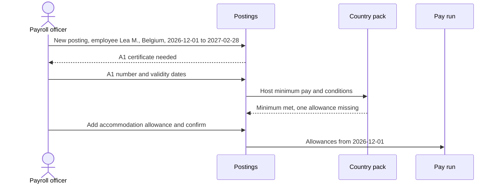

🏠 [Specs](../../../../README.md) › 🧩 [Functional capabilities](../../../README.md) ›
💶 [F13 Payroll (plugin)](../../README.md) › 📝 [Use cases](../README.md) ›
📝 [Use cases: FL-F13-10 Special contracts and outsourced payroll](README.md) › 📝 UC-F13-35 Pay posted workers

# 📝 UC-F13-35 Pay posted workers

**Status:** ✅ specified

## Summary

The payroll officer pays an employee posted to work in another country for a limited time, and keeps the papers that
make the posting lawful: the A1 certificate that keeps the employee in the home social security scheme, and the posting
declaration for a worker posted into France. The posting carries its dates, its host country, the host's minimum
conditions and the allowances paid on top of the pay.

## Personas

- [U45 Payroll officer](../../../../01-users/personas/u45-payroll-officer.md)

## Goal

A posted employee is paid by the rules of the posting, covered by the right scheme, and no posting runs without its
papers.

## Trigger

HR or a manager announces a posting (a site abroad, a service contract), or a foreign company posts a worker to a French
site.

## Frequency

A few postings a year in a company with foreign contracts; one pay line per posted worker each month.

## Preconditions

- The employee has a contract and a pay profile
  ([E-F9-02 Contract](../../../f09-hr-and-projects/data/e-f09-02-contract.md),
  [E-F13-02 Employee pay profile](../../data/e-f13-02-employee-pay-profile.md)).
- The country pack of the host country is installed, or its minimum conditions are entered by hand.
- The posting's start date, end date and place are known.

## Postconditions

- **Succeeded:** the posting is saved ([E-F13-28 Posting](../../data/e-f13-28-posting.md)) with its A1 certificate or
  its declaration receipt; the monthly pay run applies the posting's allowances and the host minimum check
  ([UC-F13-04](../02-monthly-pay-run/uc-f13-04-compute-gross-to-net.md)).
- **Failed:** the posting stays a draft, no posting allowance is paid, and the missing paper is listed.

## Main flow

1. The payroll officer opens the postings screen
   ([S-F13-28](../../screens/10-special-contracts-and-outsourcing/s-f13-28-posted-workers.md)) and creates a posting for
   an employee, with the direction (posted abroad or posted to France), the host country and the dates.
2. SimpleERP shows the paper the direction needs: an A1 certificate for an employee posted abroad, a posting
   declaration for a worker posted to France
   ([BR-F13-25](../../business-rules/br-f13-25-a-posting-needs-an-a1-certificate-or-a-sipsi-declaration.md)).
3. The payroll officer records the A1 number and its validity dates, or the declaration receipt and its date.
4. SimpleERP checks the host country's minimum pay and conditions against the employee's pay and flags a gap (a lower
   hourly rate, a missing allowance).
5. The payroll officer sets the posting allowances (travel, accommodation, hardship) and confirms; the posting becomes
   Documented and then Active on its start date.
6. Each month the pay run adds the allowances, keeps the home contributions and, at the end date, closes the posting.

## Alternative flows

- 3a. The A1 certificate is still being issued: the posting stays in Draft and the start date is not crossed; the
  payroll officer sees the days left.
- 5a. The employee's posting is extended: a new end date is entered and the certificate or declaration is renewed before
  the old one ends.
- 6a. The employee returns early: the end date is moved forward and the allowances stop at the new date.

## Error flows

- 3e. The certificate does not cover the dates of the posting: the posting is refused with the gap in days.
- 4e. The host country's pack is missing: the posting is allowed with a warning that the minimum conditions were not
  checked, and a person must confirm them.
- 6e. A pay run reaches an Active posting whose paper expired: the run is blocked for that employee with the reason.
- Any step: a service does not answer; the call is retried first
  ([BR-F3-32](../../../f03-assistant/business-rules/br-f03-32-retry-before-an-error.md)), then the message follows the
  error pattern ([D122](../../../../06-decisions/ux/d122-error-message-standard.md)) and what the user typed stays on
  the screen.

## Business rules

- [BR-F13-25](../../business-rules/br-f13-25-a-posting-needs-an-a1-certificate-or-a-sipsi-declaration.md)
- [BR-F13-17](../../business-rules/br-f13-17-special-contracts-paid-by-their-own-rules.md)
- [BR-F13-04](../../business-rules/br-f13-04-never-below-the-minimum-wage.md)

## Entities

- [E-F13-28 Posting](../../data/e-f13-28-posting.md): created, changed
- [E-F13-02 Employee pay profile](../../data/e-f13-02-employee-pay-profile.md): read, the pay profile
- [E-F13-03 Pay input](../../data/e-f13-03-pay-input.md): created, the allowances as pay inputs
- [E-F13-18 Special pay regime](../../data/e-f13-18-special-pay-regime.md): read, the regime declared to its body
- [E-F9-02 Contract](../../../f09-hr-and-projects/data/e-f09-02-contract.md): read, the contract

## Permissions

Payroll officer. HR reads the postings of their employees; the owner reads the list; the employee sees their
own posting in their payslip notes.

## Notifications

Payroll officer and HR, in the app: a posting starts in 14 days without its paper, or a paper ends in 30 days.

## Audit events

Each posting created, changed, extended or closed; each A1 number or receipt recorded or changed, with who and when;
each minimum-conditions gap flagged and how it was settled.

## AI involvement

No AI step of its own. The AI assistant may open the screen and prefill it from the user's words; the user checks and
confirms ([BR-F3-07](../../../f03-assistant/business-rules/br-f03-07-no-deletes-no-irreversible-acts.md)).

## API, MCP and A2A exposure

T5 operations of the capability for the personas above: create, read, update and list. The MCP tool of the
capability may read and propose, never confirm alone. No A2A skill.

## Screens

- [S-F13-28](../../screens/10-special-contracts-and-outsourcing/s-f13-28-posted-workers.md)

## Flowchart

See
[FL-F13-10 Special contracts and outsourced payroll](../../flows/fl-f13-10-special-contracts-and-outsourcing.md#flowchart).

## Sequence diagram

## Acceptance criteria

1. **Given** an employee posted abroad with no A1 certificate **when** the payroll officer confirms the posting **then**
   it stays Draft and names the missing certificate.
2. **Given** an A1 certificate valid until 2027-01-31 and a posting to 2027-02-28 **when** the dates are saved **then**
   the posting is refused and the 28 uncovered days are shown.
3. **Given** a posting to France with a declaration receipt **when** the posting is confirmed **then** it becomes
   Documented and Active on its start date.
4. **Given** a host minimum above the employee's rate **when** the check runs **then** a gap is flagged and the pay run
   waits for a person's choice.

## Non-functional notes

The screen answers within 2 seconds for 10,000 records; every change is audited.

## Regulatory references

A company that sends an employee to work in another EU country keeps them in the home social security scheme
with an A1 certificate; a foreign employer that posts a worker to France declares the posting on the national posting
platform (SIPSI) before it starts and keeps the receipt; the host country's minimum pay and working conditions apply
during the posting. The France-pack rule is listed below. Related:
[CR-FR-098](../../../../10-country-packs/france/labour/cr-fr-098-lawful-staff-lending.md),
[CR-FR-101](../../../../10-country-packs/france/labour/cr-fr-101-undeclared-work.md).

- France-pack rule:
  [CR-FR-218 Posted workers and the SIPSI declaration](../../../../10-country-packs/france/labour/cr-fr-218-posted-workers-sipsi.md)

## Related use cases

- [UC-F13-36 Follow days-based contracts](uc-f13-36-follow-days-based-contracts.md)
- [UC-F13-04 Compute gross to net](../02-monthly-pay-run/uc-f13-04-compute-gross-to-net.md)
- [UC-F13-22](../07-schemes-and-special-contracts/uc-f13-22-pay-an-apprentice-or-an-intern.md)
- [UC-F9-01](../../../f09-hr-and-projects/use-cases/01-people/uc-f09-01-manage-employee-records-and-contracts.md)

## Open questions

None.

---

⬅️ [UC-F13-34](../05-reports-and-rules/uc-f13-34-analyse-payroll-cost-by-site-project-and-analytic-axis.md) ·
⬆️ [Up](README.md) · ➡️ [UC-F13-36 Follow days-based contracts](uc-f13-36-follow-days-based-contracts.md)
