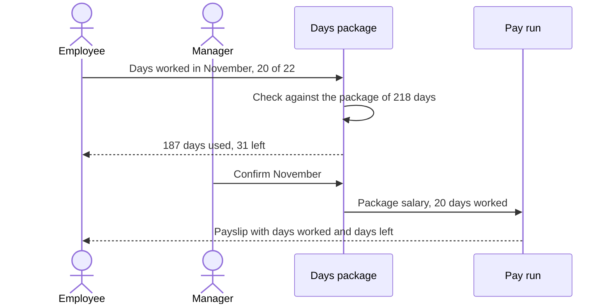

🏠 [Specs](../../../../README.md) › 🧩 [Functional capabilities](../../../README.md) ›
💶 [F13 Payroll (plugin)](../../README.md) › 📝 [Use cases](../README.md) ›
📝 [Use cases: FL-F13-10 Special contracts and outsourced payroll](README.md) › 📝 UC-F13-36 Follow days-based contracts

# 📝 UC-F13-36 Follow days-based contracts

**Status:** ✅ specified

## Summary

The payroll officer pays employees on a yearly days package (a fixed number of days a year instead of weekly hours) and
follows the days worked, the rest taken and the days left in the package. An employee declares their days from a phone;
the pay run uses the package, never the hours.

## Personas

- [U45 Payroll officer](../../../../01-users/personas/u45-payroll-officer.md)
- [U01 Employee](../../../../01-users/personas/u01-employee.md)

## Goal

A days-based employee is paid on their package, never works more days than it allows, and keeps the daily and weekly
rest the law requires.

## Trigger

A days-based contract is signed
[UC-F9-01](../../../f09-hr-and-projects/use-cases/01-people/uc-f09-01-manage-employee-records-and-contracts.md), or an
employee declares worked days at the end of the month.

## Frequency

A declaration per employee each month; a yearly review of every package.

## Preconditions

- The employee's contract is of the days-based kind with a yearly package of days
  ([E-F9-02 Contract](../../../f09-hr-and-projects/data/e-f09-02-contract.md)).
- The reference year of the package and the days of leave and public holidays are known
  ([UC-F9-09](../../../f09-hr-and-projects/use-cases/03-time/uc-f09-09-request-and-approve-time-off.md)).

## Postconditions

- **Succeeded:** the days of the month are recorded in the days package
  ([E-F13-29 Days package](../../data/e-f13-29-days-package.md)); the balance is updated; the pay run is paid on the
  package ([UC-F13-04](../02-monthly-pay-run/uc-f13-04-compute-gross-to-net.md)).
- **Failed:** the declaration is refused or waits for the manager; the pay run keeps the previous balance and lists the
  employee as waiting.

## Main flow

1. The payroll officer opens the days-based screen
   ([S-F13-29](../../screens/10-special-contracts-and-outsourcing/s-f13-29-days-based-contracts.md)) and sees each
   package with days worked, days of rest and days left.
2. At the end of the month the employee opens the declaration on their phone and confirms the days worked and the days
   of rest taken.
3. SimpleERP adds the days to the package and checks that the total never passes the package
   ([BR-F13-26](../../business-rules/br-f13-26-days-worked-never-exceed-the-package.md)).
4. SimpleERP checks the rest: the daily and weekly rest and the days off, and flags a month with too few rest days.
5. The manager confirms the declaration; the payroll officer sees the package as Confirmed for the month.
6. The pay run pays the monthly salary of the package; the payslip shows the days worked and the days left.

## Alternative flows

- 2a. The employee forgets: the payroll officer sends a reminder and the manager can declare for the employee, with a
  note.
- 4a. A month with few rest days: the payroll officer sends the employee and their manager an alert and asks for a rest
  follow-up interview.
- 6a. At the end of the reference year the unused days are listed: the payroll officer shows what the contract says
  about them (carry over, paid, lost).

## Error flows

- 3e. The days declared go over the package: the declaration is refused with the days left.
- 5e. The manager disagrees with the days declared: the declaration returns to the employee with the manager's comment.
- 6e. An employee has no declaration at the pay run: the run keeps the package salary and flags the month as not
  confirmed.
- Any step: a service does not answer; the call is retried first
  ([BR-F3-32](../../../f03-assistant/business-rules/br-f03-32-retry-before-an-error.md)), then the message follows the
  error pattern ([D122](../../../../06-decisions/ux/d122-error-message-standard.md)) and what the user typed stays on
  the screen.

## Business rules

- [BR-F13-26](../../business-rules/br-f13-26-days-worked-never-exceed-the-package.md)
- [BR-F13-17](../../business-rules/br-f13-17-special-contracts-paid-by-their-own-rules.md)

## Entities

- [E-F13-29 Days package](../../data/e-f13-29-days-package.md): created, changed
- [E-F13-02 Employee pay profile](../../data/e-f13-02-employee-pay-profile.md): read, the pay profile
- [E-F9-02 Contract](../../../f09-hr-and-projects/data/e-f09-02-contract.md): read, the contract
- [E-F9-09 Time-off request](../../../f09-hr-and-projects/data/e-f09-09-time-off-request.md): read, the days of leave

## Permissions

Payroll officer reads and changes every package. The employee declares their own days. The manager confirms
the days of their team.

## Notifications

The employee, on their phone: the monthly declaration reminder and the days left. The manager: days to confirm. The
payroll officer: a month with too few rest days.

## Audit events

Each declaration (days, by whom, when); each confirmation or return with its reason; each correction by the payroll
officer; each alert on rest.

## AI involvement

No AI step of its own. The AI assistant may open the screen and prefill it from the user's words; the user checks and
confirms ([BR-F3-07](../../../f03-assistant/business-rules/br-f03-07-no-deletes-no-irreversible-acts.md)).

## API, MCP and A2A exposure

T5 operations of the capability for the personas above: create, read, update and list. The MCP tool of the
capability may read and propose, never confirm alone. No A2A skill.

## Screens

- [S-F13-29](../../screens/10-special-contracts-and-outsourcing/s-f13-29-days-based-contracts.md)

## Flowchart

See
[FL-F13-10 Special contracts and outsourced payroll](../../flows/fl-f13-10-special-contracts-and-outsourcing.md#flowchart).

## Sequence diagram

## Acceptance criteria

1. **Given** a package of 218 days with 214 used **when** the employee declares 6 days **then** the declaration is
   refused with 4 days left.
2. **Given** a month with 24 working days declared and no rest days **when** the check runs **then** an alert goes to
   the payroll officer, the employee and the manager.
3. **Given** a declaration confirmed by the manager **when** the pay run starts **then** the payslip shows the days
   worked and the days left.
4. **Given** a manager who returns the declaration **when** the employee is told **then** the declaration is open again
   with the comment.

## Non-functional notes

The screen answers within 2 seconds for 10,000 records; every change is audited.

## Regulatory references

A days-based contract is possible only under a collective agreement or a written agreement that sets the rest
rules; the company monitors the workload, keeps a yearly interview and a right to disconnect. The package is counted in
days, not hours. See [CR-FR-099](../../../../10-country-packs/france/labour/cr-fr-099-day-based-working-time.md) for the
day-based working time rule; the France-pack rule on the follow-up is
[CR-FR-219](../../../../10-country-packs/france/labour/cr-fr-219-days-based-contracts.md).

- France-pack rule:
  [CR-FR-219 Days-based contracts (forfait jours)](../../../../10-country-packs/france/labour/cr-fr-219-days-based-contracts.md)

## Related use cases

- [UC-F13-35 Pay posted workers](uc-f13-35-pay-posted-workers.md)
- [UC-F13-37](uc-f13-37-hand-pay-inputs-to-an-outsourced-payroll-firm.md)
- [UC-F13-35 Pay posted workers](uc-f13-35-pay-posted-workers.md)
- [UC-F13-37](uc-f13-37-hand-pay-inputs-to-an-outsourced-payroll-firm.md)
- [UC-F9-10](../../../f09-hr-and-projects/use-cases/03-time/uc-f09-10-record-attendance-and-overtime.md)
- [UC-F9-09](../../../f09-hr-and-projects/use-cases/03-time/uc-f09-09-request-and-approve-time-off.md)

## Open questions

None.

---

⬅️ [UC-F13-35 Pay posted workers](uc-f13-35-pay-posted-workers.md) · ⬆️ [Up](README.md) ·
➡️ [UC-F13-37](uc-f13-37-hand-pay-inputs-to-an-outsourced-payroll-firm.md)
