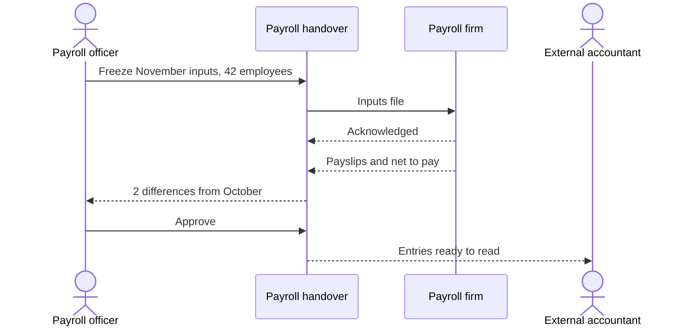

🏠 [Specs](../../../../README.md) › 🧩 [Functional capabilities](../../../README.md) ›
💶 [F13 Payroll (plugin)](../../README.md) › 📝 [Use cases](../README.md) ›
📝 [Use cases: FL-F13-10 Special contracts and outsourced payroll](README.md) ›
📝 UC-F13-37 Hand pay inputs to an outsourced payroll firm

# 📝 UC-F13-37 Hand pay inputs to an outsourced payroll firm

**Status:** 🔄 waiting for the owner

## Summary

A company that has its payslips made by an outside payroll firm keeps its pay inputs in simple-ERP and hands them over
each month as one frozen file; the firm returns the payslips, the payment file and the accounting entries, which
simple-ERP checks and posts. The external accountant reads the handover.

## Personas

- [U45 Payroll officer](../../../../01-users/personas/u45-payroll-officer.md)
- [U08 External accountant](../../../../01-users/personas/u08-external-accountant.md)

## Goal

The outside firm works from the same inputs the company approved, and what the firm returns is checked before anyone is
paid.

## Trigger

The pay inputs of the month are closed ([BR-F13-03](../../business-rules/br-f13-03-inputs-closed-before-the-run.md)) and
the company's payroll is set to an outside firm in the establishment's set-up
([UC-F13-01](../01-set-up/uc-f13-01-set-up-the-company-s-payroll.md)).

## Frequency

Every month.

## Preconditions

- The establishment is set to outsourced payroll
  ([E-F13-01 Payroll establishment](../../data/e-f13-01-payroll-establishment.md)) and the firm's connection is made in
  [UC-F24-23](../../../f24-integrations-hub/use-cases/06-business-tools/uc-f24-23-bring-hr-and-payroll-data-from-silae-payfit-or-lucca.md).
- The inputs of the month (hours, absences, bonuses, advances) are complete
  ([UC-F13-03](../02-monthly-pay-run/uc-f13-03-collect-pay-inputs-from-f9.md)).
- The employees' pay profiles are up to date
  ([E-F13-02 Employee pay profile](../../data/e-f13-02-employee-pay-profile.md)).

## Postconditions

- **Succeeded:** the handover is saved ([E-F13-30 Payroll handover](../../data/e-f13-30-payroll-handover.md)) with the
  frozen inputs, the firm's acknowledgement, the returned payslips and totals and the checks; the payment file and
  entries are posted after approval.
- **Failed:** nothing is frozen and nothing is sent; the missing or incomplete inputs are listed.

## Main flow

1. The payroll officer opens the outsourced payroll screen
   ([S-F13-30](../../screens/10-special-contracts-and-outsourcing/s-f13-30-outsourced-payroll.md)) and sees the month's
   inputs and the checks (every employee has inputs, no negative net, no missing profile).
2. The payroll officer freezes the inputs; from this point they cannot be changed
   ([BR-F13-27](../../business-rules/br-f13-27-inputs-are-frozen-once-handed-over.md)).
3. simple-ERP sends the file to the firm through the connection and records the acknowledgement.
4. The firm returns the payslips, the net-to-pay list and the contributions; simple-ERP compares them with the inputs
   and the previous month and lists the differences.
5. The payroll officer approves the comparison; the payment file and the accounting entries are prepared
   ([UC-F13-09](../03-declarations-and-payments/uc-f13-09-pay-employees-by-sepa-transfer.md),
   [UC-F13-13](../03-declarations-and-payments/uc-f13-13-post-payroll-entries-to-accounting.md)).
6. The external accountant reads the handover and the entries in their workspace.

## Alternative flows

- 2a. An input must change after the freeze: the payroll officer asks for a correction handover, which reopens only the
  employees concerned and keeps the first file.
- 4a. The firm returns a payslip with a net that differs by more than the tolerance: the line is flagged and the payroll
  officer asks the firm to explain or correct it.
- 6a. The company changes firm: the next month's handover goes to the new connection; the old handovers stay.

## Error flows

- 3e. The firm's service does not answer: the send is retried, then the handover stays Frozen, not Sent, and the payroll
  officer is told.
- 4e. The returned file is not in the expected format: it is kept and refused with the line numbers.
- 5e. The totals of the firm do not match the inputs: no payment file is prepared until the differences are settled.
- Any step: a service does not answer; the call is retried first
  ([BR-F3-32](../../../f03-assistant/business-rules/br-f03-32-retry-before-an-error.md)), then the message follows the
  error pattern ([D122](../../../../06-decisions/ux/d122-error-message-standard.md)) and what the user typed stays on
  the screen.

## Business rules

- [BR-F13-27](../../business-rules/br-f13-27-inputs-are-frozen-once-handed-over.md)
- [BR-F13-10](../../business-rules/br-f13-10-pay-run-locked-after-payment.md)
- [BR-F13-12 Payroll data restricted](../../business-rules/br-f13-12-payroll-data-restricted.md)

## Entities

- [E-F13-30 Payroll handover](../../data/e-f13-30-payroll-handover.md): created, changed
- [E-F13-03 Pay input](../../data/e-f13-03-pay-input.md): read, the frozen inputs
- [E-F13-07 Payslip](../../data/e-f13-07-payslip.md): created, the returned payslips
- [E-F13-12 Payroll entry](../../data/e-f13-12-payroll-entry.md): created, the entries after approval
- [E-F13-01 Payroll establishment](../../data/e-f13-01-payroll-establishment.md): read, the outsourcing setting

## Permissions

Payroll officer prepares, freezes and approves. The external accountant reads the handover and the returned
totals ([U08 External accountant](../../../../01-users/personas/u08-external-accountant.md)); the firm sees only the
file sent to it.

## Notifications

Payroll officer, in the app: the firm acknowledged, the firm returned its files, differences to settle. The external
accountant: the entries are ready to read.

## Audit events

Each freeze (inputs, count, by whom and when); each send and acknowledgement; each returned file and the differences
found; each correction handover; each approval.

## AI involvement

No AI step of its own. The AI assistant may open the screen and prefill it from the user's words; the user checks and
confirms ([BR-F3-07](../../../f03-assistant/business-rules/br-f03-07-no-deletes-no-irreversible-acts.md)).

## API, MCP and A2A exposure

T5 operations of the capability for the personas above: create, read, update and list. The MCP tool of the
capability may read and propose, never confirm alone. No A2A skill.

## Screens

- [S-F13-30](../../screens/10-special-contracts-and-outsourcing/s-f13-30-outsourced-payroll.md)

## Flowchart

See
[FL-F13-10 Special contracts and outsourced payroll](../../flows/fl-f13-10-special-contracts-and-outsourcing.md#flowchart).

## Sequence diagram

## Acceptance criteria

1. **Given** 42 employees with complete inputs **when** the payroll officer freezes the month **then** the inputs are
   locked and the file is sent.
2. **Given** a frozen month **when** someone edits an input **then** the edit is refused and a correction handover is
   offered.
3. **Given** a returned net that differs from the inputs by more than the tolerance **when** the comparison runs
   **then** the line is flagged and no payment is prepared for it.
4. **Given** the external accountant of the company **when** the handover is approved **then** they can read it and
   cannot change it.

## Non-functional notes

The screen answers within 2 seconds for 10,000 records; every change is audited.

## Regulatory references

The firm is a processor of the employees' personal data:
[CR-FR-049](../../../../10-country-packs/france/data-protection/cr-fr-049-processors-and-transfers.md). The company
stays responsible for the payslips and the monthly declaration:
[CR-FR-182 The payslip](../../../../10-country-packs/france/payroll/cr-fr-182-payslip.md),
[CR-FR-183](../../../../10-country-packs/france/payroll/cr-fr-183-dsn-monthly-declaration.md). (Proposed) The
France-pack rule on the contract with an outside payroll firm is written later.

## Related use cases

- [UC-F13-36 Follow days-based contracts](uc-f13-36-follow-days-based-contracts.md)
- [UC-F13-38 Follow staff representatives' hours](uc-f13-38-follow-staff-representatives-hours.md)
- [UC-F13-36 Follow days-based contracts](uc-f13-36-follow-days-based-contracts.md)
- [UC-F13-38 Follow staff representatives' hours](uc-f13-38-follow-staff-representatives-hours.md)
- [UC-F13-03](../02-monthly-pay-run/uc-f13-03-collect-pay-inputs-from-f9.md)
- [UC-F13-13](../03-declarations-and-payments/uc-f13-13-post-payroll-entries-to-accounting.md)
- [UC-F24-23](../../../f24-integrations-hub/use-cases/06-business-tools/uc-f24-23-bring-hr-and-payroll-data-from-silae-payfit-or-lucca.md)

## Open questions

None.

---

⬅️ [UC-F13-36 Follow days-based contracts](uc-f13-36-follow-days-based-contracts.md) · ⬆️ [Up](README.md) ·
➡️ [UC-F13-38 Follow staff representatives' hours](uc-f13-38-follow-staff-representatives-hours.md)
