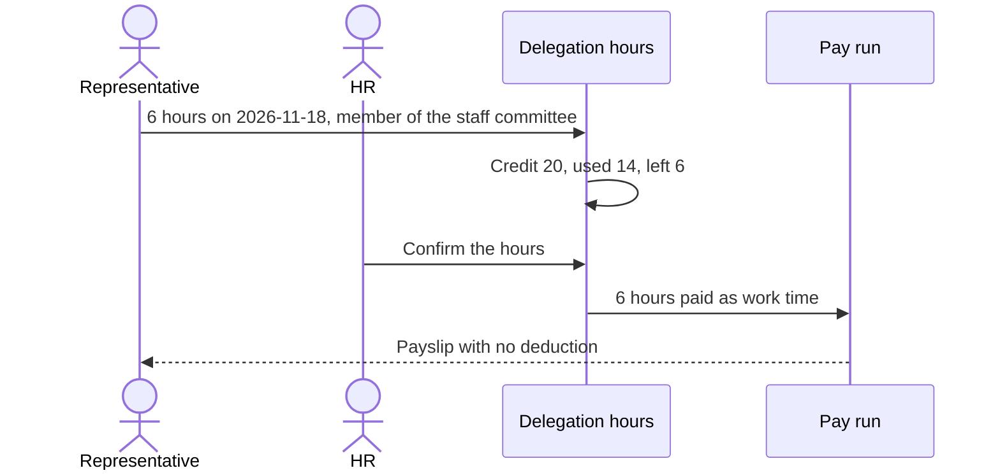

🏠 [Specs](../../../../README.md) › 🧩 [Functional capabilities](../../../README.md) ›
💶 [F13 Payroll (plugin)](../../README.md) › 📝 [Use cases](../README.md) ›
📝 [Use cases: FL-F13-10 Special contracts and outsourced payroll](README.md) ›
📝 UC-F13-38 Follow staff representatives' hours

# 📝 UC-F13-38 Follow staff representatives' hours

**Status:** ✅ specified

## Summary

HR follows the delegation hours of the staff representatives: the monthly credit each representative has to carry out
their mandate, the hours used, and the unused hours that carry over or are shared. Delegation hours are paid as normal
work time and never reduce pay.

## Personas

- [U06 Human resources](../../../../01-users/personas/u06-hr.md)
- [U45 Payroll officer](../../../../01-users/personas/u45-payroll-officer.md)

## Goal

A representative uses their credit without losing pay, the company knows the hours, and the payroll shows them as work
time.

## Trigger

A representative takes delegation hours (an HR record or a form they fill), or a new mandate starts.

## Frequency

Each month for every representative; a yearly review of the credits.

## Preconditions

- The representatives and their mandates are recorded in the HR records
  ([UC-F9-22](../../../f09-hr-and-projects/use-cases/08-hr-duties/uc-f09-22-keep-the-displays-and-the-bdese-current.md),
  [E-F9-01 Employee record](../../../f09-hr-and-projects/data/e-f09-01-employee-record.md)).
- The monthly credit of each mandate is set from the headcount and the agreement.

## Postconditions

- **Succeeded:** the hours are saved ([E-F13-31 Delegation hours](../../data/e-f13-31-delegation-hours.md)) against the
  mandate's credit; the pay run pays them as work time
  ([UC-F13-04](../02-monthly-pay-run/uc-f13-04-compute-gross-to-net.md)).
- **Failed:** the hours are refused or wait for review; nothing is deducted from the representative's pay.

## Main flow

1. HR opens the staff representatives screen
   ([S-F13-31](../../screens/10-special-contracts-and-outsourcing/s-f13-31-staff-representatives.md)) and sees each
   mandate with its credit, hours used and hours left.
2. A representative or their manager records delegation hours with the date, the duration and the mandate used.
3. SimpleERP adds the hours and compares them with the credit; hours above it are flagged (they need the
   employer's agreement or a reason).
4. HR confirms the hours; they appear on the pay input of the month as paid work time
   ([BR-F13-28](../../business-rules/br-f13-28-delegation-hours-are-paid-as-work-time.md)).
5. The payroll officer reads the hours, which are paid at the normal rate and never deducted.
6. At the month end unused hours are shown, with the carry-over or sharing the rules allow.

## Alternative flows

- 2a. A representative takes hours in a trip outside working time: the hours are recorded with their kind and the
  payroll officer sees them as working time of the trip.
- 3a. Two representatives share a part of their credit: HR records the sharing and each credit is updated.
- 5a. The representative leaves the company: the mandate ends and the credit stops; hours already confirmed stay paid.

## Error flows

- 3e. The hours pass the credit: they are held for review and not paid until HR confirms with a reason.
- 4e. The mandate has ended: the hours are refused with the end date.
- 5e. A pay run reaches unconfirmed hours: they are listed and the representative is paid their normal pay meanwhile.
- Any step: a service does not answer; the call is retried first
  ([BR-F3-32](../../../f03-assistant/business-rules/br-f03-32-retry-before-an-error.md)), then the message follows the
  error pattern ([D122](../../../../06-decisions/ux/d122-error-message-standard.md)) and what the user typed stays on
  the screen.

## Business rules

- [BR-F13-28](../../business-rules/br-f13-28-delegation-hours-are-paid-as-work-time.md)
- [BR-F13-17](../../business-rules/br-f13-17-special-contracts-paid-by-their-own-rules.md)
- [BR-F13-04](../../business-rules/br-f13-04-never-below-the-minimum-wage.md)

## Entities

- [E-F13-31 Delegation hours](../../data/e-f13-31-delegation-hours.md): created, changed
- [E-F13-03 Pay input](../../data/e-f13-03-pay-input.md): created, the paid hours as pay inputs
- [E-F9-01 Employee record](../../../f09-hr-and-projects/data/e-f09-01-employee-record.md): read, the mandate of the
  person
- [E-F13-02 Employee pay profile](../../data/e-f13-02-employee-pay-profile.md): read, the pay profile

## Permissions

HR and the payroll officer. The representative records and reads their own hours. The manager reads hours
that fall in their team without the mandate's detail.

## Notifications

HR, in the app: hours above the credit. The representative, on their phone: hours confirmed and the credit left.

## Audit events

Each mandate and credit set or changed; each hour recorded, confirmed, held or refused, with who and when; each sharing
and carry-over.

## AI involvement

No AI step of its own. The AI assistant may open the screen and prefill it from the user's words; the user checks and
confirms ([BR-F3-07](../../../f03-assistant/business-rules/br-f03-07-no-deletes-no-irreversible-acts.md)).

## API, MCP and A2A exposure

T5 operations of the capability for the personas above: create, read, update and list. The MCP tool of the
capability may read and propose, never confirm alone. No A2A skill.

## Screens

- [S-F13-31](../../screens/10-special-contracts-and-outsourcing/s-f13-31-staff-representatives.md)

## Flowchart

See
[FL-F13-10 Special contracts and outsourced payroll](../../flows/fl-f13-10-special-contracts-and-outsourcing.md#flowchart).

## Sequence diagram

## Acceptance criteria

1. **Given** a credit of 20 hours with 14 used **when** the representative records 6 hours **then** the hours are
   accepted and none is left.
2. **Given** a credit of 20 hours with 18 used **when** the representative records 6 hours **then** the hours are held
   for review.
3. **Given** confirmed delegation hours **when** the pay run computes the month **then** the hours are paid as work time
   and no deduction appears.
4. **Given** a mandate that ended on 2026-10-31 **when** hours are recorded for November **then** they are refused.

## Non-functional notes

The screen answers within 2 seconds for 10,000 records; every change is audited.

## Regulatory references

Staff representatives have a monthly credit of paid hours to carry out their mandate, which the employer pays
as work time; unused hours may carry over or be shared within set limits, and hours beyond the credit need a reason. The
credit depends on the headcount and the agreement; the France-pack rule is listed below. Related:
[CR-FR-046](../../../../10-country-packs/france/labour/cr-fr-046-headcount-thresholds.md),
[CR-FR-206](../../../../10-country-packs/france/labour/cr-fr-206-cse-consulted-on-monitoring.md).

- France-pack rule:
  [CR-FR-220 Staff representatives' delegation hours](../../../../10-country-packs/france/labour/cr-fr-220-staff-representatives-hours.md)

## Related use cases

- [UC-F13-37](uc-f13-37-hand-pay-inputs-to-an-outsourced-payroll-firm.md)
- [UC-F13-37](uc-f13-37-hand-pay-inputs-to-an-outsourced-payroll-firm.md)
- [UC-F9-22](../../../f09-hr-and-projects/use-cases/08-hr-duties/uc-f09-22-keep-the-displays-and-the-bdese-current.md)
- [UC-F9-10](../../../f09-hr-and-projects/use-cases/03-time/uc-f09-10-record-attendance-and-overtime.md)

## Open questions

None.

---

⬅️ [UC-F13-37](uc-f13-37-hand-pay-inputs-to-an-outsourced-payroll-firm.md) · ⬆️ [Up](README.md)
