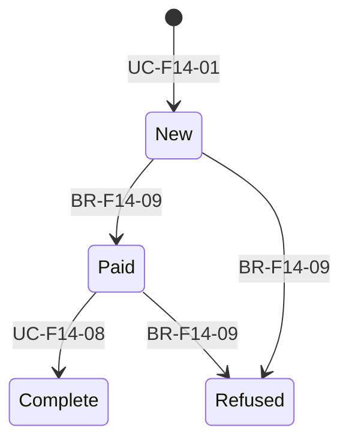

🏠 [Specs](../../../README.md) › 🧩 [Functional capabilities](../../README.md) › 🧰 [F14 Plugin store](../README.md) ›
🗃️ [Data](README.md) › 🗃️ E-F14-01 Store listing

# 🗃️ E-F14-01 Store listing

**Status:** ✅ specified

## Purpose

A plugin or sector pack in the store.

## Fields

| Name | Type | Required | Validation | Default | Example | Personal data | Custom fields |
|---|---|---|---|---|---|---|---|
| name, publisher, category | records | yes | BR-F14-09 | - | Gate Booking, Partner P, scheduling | no | no |
| rating, installs | numbers | no | - | - | 4.6, 1 240 | no | no |

## Relations

As its use cases.

## Lifecycle

## Indexes and search

By number, date, partner.

## Retention

Kept for the period of its kind of record in the country pack (D293), or else its kind's default in the
[retention schedule](../../../05-non-functional/data-retention.md).

## Audit

Every change.

## Import and export

CSV, FEC where relevant.

## Used by

- [UC-F14-01](../use-cases/01-find-and-install/uc-f14-01-browse-and-search-the-store.md)
- [UC-F14-02](../use-cases/01-find-and-install/uc-f14-02-install-a-plugin-or-sector-pack.md)
- [UC-F14-08](../use-cases/03-publish/uc-f14-08-submit-a-plugin.md)
- [UC-F14-19](../use-cases/05-store-operations/uc-f14-19-moderate-the-store-with-transparent-ranking.md)
- [UC-F14-20](../use-cases/01-find-and-install/uc-f14-20-ask-the-assistant-to-find-or-set-up-a-plugin.md)
- [UC-F14-22 Deprecate a plugin and announce its end of life](../use-cases/07-plugin-end-of-life/uc-f14-22-deprecate-a-plugin-and-announce-its-end-of-life.md)
- [UC-F14-23 Take over an abandoned plugin](../use-cases/07-plugin-end-of-life/uc-f14-23-take-over-an-abandoned-plugin.md)

## Open questions

None.

---

⬆️ [Up](README.md) · ➡️ [E-F14-02 Plugin installation](e-f14-02-plugin-installation.md)
