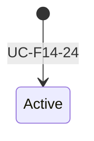

🏠 [Specs](../../../README.md) › 🧩 [Functional capabilities](../../README.md) › 🧰 [F14 Plugin store](../README.md) ›
🗃️ [Data](README.md) › 🗃️ E-F14-02 Plugin installation

# 🗃️ E-F14-02 Plugin installation

**Status:** ✅ specified

## Purpose

A plugin installed in a company.

## Fields

| Name | Type | Required | Validation | Default | Example | Personal data | Custom fields |
|---|---|---|---|---|---|---|---|
| company, plugin, version | records | yes | BR-F14-03 | - | Acme, Gate Booking, 2.3 | no | no |
| permissions accepted | list | yes | BR-F14-02 | - | calendar, email | no | no |

## Relations

As its use cases.

The same item as
[E-T04-03 Plugin installation](../../../03-technical/t04-plugin-runtime/data/e-t04-03-plugin-installation.md)
([D516](../../../06-decisions/foundations/d516-naming-rules-and-the-seven-classes-of-names.md), rule 4).

## Lifecycle

## Indexes and search

By number, date, partner.

## Retention

Kept for the period of its kind of record in the country pack (D293), or else its kind's default in the
[retention schedule](../../../05-non-functional/data-retention.md).

## Audit

Every change.

## Import and export

CSV, FEC where relevant.

## Used by

- [UC-F14-02](../use-cases/01-find-and-install/uc-f14-02-install-a-plugin-or-sector-pack.md)
- [UC-F14-03](../use-cases/01-find-and-install/uc-f14-03-update-with-compatibility-checks.md)
- [UC-F14-04](../use-cases/01-find-and-install/uc-f14-04-uninstall-and-export-the-plugin-s-data.md)
- [UC-F14-24 Publish to the beta channel](../use-cases/06-release-channels-and-rollback/uc-f14-24-publish-to-the-beta-channel.md)
- [UC-F14-28 Roll back to the previous version](../use-cases/06-release-channels-and-rollback/uc-f14-28-roll-back-to-the-previous-version.md)

## Open questions

None.

---

⬅️ [E-F14-01 Store listing](e-f14-01-store-listing.md) · ⬆️ [Up](README.md) ·
➡️ [E-F14-03 Plugin version](e-f14-03-plugin-version.md)
