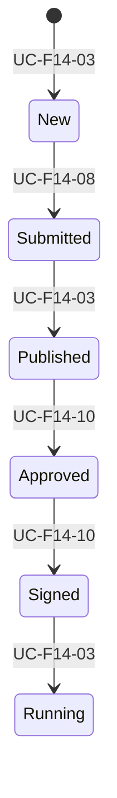

🏠 [Specs](../../../README.md) › 🧩 [Functional capabilities](../../README.md) › 🧰 [F14 Plugin store](../README.md) ›
🗃️ [Data](README.md) › 🗃️ E-F14-03 Plugin version

# 🗃️ E-F14-03 Plugin version

**Status:** ✅ specified

## Purpose

A submitted version.

## Fields

| Name | Type | Required | Validation | Default | Example | Personal data | Custom fields |
|---|---|---|---|---|---|---|---|
| plugin, version, compatibility | records | yes | BR-F14-03 | - | Gate Booking, 2.3, 3.x | no | no |
| checks, review, signature | states | yes | BR-F14-06, BR-F14-07 | - | passed, approved, signed | no | no |

## Relations

As its use cases.

## Lifecycle

## Indexes and search

By number, date, partner.

## Retention

Kept for the period of its kind of record in the country pack (D293), or else its kind's default in the
[retention schedule](../../../05-non-functional/data-retention.md).

## Audit

Every change.

## Import and export

CSV, FEC where relevant.

## Used by

- [UC-F14-03](../use-cases/01-find-and-install/uc-f14-03-update-with-compatibility-checks.md)
- [UC-F14-08](../use-cases/03-publish/uc-f14-08-submit-a-plugin.md)
- [UC-F14-09](../use-cases/03-publish/uc-f14-09-pass-automated-checks.md)
- [UC-F14-10](../use-cases/03-publish/uc-f14-10-pass-the-security-review-and-sign.md)
- [UC-F14-11](../use-cases/03-publish/uc-f14-11-publish-versions-and-release-notes.md)

## Open questions

None.

---

⬅️ [E-F14-02 Plugin installation](e-f14-02-plugin-installation.md) · ⬆️ [Up](README.md) ·
➡️ [E-F14-04 Plugin price plan](e-f14-04-plugin-price-plan.md)
