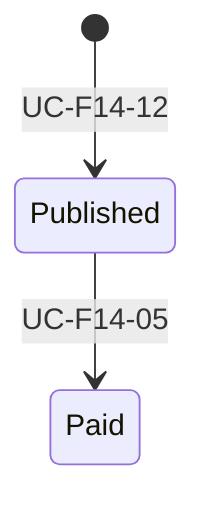

🏠 [Specs](../../../README.md) › 🧩 [Functional capabilities](../../README.md) › 🧰 [F14 Plugin store](../README.md) ›
🗃️ [Data](README.md) › 🗃️ E-F14-04 Plugin price plan

# 🗃️ E-F14-04 Plugin price plan

**Status:** ✅ specified

## Purpose

A price plan of a plugin.

## Fields

| Name | Type | Required | Validation | Default | Example | Personal data | Custom fields |
|---|---|---|---|---|---|---|---|
| plugin, plan, price | records | yes | - | - | Gate Booking, team, 9 a month | no | no |

## Relations

As its use cases.

## Lifecycle

## Indexes and search

By number, date, partner.

## Retention

Kept for the period of its kind of record in the country pack (D293), or else its kind's default in the
[retention schedule](../../../05-non-functional/data-retention.md).

## Audit

Every change.

## Import and export

CSV, FEC where relevant.

## Used by

- [UC-F14-05](../use-cases/02-buy-and-licence/uc-f14-05-buy-a-paid-plugin-or-subscription.md)
- [UC-F14-12](../use-cases/04-money-and-taxes/uc-f14-12-set-prices-and-plans.md)
- [UC-F14-27 Set and honour support terms of a paid plan](../use-cases/02-buy-and-licence/uc-f14-27-set-and-honour-support-terms-of-a-paid-plan.md)

## Open questions

None.

---

⬅️ [E-F14-03 Plugin version](e-f14-03-plugin-version.md) · ⬆️ [Up](README.md) ·
➡️ [E-F14-05 Plugin licence](e-f14-05-plugin-licence.md)
