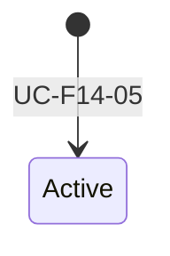

🏠 [Specs](../../../README.md) › 🧩 [Functional capabilities](../../README.md) › 🧰 [F14 Plugin store](../README.md) ›
🗃️ [Data](README.md) › 🗃️ E-F14-05 Plugin licence

# 🗃️ E-F14-05 Plugin licence

**Status:** ✅ specified

## Purpose

A licence of a paid plugin.

## Fields

| Name | Type | Required | Validation | Default | Example | Personal data | Custom fields |
|---|---|---|---|---|---|---|---|
| company, plan, valid to (seats withdrawn, D443) | records | yes | D443 | - | Acme, team, 2027-11 | no | no |

## Relations

As its use cases.

## Lifecycle

## Indexes and search

By number, date, partner.

## Retention

As an accounting record:
[CR-FR-002 Accounting records kept 10 years](../../../10-country-packs/france/accounting/cr-fr-002-accounting-records-kept-ten-years.md).

## Audit

Every change.

## Import and export

CSV, FEC where relevant.

## Used by

- [UC-F14-05](../use-cases/02-buy-and-licence/uc-f14-05-buy-a-paid-plugin-or-subscription.md)
- [UC-F14-06](../use-cases/02-buy-and-licence/uc-f14-06-manage-licences-and-seats.md)

## Open questions

None.

---

⬅️ [E-F14-04 Plugin price plan](e-f14-04-plugin-price-plan.md) · ⬆️ [Up](README.md) ·
➡️ [E-F14-06 Plugin review](e-f14-06-plugin-review.md)
