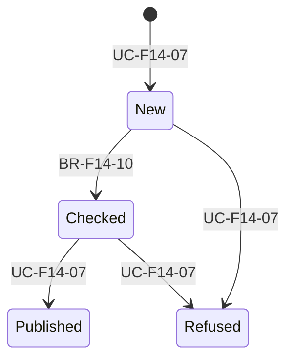

🏠 [Specs](../../../README.md) › 🧩 [Functional capabilities](../../README.md) › 🧰 [F14 Plugin store](../README.md) ›
🗃️ [Data](README.md) › 🗃️ E-F14-06 Plugin review

# 🗃️ E-F14-06 Plugin review

**Status:** ✅ specified

## Purpose

A rating and review.

## Fields

| Name | Type | Required | Validation | Default | Example | Personal data | Custom fields |
|---|---|---|---|---|---|---|---|
| plugin, company, rating, text | records | yes | BR-F14-10 | - | Gate Booking, Acme, 5, works well | no | no |

## Relations

As its use cases.

## Lifecycle

## Indexes and search

By number, date, partner.

## Retention

Kept for the period of its kind of record in the country pack (D293), or else its kind's default in the
[retention schedule](../../../05-non-functional/data-retention.md).

## Audit

Every change.

## Import and export

CSV, FEC where relevant.

## Used by

- [UC-F14-07](../use-cases/02-buy-and-licence/uc-f14-07-rate-and-review.md)
- [UC-F14-19](../use-cases/05-store-operations/uc-f14-19-moderate-the-store-with-transparent-ranking.md)

## Open questions

None.

---

⬅️ [E-F14-05 Plugin licence](e-f14-05-plugin-licence.md) · ⬆️ [Up](README.md) ·
➡️ [E-F14-07 Plugin check report](e-f14-07-plugin-check-report.md)
