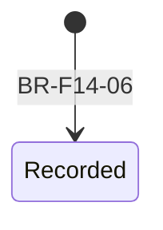

🏠 [Specs](../../../README.md) › 🧩 [Functional capabilities](../../README.md) › 🧰 [F14 Plugin store](../README.md) ›
🗃️ [Data](README.md) › 🗃️ E-F14-07 Plugin check report

# 🗃️ E-F14-07 Plugin check report

**Status:** ✅ specified

## Purpose

Automated check results.

## Fields

| Name | Type | Required | Validation | Default | Example | Personal data | Custom fields |
|---|---|---|---|---|---|---|---|
| version, check, result | records | yes | BR-F14-06 | - | 2.3, vulnerabilities, passed | no | no |

## Relations

As its use cases.

## Lifecycle

## Indexes and search

By number, date, partner.

## Retention

Kept for the period of its kind of record in the country pack (D293), or else its kind's default in the
[retention schedule](../../../05-non-functional/data-retention.md).

## Audit

Every change.

## Import and export

CSV, FEC where relevant.

## Used by

- [UC-F14-09](../use-cases/03-publish/uc-f14-09-pass-automated-checks.md)
- [UC-F14-10](../use-cases/03-publish/uc-f14-10-pass-the-security-review-and-sign.md)
- [UC-F14-21 Check a plugin's bill of materials and licences](../use-cases/03-publish/uc-f14-21-check-a-plugins-bill-of-materials-and-licences.md)

## Open questions

None.

---

⬅️ [E-F14-06 Plugin review](e-f14-06-plugin-review.md) · ⬆️ [Up](README.md) · ➡️ [E-F14-08 Payout](e-f14-08-payout.md)
