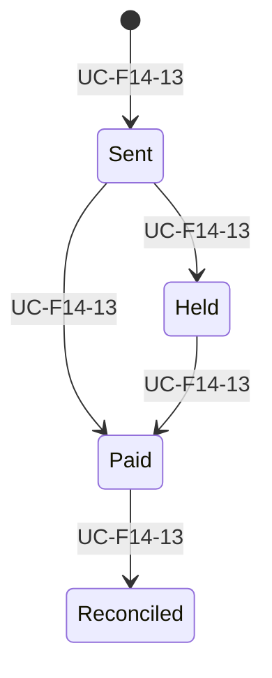

🏠 [Specs](../../../README.md) › 🧩 [Functional capabilities](../../README.md) › 🧰 [F14 Plugin store](../README.md) ›
🗃️ [Data](README.md) › 🗃️ E-F14-08 Payout

# 🗃️ E-F14-08 Payout

**Status:** ✅ specified

## Purpose

A payment to a publisher.

## Fields

| Name | Type | Required | Validation | Default | Example | Personal data | Custom fields |
|---|---|---|---|---|---|---|---|
| publisher, period, gross, commission, net | records | yes | BR-F14-13 | - | Partner P, Nov, 1 000, 200, 800 | no | no |

## Relations

As its use cases.

## Lifecycle

## Indexes and search

By number, date, partner.

## Retention

As an accounting record:
[CR-FR-002 Accounting records kept 10 years](../../../10-country-packs/france/accounting/cr-fr-002-accounting-records-kept-ten-years.md).

## Audit

Every change.

## Import and export

CSV, FEC where relevant.

## Used by

- [UC-F14-13](../use-cases/04-money-and-taxes/uc-f14-13-receive-payouts-and-statements.md)
- [UC-F14-18](../use-cases/04-money-and-taxes/uc-f14-18-follow-usage-and-revenue.md)

## Open questions

None.

---

⬅️ [E-F14-07 Plugin check report](e-f14-07-plugin-check-report.md) · ⬆️ [Up](README.md) ·
➡️ [E-F14-09 Seller report](e-f14-09-seller-report.md)
