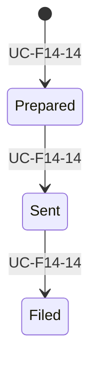

🏠 [Specs](../../../README.md) › 🧩 [Functional capabilities](../../README.md) › 🧰 [F14 Plugin store](../README.md) ›
🗃️ [Data](README.md) › 🗃️ E-F14-09 Seller report

# 🗃️ E-F14-09 Seller report

**Status:** ✅ specified

## Purpose

A yearly report of sellers.

## Fields

| Name | Type | Required | Validation | Default | Example | Personal data | Custom fields |
|---|---|---|---|---|---|---|---|
| year, sellers | records | yes | BR-F14-14 | - | 2026, 84 | no | no |

## Relations

As its use cases.

## Lifecycle

## Indexes and search

By number, date, partner.

## Retention

As an accounting record:
[CR-FR-002 Accounting records kept 10 years](../../../10-country-packs/france/accounting/cr-fr-002-accounting-records-kept-ten-years.md).

## Audit

Every change.

## Import and export

CSV, FEC where relevant.

## Used by

- [UC-F14-14](../use-cases/04-money-and-taxes/uc-f14-14-report-sellers-to-the-tax-office.md)

## Open questions

None.

---

⬅️ [E-F14-08 Payout](e-f14-08-payout.md) · ⬆️ [Up](README.md) · ➡️ [E-F14-10 Private store](e-f14-10-private-store.md)
