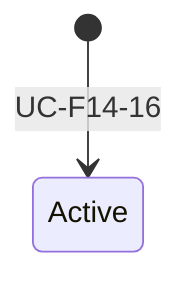

🏠 [Specs](../../../README.md) › 🧩 [Functional capabilities](../../README.md) › 🧰 [F14 Plugin store](../README.md) ›
🗃️ [Data](README.md) › 🗃️ E-F14-11 Plugin withdrawal

# 🗃️ E-F14-11 Plugin withdrawal

**Status:** ✅ specified

## Purpose

A plugin withdrawn.

## Fields

| Name | Type | Required | Validation | Default | Example | Personal data | Custom fields |
|---|---|---|---|---|---|---|---|
| plugin, reason, date | records | yes | BR-F14-12 | - | Bad Sync, exfiltration, 3 Dec | no | no |

## Relations

As its use cases.

## Lifecycle

## Indexes and search

By number, date, partner.

## Retention

Kept for the period of its kind of record in the country pack (D293), or else its kind's default in the
[retention schedule](../../../05-non-functional/data-retention.md).

## Audit

Every change.

## Import and export

CSV, FEC where relevant.

## Used by

- [UC-F14-16](../use-cases/05-store-operations/uc-f14-16-withdraw-a-vulnerable-or-harmful-plugin.md)

## Open questions

None.

---

⬅️ [E-F14-10 Private store](e-f14-10-private-store.md) · ⬆️ [Up](README.md) · ➡️ [E-F14-12 Refund](e-f14-12-refund.md)
