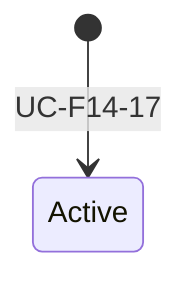

🏠 [Specs](../../../README.md) › 🧩 [Functional capabilities](../../README.md) › 🧰 [F14 Plugin store](../README.md) ›
🗃️ [Data](README.md) › 🗃️ E-F14-12 Refund

# 🗃️ E-F14-12 Refund

**Status:** ✅ specified

## Purpose

A refund or dispute.

## Fields

| Name | Type | Required | Validation | Default | Example | Personal data | Custom fields |
|---|---|---|---|---|---|---|---|
| purchase, reason, decision | records | yes | - | - | P-88, not as described, refunded | no | no |

## Relations

As its use cases.

## Lifecycle

## Indexes and search

By number, date, partner.

## Retention

As an accounting record:
[CR-FR-002 Accounting records kept 10 years](../../../10-country-packs/france/accounting/cr-fr-002-accounting-records-kept-ten-years.md).

## Audit

Every change.

## Import and export

CSV, FEC where relevant.

## Used by

- [UC-F14-17](../use-cases/02-buy-and-licence/uc-f14-17-handle-refunds-and-disputes.md)

## Open questions

None.

---

⬅️ [E-F14-11 Plugin withdrawal](e-f14-11-plugin-withdrawal.md) · ⬆️ [Up](README.md) ·
➡️ [E-F14-13 Usage metric](e-f14-13-usage-metric.md)
