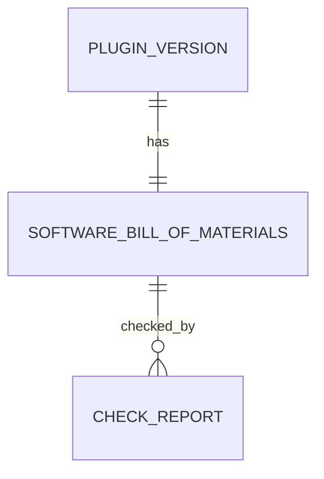
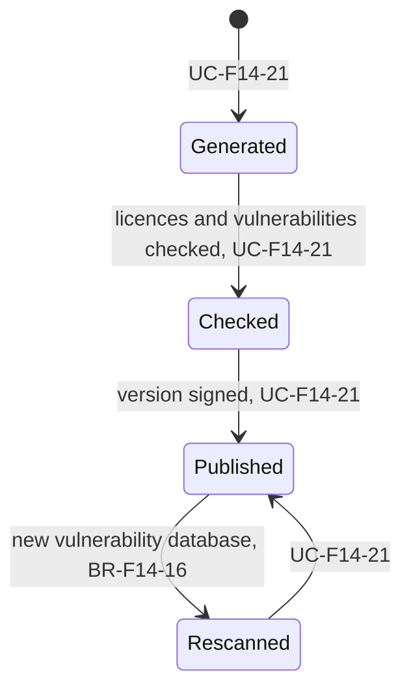

🏠 [Specs](../../../README.md) › 🧩 [Functional capabilities](../../README.md) › 🧰 [F14 Plugin store](../README.md) ›
🗃️ [Data](README.md) › 🗃️ E-F14-14 Software bill of materials

# 🗃️ E-F14-14 Software bill of materials

**Status:** 🔄 waiting for the owner

## Purpose

The list of a plugin version's dependencies with their versions, licences and known vulnerabilities.

## Fields

| Name | Type | Required | Validation | Default | Example | Personal data | Custom fields |
|---|---|---|---|---|---|---|---|
| version | link | yes | a submitted version | - | Gate Booking 2.4.0 | no | no |
| component | text | yes | name and version | - | fastapi 0.115.2 | no | no |
| licence | text | yes | an SPDX identifier | - | MIT | no | no |
| compatible | yes or no | yes | AGPL-3.0 compatibility (BR-F14-16) | computed | yes | no | no |
| vulnerabilities | list | no | identifiers | - | CVE-2026-1234 | no | no |
| format | choice | yes | CycloneDX or SPDX (Proposed) | CycloneDX | CycloneDX | no | no |

## Relations

## Lifecycle

## Indexes and search

By plugin and version; by component across all plugins (to find who uses a vulnerable one).

## Retention

As long as the version is installable, then (Proposed) 10 years for vulnerability handling (CR-FR-168).

## Audit

Every creation and change, with who, when, the old and the new value.

## Import and export

Export in its format; imported from the publisher's build when provided.

## Used by

- [UC-F14-21 Check a plugin's bill of materials and licences](../use-cases/03-publish/uc-f14-21-check-a-plugins-bill-of-materials-and-licences.md)

## Open questions

None.

---

⬅️ [E-F14-13 Usage metric](e-f14-13-usage-metric.md) · ⬆️ [Up](README.md) ·
➡️ [E-F14-15 End-of-life notice](e-f14-15-end-of-life-notice.md)
