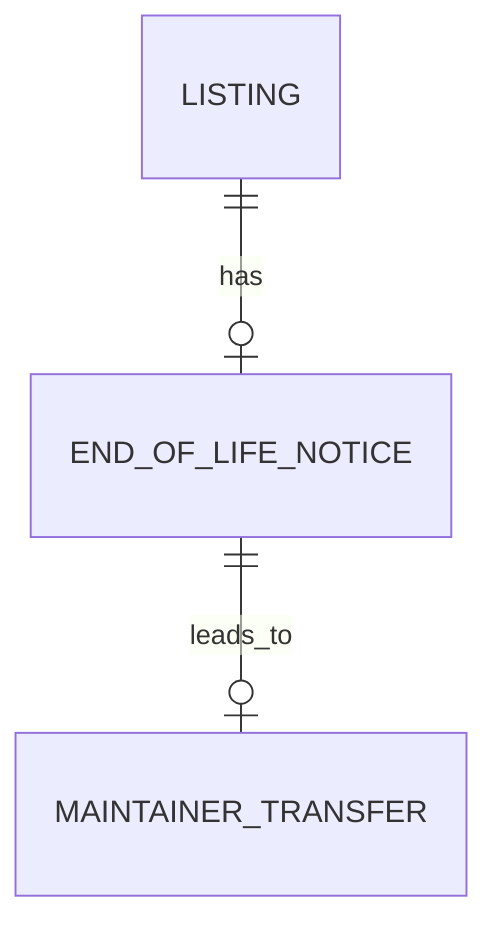
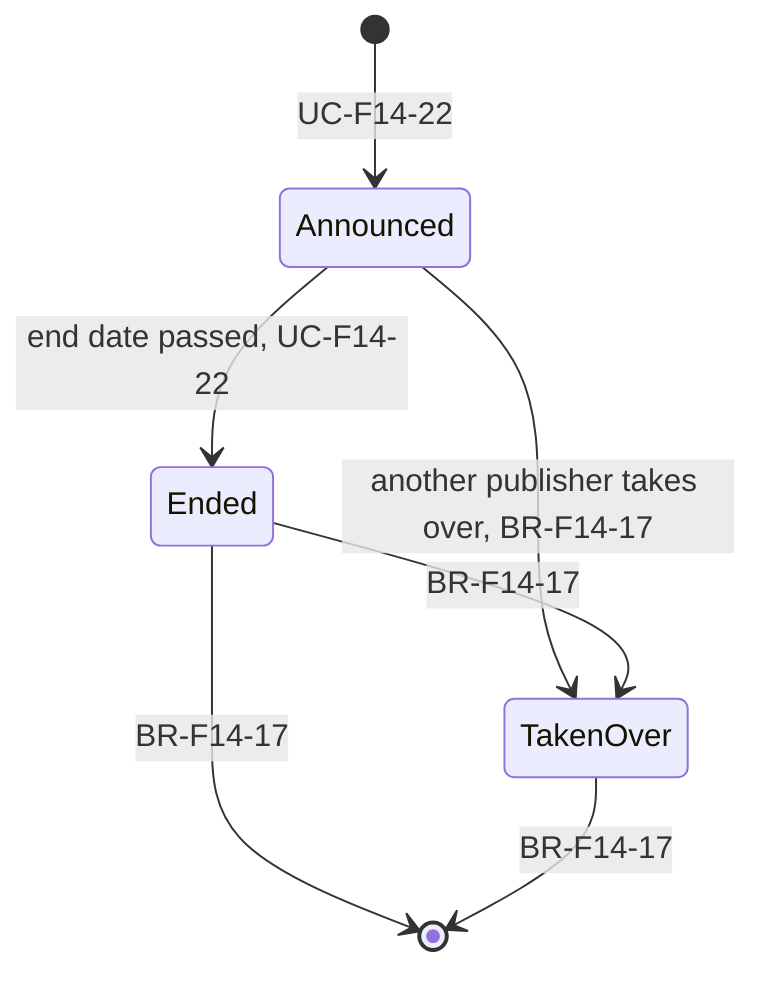

🏠 [Specs](../../../README.md) › 🧩 [Functional capabilities](../../README.md) › 🧰 [F14 Plugin store](../README.md) ›
🗃️ [Data](README.md) › 🗃️ E-F14-15 End-of-life notice

# 🗃️ E-F14-15 End-of-life notice

**Status:** ✅ specified

## Purpose

The announcement that a plugin stops being maintained, with its end date, the export and the alternatives.

## Fields

| Name | Type | Required | Validation | Default | Example | Personal data | Custom fields |
|---|---|---|---|---|---|---|---|
| plugin | link | yes | a listing | - | Old Sync | no | no |
| announced, end date | dates | yes | end at least the minimum notice after (BR-F14-17) | - | 2026-12-01, 2027-06-30 | no | no |
| reason | text | yes | - | - | publisher stops the product | no | no |
| alternatives | links | no | listings | - | New Sync | no | no |
| status | choice | yes | announced, ended, taken over | announced | announced | no | no |

## Relations

## Lifecycle

## Indexes and search

By plugin, end date and status.

## Retention

Kept with the listing's history.

## Audit

Every creation and change, with who, when, the old and the new value.

## Import and export

CSV and JSON export through the API (T5); no bulk import.

## Used by

- [UC-F14-22 Deprecate a plugin and announce its end of life](../use-cases/07-plugin-end-of-life/uc-f14-22-deprecate-a-plugin-and-announce-its-end-of-life.md)

## Open questions

None.

---

⬅️ [E-F14-14 Software bill of materials](e-f14-14-software-bill-of-materials.md) · ⬆️ [Up](README.md) ·
➡️ [E-F14-16 Maintainer transfer](e-f14-16-maintainer-transfer.md)
