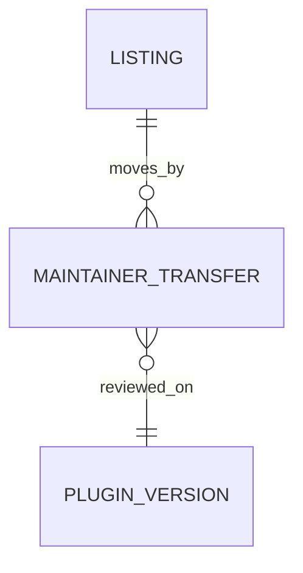
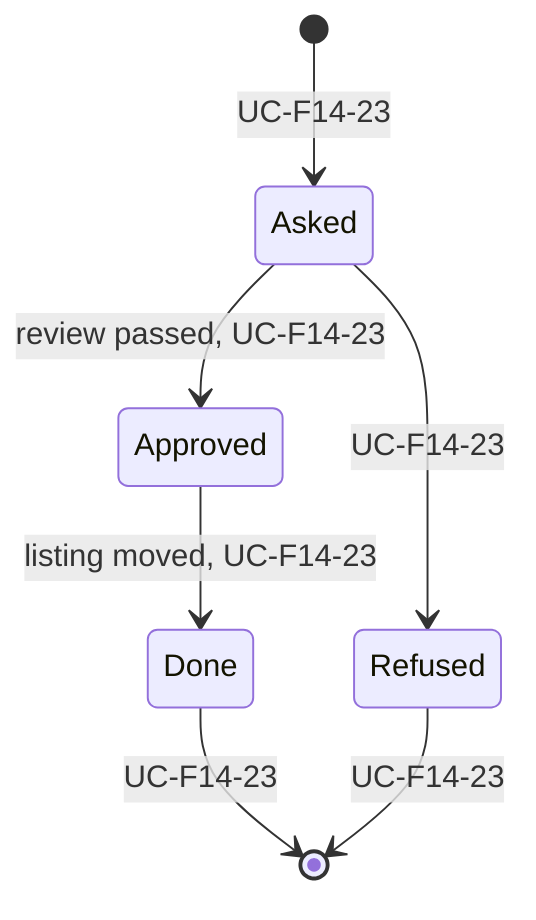

🏠 [Specs](../../../README.md) › 🧩 [Functional capabilities](../../README.md) › 🧰 [F14 Plugin store](../README.md) ›
🗃️ [Data](README.md) › 🗃️ E-F14-16 Maintainer transfer

# 🗃️ E-F14-16 Maintainer transfer

**Status:** ✅ specified

## Purpose

The move of a plugin from its publisher to a new one, with the review and each installer's consent.

## Fields

| Name | Type | Required | Validation | Default | Example | Personal data | Custom fields |
|---|---|---|---|---|---|---|---|
| plugin | link | yes | an abandoned listing | - | Old Sync | no | no |
| from, to | links | yes | verified publishers | - | Partner P, Partner Q | no | no |
| review | link | yes | a passed security review | - | review 2027-07-12 | no | no |
| consents | list | yes | per installing company | - | 41 of 52 | no | no |
| status | choice | yes | asked, approved, refused, done | asked | done | no | no |

## Relations

## Lifecycle

## Indexes and search

By plugin and publisher.

## Retention

Kept with the listing's history.

## Audit

Every creation and change, with who, when, the old and the new value.

## Import and export

CSV and JSON export through the API (T5); no bulk import.

## Used by

- [UC-F14-23 Take over an abandoned plugin](../use-cases/07-plugin-end-of-life/uc-f14-23-take-over-an-abandoned-plugin.md)

## Open questions

None.

---

⬅️ [E-F14-15 End-of-life notice](e-f14-15-end-of-life-notice.md) · ⬆️ [Up](README.md) ·
➡️ [E-F14-17 Rollout](e-f14-17-rollout.md)
