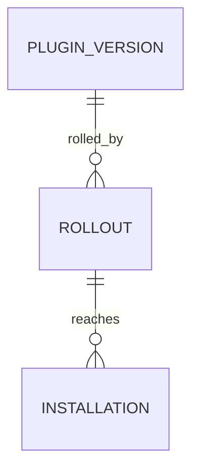
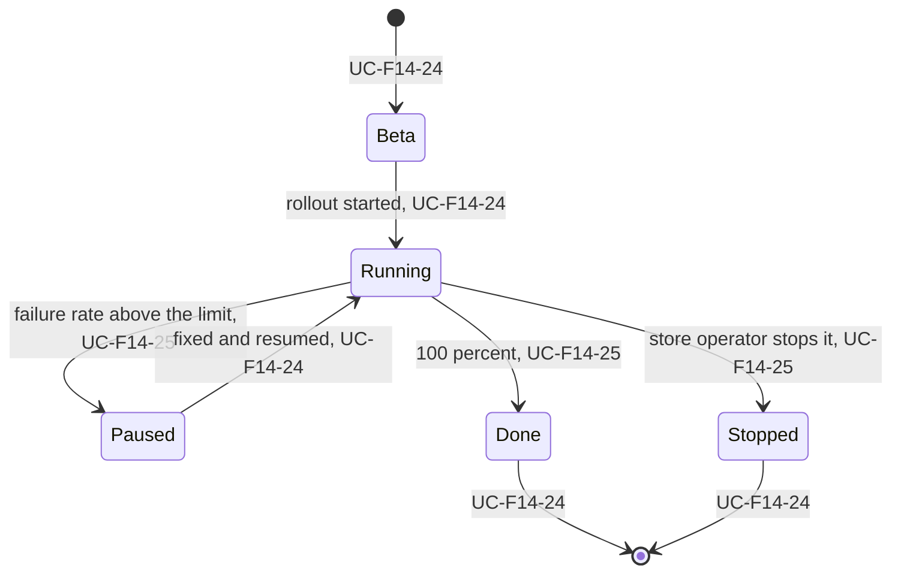

🏠 [Specs](../../../README.md) › 🧩 [Functional capabilities](../../README.md) › 🧰 [F14 Plugin store](../README.md) ›
🗃️ [Data](README.md) › 🗃️ E-F14-17 Rollout

# 🗃️ E-F14-17 Rollout

**Status:** ✅ specified

## Purpose

A release's progress through the beta channel and the stages of its general rollout.

## Fields

| Name | Type | Required | Validation | Default | Example | Personal data | Custom fields |
|---|---|---|---|---|---|---|---|
| version | link | yes | a signed version | - | Gate Booking 2.4.0 | no | no |
| channel | choice | yes | beta, stable | beta | stable | no | no |
| stages | list | yes | increasing percentages | 5, 25, 100 | 5, 25, 100 | no | no |
| current stage | percent | yes | one of the stages | first | 25 | no | no |
| failure rate | percent | yes | computed from install reports | 0 | 0.6 | no | no |
| status | choice | yes | running, paused, done, stopped | running | paused | no | no |

## Relations

## Lifecycle

## Indexes and search

By plugin, version and status.

## Retention

Kept with the version.

## Audit

Every creation and change, with who, when, the old and the new value.

## Import and export

CSV and JSON export through the API (T5); no bulk import.

## Used by

- [UC-F14-24 Publish to the beta channel](../use-cases/06-release-channels-and-rollback/uc-f14-24-publish-to-the-beta-channel.md)
- [UC-F14-25 Roll out a release in stages](../use-cases/06-release-channels-and-rollback/uc-f14-25-roll-out-a-release-in-stages.md)

## Open questions

None.

---

⬅️ [E-F14-16 Maintainer transfer](e-f14-16-maintainer-transfer.md) · ⬆️ [Up](README.md) ·
➡️ [E-F14-18 Listing translation](e-f14-18-listing-translation.md)
