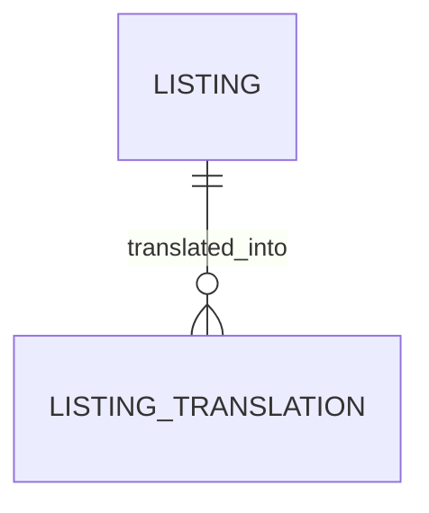
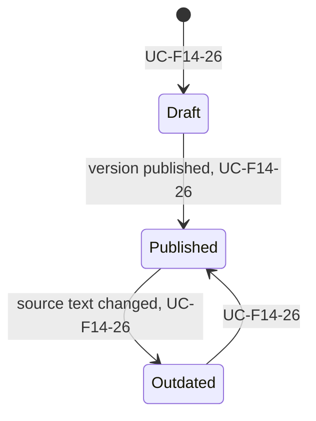

🏠 [Specs](../../../README.md) › 🧩 [Functional capabilities](../../README.md) › 🧰 [F14 Plugin store](../README.md) ›
🗃️ [Data](README.md) › 🗃️ E-F14-18 Listing translation

# 🗃️ E-F14-18 Listing translation

**Status:** ✅ specified

## Purpose

A listing's or a plugin's texts in one language, with how they were translated.

## Fields

| Name | Type | Required | Validation | Default | Example | Personal data | Custom fields |
|---|---|---|---|---|---|---|---|
| listing | link | yes | a listing | - | Gate Booking | no | no |
| language | choice | yes | a language of T10 | - | fr | no | no |
| texts | text | yes | the listing's fields | - | name, summary, description, release notes | no | no |
| source | choice | yes | human, machine | human | machine | no | no |

## Relations

## Lifecycle

## Indexes and search

By listing and language.

## Retention

Kept with the listing.

## Audit

Every creation and change, with who, when, the old and the new value.

## Import and export

Import and export of translation files PO or JSON.

## Used by

- [UC-F14-26 Translate a listing and a plugin](../use-cases/03-publish/uc-f14-26-translate-a-listing-and-a-plugin.md)

## Open questions

None.

---

⬅️ [E-F14-17 Rollout](e-f14-17-rollout.md) · ⬆️ [Up](README.md) ·
➡️ [E-F14-19 Support terms](e-f14-19-support-terms.md)
