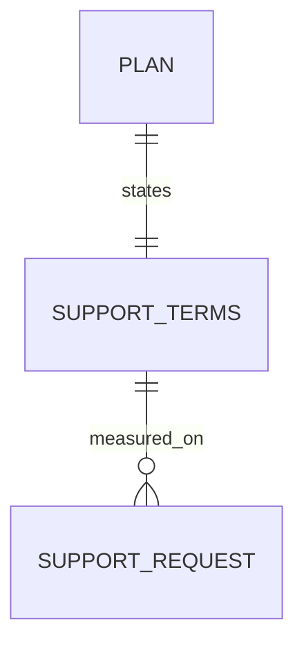
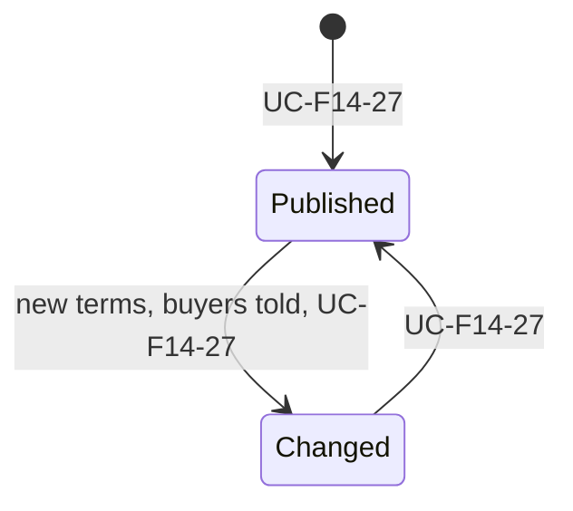

🏠 [Specs](../../../README.md) › 🧩 [Functional capabilities](../../README.md) › 🧰 [F14 Plugin store](../README.md) ›
🗃️ [Data](README.md) › 🗃️ E-F14-19 Support terms

# 🗃️ E-F14-19 Support terms

**Status:** ✅ specified

## Purpose

The support a paid plan includes and the publisher's measured record.

## Fields

| Name | Type | Required | Validation | Default | Example | Personal data | Custom fields |
|---|---|---|---|---|---|---|---|
| plan | link | yes | a paid plan | - | Gate Booking team | no | no |
| channels | list | yes | email, chat, phone | - | email | no | no |
| languages | list | yes | - | - | French, English | no | no |
| hours | text | yes | - | - | weekdays 9 to 18 Paris time | no | no |
| first response | duration | yes | in business days or hours | - | 1 business day | no | no |
| record | percent | no | computed | - | 94 % within the term | no | no |

## Relations

## Lifecycle

## Indexes and search

By plan and publisher.

## Retention

Every version of the terms kept for the life of the subscriptions sold under it.

## Audit

Every creation and change, with who, when, the old and the new value.

## Import and export

CSV and JSON export through the API (T5); no bulk import.

## Used by

- [UC-F14-27 Set and honour support terms of a paid plan](../use-cases/02-buy-and-licence/uc-f14-27-set-and-honour-support-terms-of-a-paid-plan.md)
- [UC-F14-05 Buy a paid plugin or subscription](../use-cases/02-buy-and-licence/uc-f14-05-buy-a-paid-plugin-or-subscription.md)

## Open questions

None.

---

⬅️ [E-F14-18 Listing translation](e-f14-18-listing-translation.md) · ⬆️ [Up](README.md) ·
➡️ [E-F14-20 Rollback point](e-f14-20-rollback-point.md)
