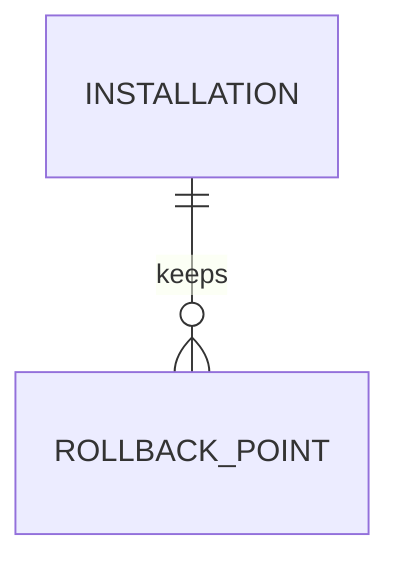
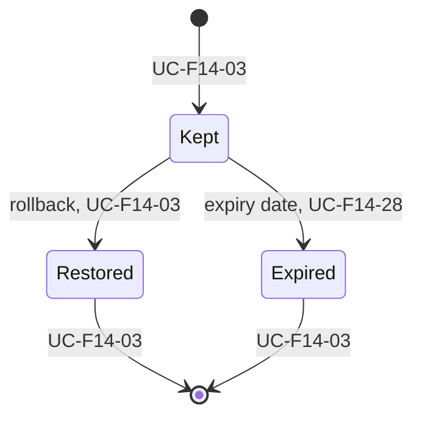

🏠 [Specs](../../../README.md) › 🧩 [Functional capabilities](../../README.md) › 🧰 [F14 Plugin store](../README.md) ›
🗃️ [Data](README.md) › 🗃️ E-F14-20 Rollback point

# 🗃️ E-F14-20 Rollback point

**Status:** ✅ specified

## Purpose

The previous version and the data snapshot of a plugin kept before an update, for a rollback.

## Fields

| Name | Type | Required | Validation | Default | Example | Personal data | Custom fields |
|---|---|---|---|---|---|---|---|
| installation | link | yes | an installation | - | Gate Booking at the restaurant example company | no | no |
| version | text | yes | the version before the update | - | 2.3.1 | no | no |
| snapshot | file | yes | the plugin's data | - | 128 MB | no | no |
| taken, expires | dates | yes | expires 30 days after | - | 2026-11-02, 2026-12-02 | no | no |

## Relations

## Lifecycle

## Indexes and search

By installation.

## Retention

Until it expires, then deleted.

## Audit

Every creation and change, with who, when, the old and the new value.

## Import and export

CSV and JSON export through the API (T5); no bulk import.

## Used by

- [UC-F14-28 Roll back to the previous version](../use-cases/06-release-channels-and-rollback/uc-f14-28-roll-back-to-the-previous-version.md)
- [UC-F14-03 Update with compatibility checks](../use-cases/01-find-and-install/uc-f14-03-update-with-compatibility-checks.md)

## Open questions

None.

---

⬅️ [E-F14-19 Support terms](e-f14-19-support-terms.md) · ⬆️ [Up](README.md) ·
➡️ [E-F14-21 Plugin security review](e-f14-21-plugin-security-review.md)
