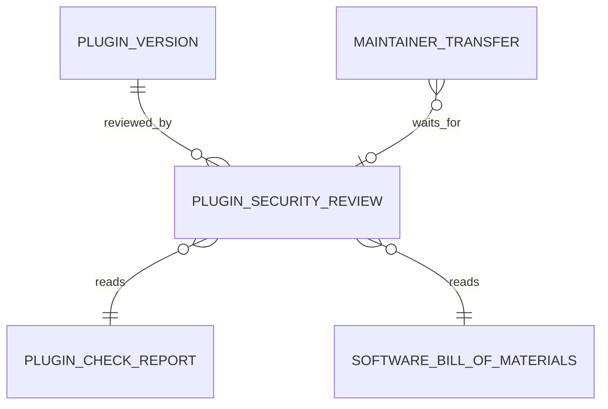
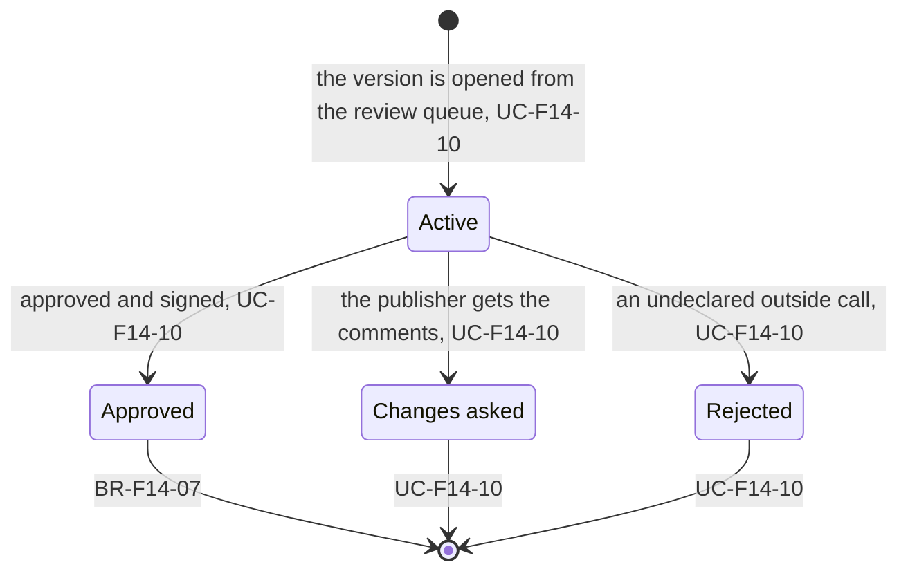

🏠 [Specs](../../../README.md) › 🧩 [Functional capabilities](../../README.md) › 🧰 [F14 Plugin store](../README.md) ›
🗃️ [Data](README.md) › 🗃️ E-F14-21 Plugin security review

# 🗃️ E-F14-21 Plugin security review

**Status:** ✅ specified

## Purpose

The plugin security review the flow charts name with the words "Security review"
([FL-F14-03](../flows/fl-f14-03-publish.md), [FL-F14-07](../flows/fl-f14-07-plugin-end-of-life.md)). The owner decided
to create it ([D516](../../../06-decisions/foundations/d516-naming-rules-and-the-seven-classes-of-names.md)); its fields
are derived from the specifications and confirmed by the owner (D572).

## Fields

| Name | Type | Required | Validation | Default | Example | Personal data | Custom fields |
|---|---|---|---|---|---|---|---|
| title | text | yes | - | - | Review Gate Booking 2.4.0 | no | no |
| version | link | yes | a plugin version whose checks passed | - | Gate Booking 2.4.0 | no | no |
| check report, bill of materials | links | yes | the version's own | - | checks passed, 42 components | no | no |
| outside calls declared | yes or no | yes | an undeclared outside call rejects the version | - | yes | no | no |
| no secrets in the package | yes or no | yes | - | - | yes | no | no |
| sandbox test | text | no | the result of the test in a sandbox company | - | bookings created and cancelled | no | no |
| reviewer | user | yes | a store operator | - | store operator | yes | no |
| comments | text | when changes are asked | sent to the publisher | - | Declare the call to the maps API | no | no |
| signed | date and time | when approved | set by the signature (BR-F14-07) | - | 2026-11-27 10:42 | no | no |
| state | choice | yes | active, approved, changes asked, rejected | active | approved | no | no |

The store operator's review of one plugin version before it is signed
([UC-F14-10](../use-cases/03-publish/uc-f14-10-pass-the-security-review-and-sign.md)): they read the check report, the
bill of materials and the declared outside calls, test the plugin in a sandbox company, then approve, and SimpleERP
signs the version ([BR-F14-07](../business-rules/br-f14-07-releases-signed.md)), ask for changes with comments, or
reject it. A takeover of an abandoned plugin needs its first version to pass this review
([UC-F14-23](../use-cases/07-plugin-end-of-life/uc-f14-23-take-over-an-abandoned-plugin.md),
[BR-F14-18](../business-rules/br-f14-18-abandoned-plugins-can-be-taken-over.md)). The title and the state are the
columns of [S-F14-L21 Plugin security reviews](../screens/00-lists/s-f14-l21-plugin-security-reviews.md); the declared
outside calls, the secrets check and the decision are what
[S-F14-10 Security review](../screens/03-publish/s-f14-10-security-review.md) shows.

## Relations

- [E-F14-03 Plugin version](e-f14-03-plugin-version.md)
- [E-F14-07 Plugin check report](e-f14-07-plugin-check-report.md)
- [E-F14-14 Software bill of materials](e-f14-14-software-bill-of-materials.md)
- [E-F14-16 Maintainer transfer](e-f14-16-maintainer-transfer.md)

## Lifecycle

A decided review is read-only; a new version gets its own review.

## Indexes and search

By plugin, version, reviewer and state; the review queue of the versions still Active.

## Retention

As the other records of its capability.

## Audit

Every change, as the other records of its capability.

## Import and export

CSV and JSON export through the API (T5); no bulk import.

## Used by

- [UC-F14-10 Pass the security review and sign](../use-cases/03-publish/uc-f14-10-pass-the-security-review-and-sign.md)
- [UC-F14-23 Take over an abandoned plugin](../use-cases/07-plugin-end-of-life/uc-f14-23-take-over-an-abandoned-plugin.md)

## Open questions

None.

---

⬅️ [E-F14-20 Rollback point](e-f14-20-rollback-point.md) · ⬆️ [Up](README.md) ·
➡️ [E-F14-22 Test instance](e-f14-22-test-instance.md)
