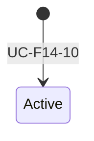

🏠 [Specs](../../../README.md) › 🧩 [Functional capabilities](../../README.md) › 🧰 [F14 Plugin store](../README.md) ›
🗃️ [Data](README.md) › 🗃️ E-F14-21 Plugin security review

# 🗃️ E-F14-21 Plugin security review

**Status:** 🔄 waiting for the owner

## Purpose

(Proposed) The plugin security review the flow charts name with the words "Security review"
([FL-F14-03](../flows/fl-f14-03-publish.md), [FL-F14-07](../flows/fl-f14-07-plugin-end-of-life.md)). The owner decided
to create it ([D516](../../../06-decisions/foundations/d516-naming-rules-and-the-seven-classes-of-names.md)); what it
holds waits for the owner's confirmation.

## Fields

(Proposed) To define with the owner: the flow charts name the record, not its fields.

## Relations

(Proposed) To define with the owner, from the use cases below.

## Lifecycle

## Indexes and search

(Proposed) To define with the owner.

## Retention

(Proposed) As the other records of its capability, to confirm with the owner.

## Audit

(Proposed) Every change, as the other records of its capability.

## Import and export

(Proposed) To define with the owner.

## Used by

- [UC-F14-10 Pass the security review and sign](../use-cases/03-publish/uc-f14-10-pass-the-security-review-and-sign.md)
- [UC-F14-23 Take over an abandoned plugin](../use-cases/07-plugin-end-of-life/uc-f14-23-take-over-an-abandoned-plugin.md)

## Open questions

(Proposed) Its fields, relations and states wait for the owner (waiting list, step 36e).

---

⬅️ [E-F14-20 Rollback point](e-f14-20-rollback-point.md) · ⬆️ [Up](README.md) ·
➡️ [E-F14-22 Test instance](e-f14-22-test-instance.md)
