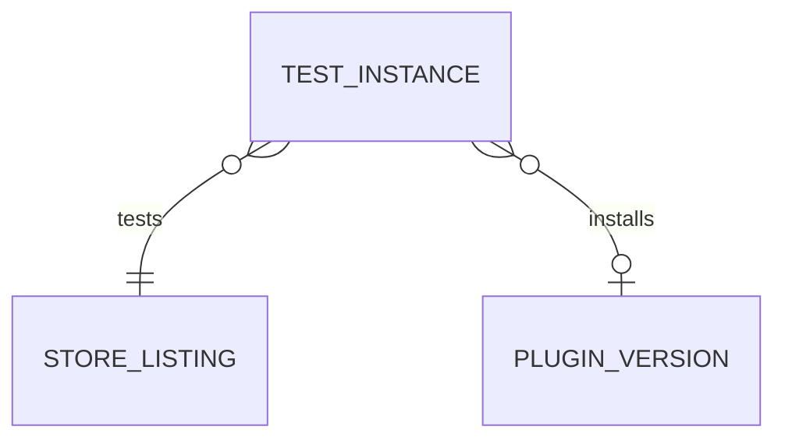
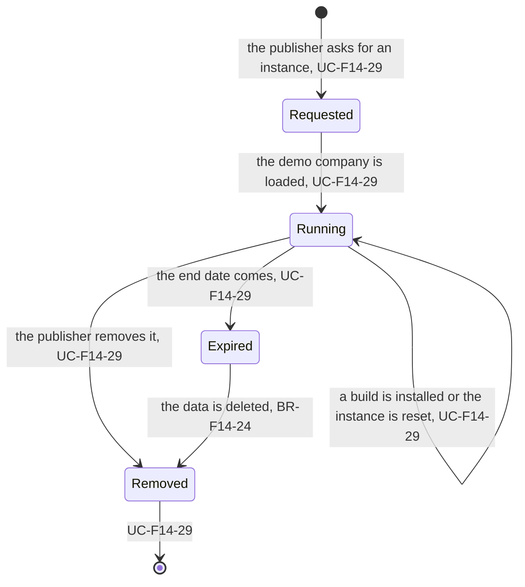

🏠 [Specs](../../../README.md) › 🧩 [Functional capabilities](../../README.md) › 🧰 [F14 Plugin store](../README.md) ›
🗃️ [Data](README.md) › 🗃️ E-F14-22 Test instance

# 🗃️ E-F14-22 Test instance

**Status:** ✅ specified

## Purpose

A test instance: a short-lived SimpleERP company with demo data on which a publisher tries a plugin
([D533](../../../06-decisions/f14-plugin-store/d533-benchmark-gaps-f14-plugin-store.md)).

## Fields

| Name | Type | Required | Validation | Default | Example | Personal data | Custom fields |
|---|---|---|---|---|---|---|---|
| publisher | user (E-F1-03) | yes | a plugin publisher | - | Garden Tools Ltd | yes | no |
| plugin | store listing (E-F14-01) | yes | a plugin of the publisher | - | Garden planner | no | no |
| build | version | yes | a build of the plugin | latest | 1.4.1 | no | no |
| platform version | version | yes | a supported version or its preview | current | 2026.4 | no | no |
| demo dataset | sector example | yes | one of the example companies | services | Services demo | no | no |
| address | link | no | set when Running | - | t-4821.test.example | no | no |
| ends on | date | yes | within 30 days of the start | 30 days | 2026-12-12 | no | no |
| extended | yes or no | yes | at most once | no | no | no | no |
| state | Requested, Running, Expired, Removed | yes | the lifecycle below | Requested | Running | no | no |
| owner | user | yes | a user of the company | the creator | Claire P. | yes | no |

## Relations

- [E-F14-01 Store listing](e-f14-01-store-listing.md)
- [E-F14-03 Plugin version](e-f14-03-plugin-version.md)

## Lifecycle

## Indexes and search

By publisher, plugin, state and end date.

## Retention

The instance and its data are deleted at the end date; the log of its life is kept 1 year.

## Audit

Every creation, build installed, reset, extension and removal, with who and when.

## Import and export

No import. The plugin's test logs can be exported before removal.

## Used by

- [UC-F14-29](../use-cases/08-trials-instances-and-partners/uc-f14-29-get-a-publisher-test-instance.md)

## Open questions

None.

---

⬅️ [E-F14-21 Plugin security review](e-f14-21-plugin-security-review.md) · ⬆️ [Up](README.md) ·
➡️ [E-F14-23 Trial](e-f14-23-trial.md)
