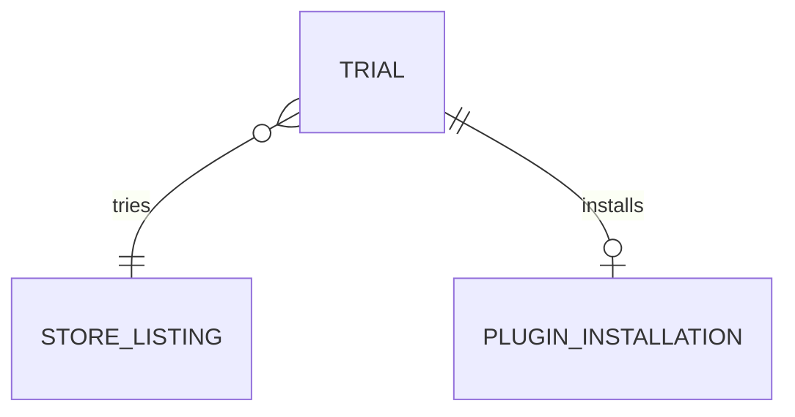
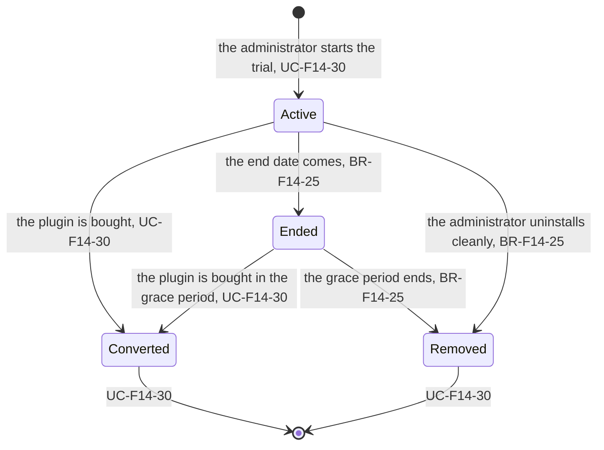

🏠 [Specs](../../../README.md) › 🧩 [Functional capabilities](../../README.md) › 🧰 [F14 Plugin store](../README.md) ›
🗃️ [Data](README.md) › 🗃️ E-F14-23 Trial

# 🗃️ E-F14-23 Trial

**Status:** ✅ specified

## Purpose

A free trial of a paid plugin by a company: its dates, its state and how it ended
([D533](../../../06-decisions/f14-plugin-store/d533-benchmark-gaps-f14-plugin-store.md)).

## Fields

| Name | Type | Required | Validation | Default | Example | Personal data | Custom fields |
|---|---|---|---|---|---|---|---|
| plugin | store listing (E-F14-01) | yes | a plugin with a trial plan | - | Garden planner | no | no |
| company | company (E-F1-01) | yes | the company of the administrator | - | Atelier Verdier | no | no |
| started on | date | yes | today at the start | today | 2026-11-01 | no | no |
| ends on | date | yes | after the start | 14 days | 2026-11-15 | no | no |
| extended | yes or no | yes | at most once if the plan allows | no | no | no | no |
| grace ends on | date | no | 30 days after the end | - | 2026-12-15 | no | no |
| outcome | purchased, removed, none yet | yes | one of the three | none yet | none yet | no | no |
| state | Active, Converted, Ended, Removed | yes | the lifecycle below | Active | Converted | no | no |
| owner | user | yes | a user of the company | the creator | Claire P. | yes | no |

## Relations

- [E-F14-01 Store listing](e-f14-01-store-listing.md)
- [E-F14-02 Plugin installation](e-f14-02-plugin-installation.md)
- [E-F14-04 Plugin price plan](e-f14-04-plugin-price-plan.md)

## Lifecycle

## Indexes and search

By plugin, company, state and end date.

## Retention

The trial record is kept 3 years for the one-trial rule; the plugin's data is removed at the end of the grace
period.

## Audit

Every start, extension, reminder, purchase, end and removal, with who and when.

## Import and export

No import. The trials of a company are exported as a CSV.

## Used by

- [UC-F14-30](../use-cases/08-trials-instances-and-partners/uc-f14-30-try-a-paid-plugin-free.md)

## Open questions

None.

---

⬅️ [E-F14-22 Test instance](e-f14-22-test-instance.md) · ⬆️ [Up](README.md) ·
➡️ [E-F14-24 Partner listing](e-f14-24-partner-listing.md)
