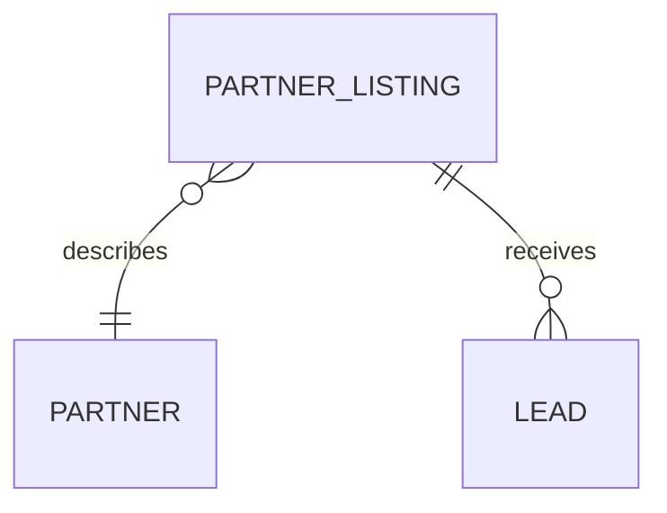
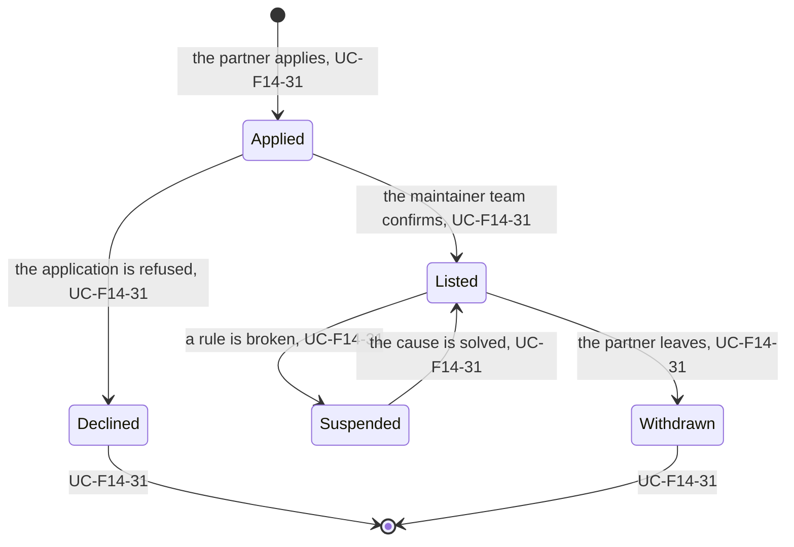

🏠 [Specs](../../../README.md) › 🧩 [Functional capabilities](../../README.md) › 🧰 [F14 Plugin store](../README.md) ›
🗃️ [Data](README.md) › 🗃️ E-F14-24 Partner listing

# 🗃️ E-F14-24 Partner listing

**Status:** ✅ specified

## Purpose

A partner's listing in the directory: coverage, services, evidence and rank
([D533](../../../06-decisions/f14-plugin-store/d533-benchmark-gaps-f14-plugin-store.md)).

## Fields

| Name | Type | Required | Validation | Default | Example | Personal data | Custom fields |
|---|---|---|---|---|---|---|---|
| partner | partner (E-F6-23) | yes | a reseller partner | - | Norte Systems | no | no |
| countries | list of countries | yes | 1 or more | - | Spain, Portugal | no | no |
| languages | list of languages | yes | 1 or more | - | Spanish, English | no | no |
| sectors | list of sectors | yes | 1 or more | - | Services, Retail | no | no |
| services | list | yes | implementation, training, migration, custom plugin | - | implementation, migration | no | no |
| projects delivered | number | no | 0 or more | 0 | 31 | no | no |
| rating | number | no | 1 to 5 | - | 4.7 | no | no |
| certified | yes or no | yes | needs evidence | no | yes | no | no |
| score | number | yes | 0 to 100, computed | 0 | 84 | no | no |
| state | Applied, Listed, Declined, Suspended, Withdrawn | yes | the lifecycle below | Applied | Listed | no | no |
| owner | user | yes | a user of the company | the creator | Claire P. | yes | no |

## Relations

- [E-F6-23 Partner](../../f06-customers-and-sales/data/e-f06-23-partner.md)
- [E-F6-20 Lead](../../f06-customers-and-sales/data/e-f06-20-lead.md)

## Lifecycle

## Indexes and search

By country, language, sector, service, score and state.

## Retention

Ratings and enquiries are kept 3 years; a withdrawn listing is hidden at once.

## Audit

Every application, confirmation, suspension, rating and every change of the formula, with who and when.

## Import and export

No import. A partner exports their enquiries as a CSV.

## Used by

- [UC-F14-31](../use-cases/08-trials-instances-and-partners/uc-f14-31-find-an-implementation-partner.md)

## Open questions

None.

---

⬅️ [E-F14-23 Trial](e-f14-23-trial.md) · ⬆️ [Up](README.md) · ➡️ [E-F14-25 Theme](e-f14-25-theme.md)
