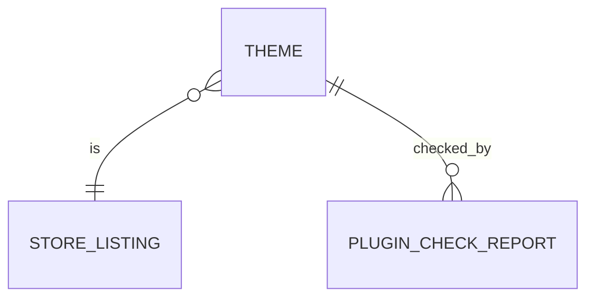
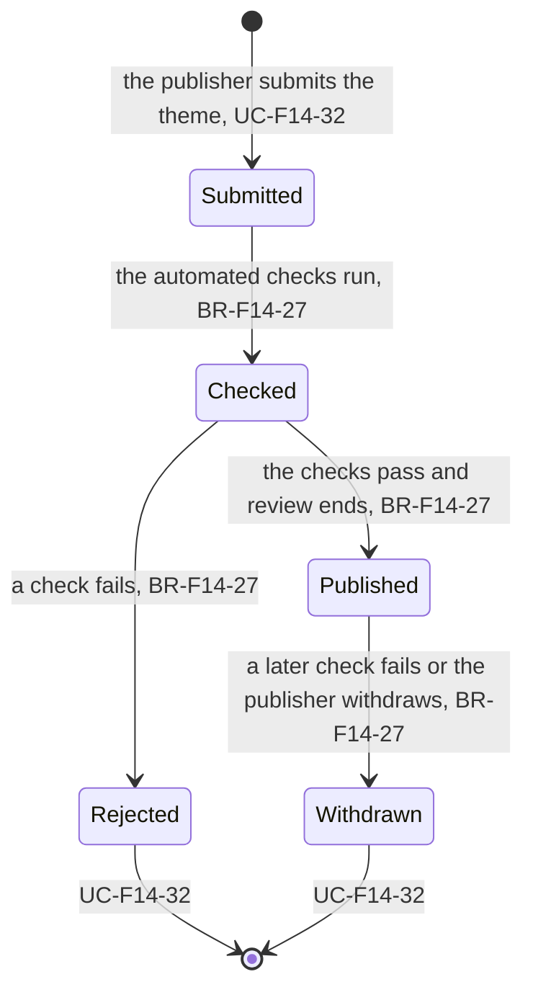

🏠 [Specs](../../../README.md) › 🧩 [Functional capabilities](../../README.md) › 🧰 [F14 Plugin store](../README.md) ›
🗃️ [Data](README.md) › 🗃️ E-F14-25 Theme

# 🗃️ E-F14-25 Theme

**Status:** ✅ specified

## Purpose

A website theme: its tokens, its price, its accessibility result and its state in the store
([D533](../../../06-decisions/f14-plugin-store/d533-benchmark-gaps-f14-plugin-store.md)).

## Fields

| Name | Type | Required | Validation | Default | Example | Personal data | Custom fields |
|---|---|---|---|---|---|---|---|
| name | text | yes | unique per publisher | - | Slate | no | no |
| publisher | user (E-F1-03) | yes | a plugin publisher | - | Studio Nord | yes | no |
| version | version | yes | a released version | - | 2.1.0 | no | no |
| sectors | list of sectors | no | - | all | Retail, Services | no | no |
| tokens | colours and fonts | yes | contrast limits met | - | Slate blue, serif | no | no |
| accessibility result | passed, failed, needs a new check | yes | computed | needs a new check | passed | no | no |
| checked on | date | no | after each version | - | 2026-11-02 | no | no |
| price plan | price plan (E-F14-04) | no | - | free | Free | no | no |
| state | Submitted, Checked, Published, Rejected, Withdrawn | yes | the lifecycle below | Submitted | Checked | no | no |
| owner | user | yes | a user of the company | the creator | Claire P. | yes | no |

## Relations

- [E-F14-01 Store listing](e-f14-01-store-listing.md)
- [E-F14-04 Plugin price plan](e-f14-04-plugin-price-plan.md)
- [E-F14-07 Plugin check report](e-f14-07-plugin-check-report.md)

## Lifecycle

## Indexes and search

By name, publisher, sector, state and result.

## Retention

Every version's report is kept 3 years; a withdrawn theme stays on the sites that wear it with a warning.

## Audit

Every submission, check, publication, withdrawal and installation, with who and when.

## Import and export

No import. The check report of a theme is exported as a file.

## Used by

- [UC-F14-32](../use-cases/08-trials-instances-and-partners/uc-f14-32-install-a-website-theme.md)

## Open questions

None.

---

⬅️ [E-F14-24 Partner listing](e-f14-24-partner-listing.md) · ⬆️ [Up](README.md)
