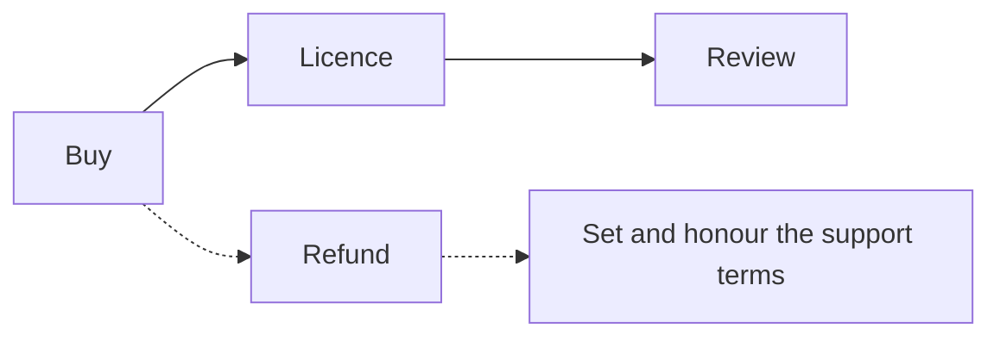

🏠 [Specs](../../../README.md) › 🧩 [Functional capabilities](../../README.md) › 🧰 [F14 Plugin store](../README.md) ›
🔀 [Flows](README.md) › 🔀 FL-F14-02 Buy and licence

# 🔀 FL-F14-02 Buy and licence

**Status:** ✅ specified

## Summary

Covers UC-F14-05, UC-F14-06, UC-F14-07, UC-F14-17.

## Personas

- [U07 Administrator](../../../01-users/personas/u07-administrator.md)
- [U11 IT provider administrator](../../../01-users/personas/u11-provider-admin.md)
- [U13 Owner](../../../01-users/personas/u13-owner.md)
- [U46 Plugin publisher](../../../01-users/personas/u46-plugin-publisher.md)

## Flowchart

## Sequence diagram

See each use case.

## Steps

| Step | Persona | Screen | Use case | What happens |
|---|---|---|---|---|
| 1 | U13, U07 | [S-F14-05](../screens/02-buy-and-licence/s-f14-05-purchase.md) | [UC-F14-05](../use-cases/02-buy-and-licence/uc-f14-05-buy-a-paid-plugin-or-subscription.md) | Buy a paid plugin or subscription |
| 2 | U07, U13 | [S-F14-06](../screens/02-buy-and-licence/s-f14-06-licences.md) | [UC-F14-06](../use-cases/02-buy-and-licence/uc-f14-06-manage-licences-and-seats.md) | Manage licences and seats |
| 3 | U07, U46 | [S-F14-07](../screens/02-buy-and-licence/s-f14-07-reviews.md) | [UC-F14-07](../use-cases/02-buy-and-licence/uc-f14-07-rate-and-review.md) | Rate and review |
| 4 | U11, U13 | [S-F14-17](../screens/02-buy-and-licence/s-f14-17-refunds.md) | [UC-F14-17](../use-cases/02-buy-and-licence/uc-f14-17-handle-refunds-and-disputes.md) | Handle refunds and disputes |
| 5 | U46, U07 | [S-F14-25](../screens/02-buy-and-licence/s-f14-25-support-terms.md) | [UC-F14-27](../use-cases/02-buy-and-licence/uc-f14-27-set-and-honour-support-terms-of-a-paid-plan.md) | Set and honour the support terms |

### Entities and screens

| Entity | States in this flow | Shown at step and screen | Aggregated view |
|---|---|---|---|
| [E-F14-05 Plugin licence](../data/e-f14-05-plugin-licence.md) | Active | 1 [S-F14-05](../screens/02-buy-and-licence/s-f14-05-purchase.md); 2 [S-F14-06](../screens/02-buy-and-licence/s-f14-06-licences.md) | Plugin licences |
| [E-F14-06 Plugin review](../data/e-f14-06-plugin-review.md) | New, Checked, Refused, Published | 3 [S-F14-07](../screens/02-buy-and-licence/s-f14-07-reviews.md) | Plugin reviews |
| [E-F14-12 Refund](../data/e-f14-12-refund.md) | Active | 4 [S-F14-17](../screens/02-buy-and-licence/s-f14-17-refunds.md) | Refunds |
| [E-F14-19 Support terms](../data/e-f14-19-support-terms.md) | Published, Changed | 1 [S-F14-05](../screens/02-buy-and-licence/s-f14-05-purchase.md); 5 [S-F14-25](../screens/02-buy-and-licence/s-f14-25-support-terms.md) | Support terms |

## Errors

As each use case.

## Images

Every step and error, for each persona taking part, in light and dark mode (D120). Steps are numbered as in the Steps
table; E rows are the error cases.

| Step | Persona | Device | Light | Dark |
|---|---|---|---|---|
| 1 | U13 | desktop | [light](../images/02-buy-and-licence/u13-owner/1-buy-desktop-light.png) | [dark](../images/02-buy-and-licence/u13-owner/1-buy-desktop-dark.png) |
| 1 | U13 | phone | [light](../images/02-buy-and-licence/u13-owner/1-buy-phone-light.png) | [dark](../images/02-buy-and-licence/u13-owner/1-buy-phone-dark.png) |
| 1 | U07 | desktop | [light](../images/02-buy-and-licence/u07-administrator/1-buy-desktop-light.png) | [dark](../images/02-buy-and-licence/u07-administrator/1-buy-desktop-dark.png) |
| 2 | U07 | desktop | [light](../images/02-buy-and-licence/u07-administrator/2-licences-desktop-light.png) | [dark](../images/02-buy-and-licence/u07-administrator/2-licences-desktop-dark.png) |
| 2 | U13 | desktop | [light](../images/02-buy-and-licence/u13-owner/2-licences-desktop-light.png) | [dark](../images/02-buy-and-licence/u13-owner/2-licences-desktop-dark.png) |
| 2 | U13 | phone | [light](../images/02-buy-and-licence/u13-owner/2-licences-phone-light.png) | [dark](../images/02-buy-and-licence/u13-owner/2-licences-phone-dark.png) |
| 3 | U07 | desktop | [light](../images/02-buy-and-licence/u07-administrator/3-review-desktop-light.png) | [dark](../images/02-buy-and-licence/u07-administrator/3-review-desktop-dark.png) |
| 3 | U46 | desktop | [light](../images/02-buy-and-licence/u46-plugin-publisher/3-review-desktop-light.png) | [dark](../images/02-buy-and-licence/u46-plugin-publisher/3-review-desktop-dark.png) |
| 4 | U11 | desktop | [light](../images/02-buy-and-licence/u11-provider-admin/4-refund-desktop-light.png) | [dark](../images/02-buy-and-licence/u11-provider-admin/4-refund-desktop-dark.png) |
| 4 | U13 | desktop | [light](../images/02-buy-and-licence/u13-owner/4-refund-desktop-light.png) | [dark](../images/02-buy-and-licence/u13-owner/4-refund-desktop-dark.png) |
| 4 | U13 | phone | [light](../images/02-buy-and-licence/u13-owner/4-refund-phone-light.png) | [dark](../images/02-buy-and-licence/u13-owner/4-refund-phone-dark.png) |
| E1 | U07 | desktop | [light](../images/02-buy-and-licence/u07-administrator/e1-licence-expired-desktop-light.png) | [dark](../images/02-buy-and-licence/u07-administrator/e1-licence-expired-desktop-dark.png) |
| 5 | U46 | desktop | [light](../images/02-buy-and-licence/u46-plugin-publisher/5-support-terms-desktop-light.png) | [dark](../images/02-buy-and-licence/u46-plugin-publisher/5-support-terms-desktop-dark.png) |
| 5 | U07 | desktop | [light](../images/02-buy-and-licence/u07-administrator/5-support-terms-desktop-light.png) | [dark](../images/02-buy-and-licence/u07-administrator/5-support-terms-desktop-dark.png) |

## Open questions

None.

---

⬅️ [FL-F14-01 Find and install](fl-f14-01-find-and-install.md) · ⬆️ [Up](README.md) ·
➡️ [FL-F14-03 Publish](fl-f14-03-publish.md)
