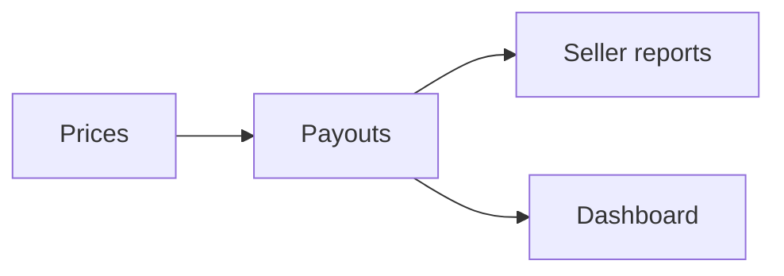

🏠 [Specs](../../../README.md) › 🧩 [Functional capabilities](../../README.md) › 🧰 [F14 Plugin store](../README.md) ›
🔀 [Flows](README.md) › 🔀 FL-F14-04 Money and taxes

# 🔀 FL-F14-04 Money and taxes

**Status:** ✅ specified

## Summary

Covers UC-F14-12, UC-F14-13, UC-F14-14, UC-F14-18.

## Personas

- [U05 Accounting](../../../01-users/personas/u05-accounting.md)
- [U11 IT provider administrator](../../../01-users/personas/u11-provider-admin.md)
- [U46 Plugin publisher](../../../01-users/personas/u46-plugin-publisher.md)

## Flowchart

## Sequence diagram

See each use case.

## Steps

| Step | Persona | Screen | Use case | What happens |
|---|---|---|---|---|
| 1 | U46 | [S-F14-12](../screens/04-money-and-taxes/s-f14-12-pricing.md) | [UC-F14-12](../use-cases/04-money-and-taxes/uc-f14-12-set-prices-and-plans.md) | Set prices and plans |
| 2 | U46, U05 | [S-F14-13](../screens/04-money-and-taxes/s-f14-13-payouts.md) | [UC-F14-13](../use-cases/04-money-and-taxes/uc-f14-13-receive-payouts-and-statements.md) | Receive payouts and statements |
| 3 | U11, U05 | [S-F14-14](../screens/04-money-and-taxes/s-f14-14-seller-reports.md) | [UC-F14-14](../use-cases/04-money-and-taxes/uc-f14-14-report-sellers-to-the-tax-office.md) | Report sellers to the tax office |
| 4 | U46 | [S-F14-18](../screens/04-money-and-taxes/s-f14-18-publisher-dashboard.md) | [UC-F14-18](../use-cases/04-money-and-taxes/uc-f14-18-follow-usage-and-revenue.md) | Follow usage and revenue |

### Entities and screens

| Entity | States in this flow | Shown at step and screen | Aggregated view |
|---|---|---|---|
| [E-F14-04 Plugin price plan](../data/e-f14-04-plugin-price-plan.md) | Published, Paid | 1 [S-F14-12](../screens/04-money-and-taxes/s-f14-12-pricing.md) | Plugin price plans |
| [E-F14-08 Payout](../data/e-f14-08-payout.md) | Sent, Paid, Held, Reconciled | 2 [S-F14-13](../screens/04-money-and-taxes/s-f14-13-payouts.md); 4 [S-F14-18](../screens/04-money-and-taxes/s-f14-18-publisher-dashboard.md) | Payouts |
| [E-F14-09 Seller report](../data/e-f14-09-seller-report.md) | Prepared, Sent, Filed | 3 [S-F14-14](../screens/04-money-and-taxes/s-f14-14-seller-reports.md) | Seller reports |

## Errors

As each use case.

## Images

Every step and error, for each persona taking part, in light and dark mode (D120). Steps are numbered as in the Steps
table; E rows are the error cases.

| Step | Persona | Device | Light | Dark |
|---|---|---|---|---|
| 1 | U46 | desktop | [light](../images/04-money-and-taxes/u46-plugin-publisher/1-prices-desktop-light.png) | [dark](../images/04-money-and-taxes/u46-plugin-publisher/1-prices-desktop-dark.png) |
| 2 | U46 | desktop | [light](../images/04-money-and-taxes/u46-plugin-publisher/2-payout-desktop-light.png) | [dark](../images/04-money-and-taxes/u46-plugin-publisher/2-payout-desktop-dark.png) |
| 2 | U05 | desktop | [light](../images/04-money-and-taxes/u05-accounting/2-payout-desktop-light.png) | [dark](../images/04-money-and-taxes/u05-accounting/2-payout-desktop-dark.png) |
| 3 | U11 | desktop | [light](../images/04-money-and-taxes/u11-provider-admin/3-seller-report-desktop-light.png) | [dark](../images/04-money-and-taxes/u11-provider-admin/3-seller-report-desktop-dark.png) |
| 3 | U05 | desktop | [light](../images/04-money-and-taxes/u05-accounting/3-seller-report-desktop-light.png) | [dark](../images/04-money-and-taxes/u05-accounting/3-seller-report-desktop-dark.png) |
| 4 | U46 | desktop | [light](../images/04-money-and-taxes/u46-plugin-publisher/4-dashboard-desktop-light.png) | [dark](../images/04-money-and-taxes/u46-plugin-publisher/4-dashboard-desktop-dark.png) |
| E1 | U46 | desktop | [light](../images/04-money-and-taxes/u46-plugin-publisher/e1-tax-data-desktop-light.png) | [dark](../images/04-money-and-taxes/u46-plugin-publisher/e1-tax-data-desktop-dark.png) |

## Open questions

None.

---

⬅️ [FL-F14-03 Publish](fl-f14-03-publish.md) · ⬆️ [Up](README.md) ·
➡️ [FL-F14-05 Store operations](fl-f14-05-store-operations.md)
