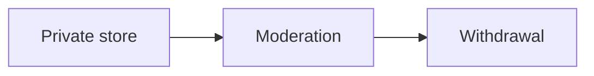

🏠 [Specs](../../../README.md) › 🧩 [Functional capabilities](../../README.md) › 🧰 [F14 Plugin store](../README.md) ›
🔀 [Flows](README.md) › 🔀 FL-F14-05 Store operations

# 🔀 FL-F14-05 Store operations

**Status:** ✅ specified

## Summary

Covers UC-F14-15, UC-F14-16, UC-F14-19.

## Personas

- [U11 IT provider administrator](../../../01-users/personas/u11-provider-admin.md)

## Flowchart

## Sequence diagram

See each use case.

## Steps

| Step | Persona | Screen | Use case | What happens |
|---|---|---|---|---|
| 1 | U11 | [S-F14-15](../screens/05-store-operations/s-f14-15-private-store.md) | [UC-F14-15](../use-cases/05-store-operations/uc-f14-15-run-a-private-store.md) | Run a private store |
| 2 | U11 | [S-F14-16](../screens/05-store-operations/s-f14-16-withdrawal.md) | [UC-F14-16](../use-cases/05-store-operations/uc-f14-16-withdraw-a-vulnerable-or-harmful-plugin.md) | Withdraw a vulnerable or harmful plugin |
| 3 | U11 | [S-F14-19](../screens/05-store-operations/s-f14-19-moderation.md) | [UC-F14-19](../use-cases/05-store-operations/uc-f14-19-moderate-the-store-with-transparent-ranking.md) | Moderate the store with transparent ranking |

### Entities and screens

| Entity | States in this flow | Shown at step and screen | Aggregated view |
|---|---|---|---|
| [E-F14-10 Private store](../data/e-f14-10-private-store.md) | Active | 1 [S-F14-15](../screens/05-store-operations/s-f14-15-private-store.md) | Private stores |
| [E-F14-11 Plugin withdrawal](../data/e-f14-11-plugin-withdrawal.md) | Active | 2 [S-F14-16](../screens/05-store-operations/s-f14-16-withdrawal.md) | Plugin withdrawals |

## Errors

As each use case.

## Images

Every step and error, for each persona taking part, in light and dark mode (D120). Steps are numbered as in the Steps
table; E rows are the error cases.

| Step | Persona | Device | Light | Dark |
|---|---|---|---|---|
| 1 | U11 | desktop | [light](../images/05-store-operations/u11-provider-admin/1-private-store-desktop-light.png) | [dark](../images/05-store-operations/u11-provider-admin/1-private-store-desktop-dark.png) |
| 2 | U11 | desktop | [light](../images/05-store-operations/u11-provider-admin/2-withdraw-desktop-light.png) | [dark](../images/05-store-operations/u11-provider-admin/2-withdraw-desktop-dark.png) |
| 3 | U11 | desktop | [light](../images/05-store-operations/u11-provider-admin/3-moderate-desktop-light.png) | [dark](../images/05-store-operations/u11-provider-admin/3-moderate-desktop-dark.png) |
| E1 | U11 | desktop | [light](../images/05-store-operations/u11-provider-admin/e1-notice-first-desktop-light.png) | [dark](../images/05-store-operations/u11-provider-admin/e1-notice-first-desktop-dark.png) |

## Open questions

None.

---

⬅️ [FL-F14-04 Money and taxes](fl-f14-04-money-and-taxes.md) · ⬆️ [Up](README.md) ·
➡️ [FL-F14-06 Release channels and rollback](fl-f14-06-release-channels-and-rollback.md)
