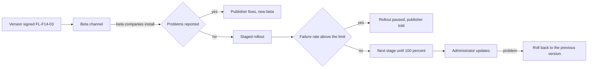
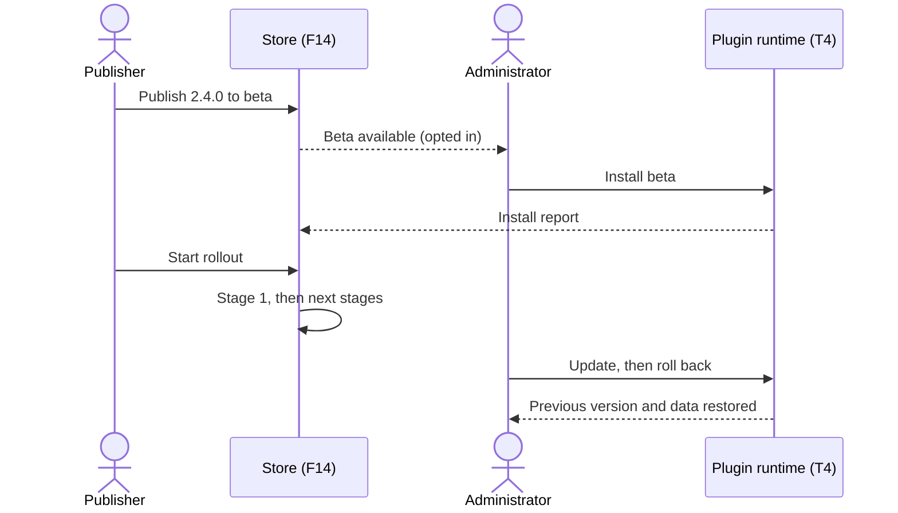

🏠 [Specs](../../../README.md) › 🧩 [Functional capabilities](../../README.md) › 🧰 [F14 Plugin store](../README.md) ›
🔀 [Flows](README.md) › 🔀 FL-F14-06 Release channels and rollback

# 🔀 FL-F14-06 Release channels and rollback

**Status:** ✅ specified

## Summary

A publisher ships a version first to the companies that opted into the beta channel, then rolls it out in stages to
everyone, pausing when installs fail; an administrator who meets a problem rolls back to the previous version with its
data (D471).

## Personas

- [U46 Plugin publisher](../../../01-users/personas/u46-plugin-publisher.md)
- [U07 Administrator](../../../01-users/personas/u07-administrator.md)
- [U11 IT provider administrator](../../../01-users/personas/u11-provider-admin.md)

## Flowchart

## Sequence diagram

## Steps

| Step | Persona | Screen | Use case | What happens |
|---|---|---|---|---|
| 1 | U46, U07 | [S-F14-23](../screens/06-release-channels-and-rollback/s-f14-23-release-channels.md) | [UC-F14-24](../use-cases/06-release-channels-and-rollback/uc-f14-24-publish-to-the-beta-channel.md) | Publish to the beta channel |
| 2 | U46, U11 | [S-F14-23](../screens/06-release-channels-and-rollback/s-f14-23-release-channels.md) | [UC-F14-25](../use-cases/06-release-channels-and-rollback/uc-f14-25-roll-out-a-release-in-stages.md) | Roll out a release in stages |
| 3 | U07 | [S-F14-26](../screens/06-release-channels-and-rollback/s-f14-26-version-history.md) | [UC-F14-28](../use-cases/06-release-channels-and-rollback/uc-f14-28-roll-back-to-the-previous-version.md) | Roll back to the previous version |

### Entities and screens

| Entity | States in this flow | Shown at step and screen | Aggregated view |
|---|---|---|---|
| [E-F14-03 Plugin version](../data/e-f14-03-plugin-version.md) | New, Signed | Shown elsewhere: [S-F14-03 Updates](../screens/01-find-and-install/s-f14-03-updates.md) | Plugin versions |
| [E-F14-17 Rollout](../data/e-f14-17-rollout.md) | Beta, Running, Paused | 1, 2 [S-F14-23](../screens/06-release-channels-and-rollback/s-f14-23-release-channels.md) | Rollouts |
| [E-F14-20 Rollback point](../data/e-f14-20-rollback-point.md) | Kept, Restored | 3 [S-F14-26](../screens/06-release-channels-and-rollback/s-f14-26-version-history.md) | Rollback points |

## Errors

E1: a beta install fails: the report goes to the publisher and the version stays in beta (step 1). E2: the failure rate
of a stage is above the limit: the rollout pauses (BR-F14-20) and resumes at step 2 once fixed. E3: the rollback cannot
restore the data snapshot: the plugin stays on the new version, the administrator is told and support is offered (step
3).

## Images

Every step and error, for each persona taking part, in light and dark mode (D120). Steps are numbered as in the Steps
table; E rows are the error cases.

| Step | Persona | Device | Light | Dark |
|---|---|---|---|---|
| 1 | U46 | desktop | [light](../images/06-release-channels-and-rollback/u46-plugin-publisher/1-release-channels-desktop-light.png) | [dark](../images/06-release-channels-and-rollback/u46-plugin-publisher/1-release-channels-desktop-dark.png) |
| 1 | U07 | desktop | [light](../images/06-release-channels-and-rollback/u07-administrator/1-release-channels-desktop-light.png) | [dark](../images/06-release-channels-and-rollback/u07-administrator/1-release-channels-desktop-dark.png) |
| 2 | U46 | desktop | [light](../images/06-release-channels-and-rollback/u46-plugin-publisher/2-release-channels-desktop-light.png) | [dark](../images/06-release-channels-and-rollback/u46-plugin-publisher/2-release-channels-desktop-dark.png) |
| 2 | U11 | desktop | [light](../images/06-release-channels-and-rollback/u11-provider-admin/2-release-channels-desktop-light.png) | [dark](../images/06-release-channels-and-rollback/u11-provider-admin/2-release-channels-desktop-dark.png) |
| 3 | U07 | desktop | [light](../images/06-release-channels-and-rollback/u07-administrator/3-version-history-desktop-light.png) | [dark](../images/06-release-channels-and-rollback/u07-administrator/3-version-history-desktop-dark.png) |
| E1 | U46 | desktop | [light](../images/06-release-channels-and-rollback/u46-plugin-publisher/e1-release-channels-refused-desktop-light.png) | [dark](../images/06-release-channels-and-rollback/u46-plugin-publisher/e1-release-channels-refused-desktop-dark.png) |

## Open questions

None.

---

⬅️ [FL-F14-05 Store operations](fl-f14-05-store-operations.md) · ⬆️ [Up](README.md) ·
➡️ [FL-F14-07 Plugin end of life](fl-f14-07-plugin-end-of-life.md)
