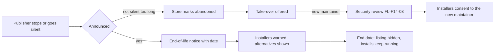
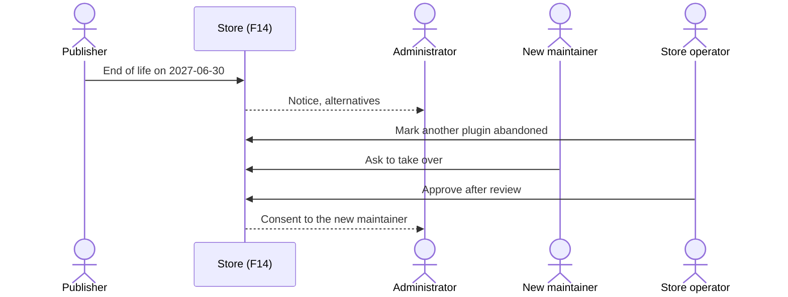

🏠 [Specs](../../../README.md) › 🧩 [Functional capabilities](../../README.md) › 🧰 [F14 Plugin store](../README.md) ›
🔀 [Flows](README.md) › 🔀 FL-F14-07 Plugin end of life

# 🔀 FL-F14-07 Plugin end of life

**Status:** ✅ specified

## Summary

A publisher who stops maintaining a plugin announces its end of life in advance, or the store finds it abandoned;
installers are warned, offered alternatives, and another publisher can take it over after a security review (D471).

## Personas

- [U46 Plugin publisher](../../../01-users/personas/u46-plugin-publisher.md)
- [U07 Administrator](../../../01-users/personas/u07-administrator.md)
- [U11 IT provider administrator](../../../01-users/personas/u11-provider-admin.md)

## Flowchart

## Sequence diagram

## Steps

| Step | Persona | Screen | Use case | What happens |
|---|---|---|---|---|
| 1 | U46, U07 | [S-F14-22](../screens/07-plugin-end-of-life/s-f14-22-plugin-lifecycle.md) | [UC-F14-22](../use-cases/07-plugin-end-of-life/uc-f14-22-deprecate-a-plugin-and-announce-its-end-of-life.md) | Deprecate a plugin and announce its end of life |
| 2 | U46, U11, U07 | [S-F14-22](../screens/07-plugin-end-of-life/s-f14-22-plugin-lifecycle.md) | [UC-F14-23](../use-cases/07-plugin-end-of-life/uc-f14-23-take-over-an-abandoned-plugin.md) | Take over an abandoned plugin |

### Entities and screens

| Entity | States in this flow | Shown at step and screen | Aggregated view |
|---|---|---|---|
| [E-F14-15 End-of-life notice](../data/e-f14-15-end-of-life-notice.md) | Announced | 1, 2 [S-F14-22](../screens/07-plugin-end-of-life/s-f14-22-plugin-lifecycle.md) | End-of-life notices |
| [E-F14-01 Store listing](../data/e-f14-01-store-listing.md) | New, Paid, Refused | 1, 2 [S-F14-22](../screens/07-plugin-end-of-life/s-f14-22-plugin-lifecycle.md) | Store listings |
| [E-F14-16 Maintainer transfer](../data/e-f14-16-maintainer-transfer.md) | Asked, Refused | 1, 2 [S-F14-22](../screens/07-plugin-end-of-life/s-f14-22-plugin-lifecycle.md) | Maintainer transfers |
| [E-F14-21 Plugin security review](../data/e-f14-21-plugin-security-review.md) | Active | 1, 2 [S-F14-22](../screens/07-plugin-end-of-life/s-f14-22-plugin-lifecycle.md) | Plugin security reviews |
| [E-F14-02 Plugin installation](../data/e-f14-02-plugin-installation.md) | Active | Shown elsewhere: [S-F14-26 Version history](../screens/06-release-channels-and-rollback/s-f14-26-version-history.md) | Plugin installations |

## Errors

E1: a notice shorter than the minimum notice is refused (BR-F14-17) and the publisher sets a later date (step 1). E2:
the take-over candidate fails the security review: the plugin stays abandoned and the offer reopens (step 2). E3: an
installer refuses the new maintainer: their copy stays on the last version of the old maintainer.

## Images

Every step and error, for each persona taking part, in light and dark mode (D120). Steps are numbered as in the Steps
table; E rows are the error cases.

| Step | Persona | Device | Light | Dark |
|---|---|---|---|---|
| 1 | U46 | desktop | [light](../images/07-plugin-end-of-life/u46-plugin-publisher/1-plugin-lifecycle-desktop-light.png) | [dark](../images/07-plugin-end-of-life/u46-plugin-publisher/1-plugin-lifecycle-desktop-dark.png) |
| 1 | U07 | desktop | [light](../images/07-plugin-end-of-life/u07-administrator/1-plugin-lifecycle-desktop-light.png) | [dark](../images/07-plugin-end-of-life/u07-administrator/1-plugin-lifecycle-desktop-dark.png) |
| 2 | U46 | desktop | [light](../images/07-plugin-end-of-life/u46-plugin-publisher/2-plugin-lifecycle-desktop-light.png) | [dark](../images/07-plugin-end-of-life/u46-plugin-publisher/2-plugin-lifecycle-desktop-dark.png) |
| 2 | U07 | desktop | [light](../images/07-plugin-end-of-life/u07-administrator/2-plugin-lifecycle-desktop-light.png) | [dark](../images/07-plugin-end-of-life/u07-administrator/2-plugin-lifecycle-desktop-dark.png) |
| 2 | U11 | desktop | [light](../images/07-plugin-end-of-life/u11-provider-admin/2-plugin-lifecycle-desktop-light.png) | [dark](../images/07-plugin-end-of-life/u11-provider-admin/2-plugin-lifecycle-desktop-dark.png) |
| E1 | U46 | desktop | [light](../images/07-plugin-end-of-life/u46-plugin-publisher/e1-plugin-lifecycle-refused-desktop-light.png) | [dark](../images/07-plugin-end-of-life/u46-plugin-publisher/e1-plugin-lifecycle-refused-desktop-dark.png) |

## Open questions

None.

---

⬅️ [FL-F14-06 Release channels and rollback](fl-f14-06-release-channels-and-rollback.md) · ⬆️ [Up](README.md) ·
➡️ [FL-F14-08 Trials, test instances, partners and themes](fl-f14-08-trials-instances-and-partners.md)
