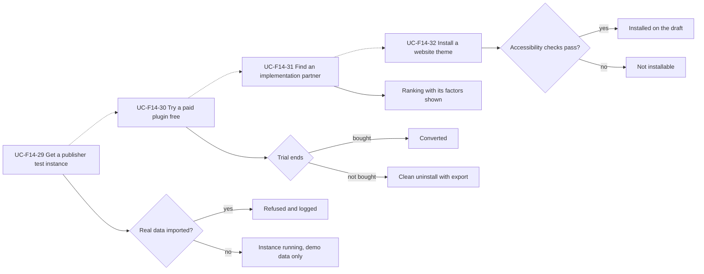
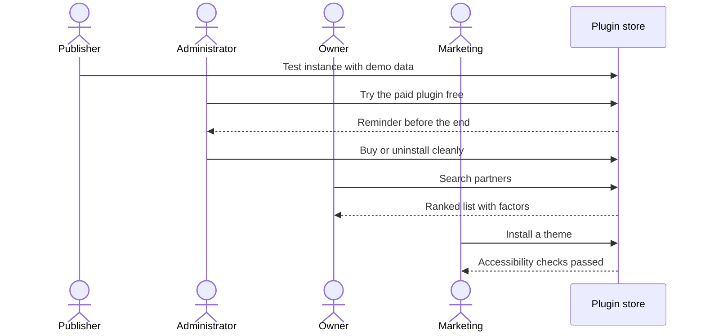

🏠 [Specs](../../../README.md) › 🧩 [Functional capabilities](../../README.md) › 🧰 [F14 Plugin store](../README.md) ›
🔀 [Flows](README.md) › 🔀 FL-F14-08 Trials, test instances, partners and themes

# 🔀 FL-F14-08 Trials, test instances, partners and themes

**Status:** 🔄 waiting for the owner

## Summary

A publisher tries their plugin on a test instance that holds demo data only, an administrator tries a paid plugin free
and ends with a purchase or a clean uninstall, the owner finds an implementation partner in a directory whose ranking is
explained, and marketing installs a website theme that passed the accessibility checks
([D533](../../../06-decisions/f14-plugin-store/d533-benchmark-gaps-f14-plugin-store.md)).

## Personas

- [U46 Plugin publisher](../../../01-users/personas/u46-plugin-publisher.md), who tests plugins and submits themes
- [U07 Administrator](../../../01-users/personas/u07-administrator.md), who tries a paid plugin
- [U13 Owner](../../../01-users/personas/u13-owner.md), who looks for a partner
- [U51 Reseller partner](../../../01-users/personas/u51-reseller-partner.md), who keeps a partner listing
- [U12 Marketing and communication](../../../01-users/personas/u12-marketing.md), who installs a theme

## Flowchart

## Sequence diagram

## Steps

| Step | Persona | Screen | Use case | What happens |
|---|---|---|---|---|
| 1 | [U46](../../../01-users/personas/u46-plugin-publisher.md) | [S-F14-27](../screens/08-trials-instances-and-partners/s-f14-27-test-instances.md) | [UC-F14-29](../use-cases/08-trials-instances-and-partners/uc-f14-29-get-a-publisher-test-instance.md) | The publisher asks for a test instance with demo data and installs a plugin build on it |
| 2 | [U07](../../../01-users/personas/u07-administrator.md) | [S-F14-28](../screens/08-trials-instances-and-partners/s-f14-28-free-trials.md) | [UC-F14-30](../use-cases/08-trials-instances-and-partners/uc-f14-30-try-a-paid-plugin-free.md) | The administrator starts a free trial and the trial ends with a purchase or a clean uninstall |
| 3 | [U13](../../../01-users/personas/u13-owner.md) | [S-F14-29](../screens/08-trials-instances-and-partners/s-f14-29-partner-directory.md) | [UC-F14-31](../use-cases/08-trials-instances-and-partners/uc-f14-31-find-an-implementation-partner.md) | The owner searches the partner directory and reads why each partner ranks where it does |
| 4 | [U12](../../../01-users/personas/u12-marketing.md) | [S-F14-30](../screens/08-trials-instances-and-partners/s-f14-30-website-themes.md) | [UC-F14-32](../use-cases/08-trials-instances-and-partners/uc-f14-32-install-a-website-theme.md) | Marketing installs a website theme that passed the accessibility checks |

### Entities and screens

| Entity | States in this flow | Shown at step and screen | Aggregated view |
|---|---|---|---|
| [E-F14-22 Test instance](../data/e-f14-22-test-instance.md) | Requested, Running, Expired, Removed | 1 [S-F14-27](../screens/08-trials-instances-and-partners/s-f14-27-test-instances.md) | Test instances |
| [E-F14-23 Trial](../data/e-f14-23-trial.md) | Active, Converted, Ended, Removed | 2 [S-F14-28](../screens/08-trials-instances-and-partners/s-f14-28-free-trials.md) | Trials |
| [E-F14-24 Partner listing](../data/e-f14-24-partner-listing.md) | Applied, Listed, Declined, Suspended, Withdrawn | 3 [S-F14-29](../screens/08-trials-instances-and-partners/s-f14-29-partner-directory.md) | Partner listings |
| [E-F14-25 Theme](../data/e-f14-25-theme.md) | Submitted, Checked, Published, Rejected, Withdrawn | 4 [S-F14-30](../screens/08-trials-instances-and-partners/s-f14-30-website-themes.md) | Themes |

## Errors

- **E1 The trial has ended.** The plugin is switched off, its export is offered and its data is removed after the grace
  period ([BR-F14-25](../business-rules/br-f14-25-a-trial-ends-with-a-purchase-or-a-clean-uninstall.md), step 2).

## Images

Every step and error, for each persona taking part, in light and dark mode (D120). Steps are numbered as in the Steps
table; E rows are the error cases.

| Step | Persona | Device | Light | Dark |
|---|---|---|---|---|
| 1 | U46 | desktop | [light](../images/08-trials-instances-and-partners/u46-plugin-publisher/1-test-instances-desktop-light.png) | [dark](../images/08-trials-instances-and-partners/u46-plugin-publisher/1-test-instances-desktop-dark.png) |
| 2 | U07 | desktop | [light](../images/08-trials-instances-and-partners/u07-administrator/2-free-trials-desktop-light.png) | [dark](../images/08-trials-instances-and-partners/u07-administrator/2-free-trials-desktop-dark.png) |
| 3 | U13 | desktop | [light](../images/08-trials-instances-and-partners/u13-owner/3-partner-directory-desktop-light.png) | [dark](../images/08-trials-instances-and-partners/u13-owner/3-partner-directory-desktop-dark.png) |
| 3 | U51 | desktop | [light](../images/08-trials-instances-and-partners/u51-reseller-partner/3-partner-directory-desktop-light.png) | [dark](../images/08-trials-instances-and-partners/u51-reseller-partner/3-partner-directory-desktop-dark.png) |
| 3 | U13 | phone | [light](../images/08-trials-instances-and-partners/u13-owner/3-partner-directory-phone-light.png) | [dark](../images/08-trials-instances-and-partners/u13-owner/3-partner-directory-phone-dark.png) |
| 4 | U12 | desktop | [light](../images/08-trials-instances-and-partners/u12-marketing/4-website-themes-desktop-light.png) | [dark](../images/08-trials-instances-and-partners/u12-marketing/4-website-themes-desktop-dark.png) |
| 4 | U46 | desktop | [light](../images/08-trials-instances-and-partners/u46-plugin-publisher/4-website-themes-desktop-light.png) | [dark](../images/08-trials-instances-and-partners/u46-plugin-publisher/4-website-themes-desktop-dark.png) |
| 4 | U12 | phone | [light](../images/08-trials-instances-and-partners/u12-marketing/4-website-themes-phone-light.png) | [dark](../images/08-trials-instances-and-partners/u12-marketing/4-website-themes-phone-dark.png) |
| E1 | U46 | desktop | [light](../images/08-trials-instances-and-partners/u46-plugin-publisher/e1-the-trial-has-ended-desktop-light.png) | [dark](../images/08-trials-instances-and-partners/u46-plugin-publisher/e1-the-trial-has-ended-desktop-dark.png) |

## Open questions

None.

---

⬅️ [FL-F14-07 Plugin end of life](fl-f14-07-plugin-end-of-life.md) · ⬆️ [Up](README.md)
