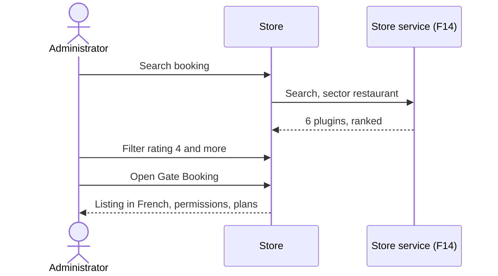

🏠 [Specs](../../../../README.md) › 🧩 [Functional capabilities](../../../README.md) ›
🧰 [F14 Plugin store](../../README.md) › 📝 [Use cases](../README.md) ›
📝 [Use cases: FL-F14-01 Find and install](README.md) › 📝 UC-F14-01 Browse and search the store

# 📝 UC-F14-01 Browse and search the store

**Status:** ✅ specified

## Summary

The administrator or the owner browses and searches the store by category, sector, rating and price, with the ranking
explained, and opens a plugin's listing.

## Personas

- [U07 Administrator](../../../../01-users/personas/u07-administrator.md)
- [U13 Owner](../../../../01-users/personas/u13-owner.md)

## Goal

Find a plugin or sector pack that fits the company's need.

## Trigger

A need for a feature the company does not have.

## Frequency

A few times a month per company.

## Preconditions

- The user is signed in with access to the store.

## Postconditions

- Success: the listing of a plugin is open with its permissions, plans, reviews and compatibility.
- Failure: nothing matches; the filters can be cleared.

## Main flow

1. The administrator opens the Store (S-F14-01); SimpleERP shows the plugins recommended for the company's sector
   first.
2. The administrator types a search or picks a category.
3. They filter by rating, price, language and compatibility with the running version.
4. They read "How ranking works" (BR-F14-10).
5. They open a listing: description in their language, permissions, plans, support terms, reviews and compatibility.

## Alternative flows

- 1a. The owner browses: same results, the install button is replaced by "Ask the administrator".

## Error flows

- 3e. A plugin is not compatible with the running version: shown greyed with the reason.
- 2e. No result: a message offers to clear filters or to ask the AI assistant (UC-F14-20).
- Any step: a service does not answer; the call is retried first (BR-F3-32), then the message follows the error pattern
  (D122) and what was typed stays on the screen.

## Business rules

- [BR-F14-10 Ranking explained](../../business-rules/br-f14-10-ranking-explained.md)

## Entities

- [E-F14-01 Store listing](../../data/e-f14-01-store-listing.md)

## Permissions

Administrator and owner browse; the private store's clients see only their store (UC-F14-15).

## Notifications

- None.

## Audit events

None for browsing; listing views counted anonymously for the publisher's metrics.

## AI involvement

The AI assistant may suggest plugins for a need described in a sentence (UC-F14-20).

## API, MCP and A2A exposure

Through T5 and T6 with the caller's rights (BR-F3-34).

## Screens

- [S-F14-01 Store](../../screens/01-find-and-install/s-f14-01-store.md)

## Flowchart

See [FL-F14-01 Find and install](../../flows/fl-f14-01-find-and-install.md#flowchart).

## Sequence diagram

## Acceptance criteria

1. **Given** the restaurant example company **when** its administrator opens the store **then** plugins for restaurants
   are shown first.
2. **Given** a search "booking" filtered on 4 stars and more **when** applied **then** only plugins rated 4 or more are
   listed.
3. **Given** a plugin not compatible with the running version **when** listed **then** it is greyed with the reason.
4. **Given** the owner **when** they open a listing **then** "Ask the administrator" replaces "Install".

## Non-functional notes

D408's targets ([Performance](../../../../05-non-functional/performance.md)): 95 % of screens within 1 second; lists
paged on the server, the first page within 1 second; reports within 5 seconds or in the background.

## Regulatory references

Store rules of the France country pack:
[CR-FR-188 Reporting sellers' income (DAC7)](../../../../10-country-packs/france/digital/cr-fr-188-dac7-seller-reporting.md),
[CR-FR-189 Platform-to-business terms](../../../../10-country-packs/france/digital/cr-fr-189-p2b-platform-terms.md),
[CR-FR-190 Traceability of traders on a marketplace](../../../../10-country-packs/france/digital/cr-fr-190-marketplace-trader-traceability.md),
[CR-FR-191 Marketplace information to buyers](../../../../10-country-packs/france/consumer/cr-fr-191-marketplace-consumer-information.md),
[CR-FR-168 Cyber Resilience Act reporting](../../../../10-country-packs/france/digital/cr-fr-168-cyber-resilience-reporting.md),
[CR-FR-071 VAT on distance sales in the EU](../../../../10-country-packs/france/tax-and-vat/cr-fr-071-distance-sales-vat-oss.md),
[CR-FR-100 VAT on services to clients abroad](../../../../10-country-packs/france/tax-and-vat/cr-fr-100-vat-on-services-abroad.md),
[CR-FR-049 Processors and transfers outside the EU](../../../../10-country-packs/france/data-protection/cr-fr-049-processors-and-transfers.md),
[CR-FR-016 Electronic invoicing](../../../../10-country-packs/france/invoicing/cr-fr-016-electronic-invoicing.md).

## Related use cases

- [UC-F14-02 Install a plugin or sector pack](uc-f14-02-install-a-plugin-or-sector-pack.md)
- [UC-F14-20 Ask the AI assistant to find or set up a plugin](uc-f14-20-ask-the-assistant-to-find-or-set-up-a-plugin.md)

## Open questions

None.

---

⬆️ [Up](README.md) · ➡️ [UC-F14-02 Install a plugin or sector pack](uc-f14-02-install-a-plugin-or-sector-pack.md)
