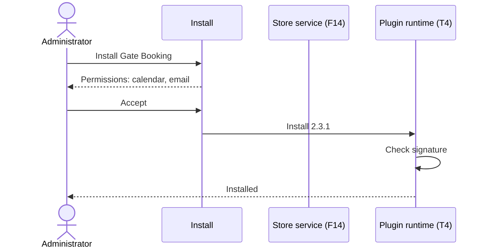

🏠 [Specs](../../../../README.md) › 🧩 [Functional capabilities](../../../README.md) ›
🧰 [F14 Plugin store](../../README.md) › 📝 [Use cases](../README.md) ›
📝 [Use cases: FL-F14-01 Find and install](README.md) › 📝 UC-F14-02 Install a plugin or sector pack

# 📝 UC-F14-02 Install a plugin or sector pack

**Status:** ✅ specified

## Summary

The administrator installs a plugin or a sector pack after reading and accepting the permissions it asks for; simple-ERP
checks the signature and installs it.

## Personas

- [U07 Administrator](../../../../01-users/personas/u07-administrator.md)

## Goal

The plugin works in the company with only the permissions accepted.

## Trigger

A plugin chosen in the store.

## Frequency

A few a month per company.

## Preconditions

- The plugin is compatible and signed (BR-F14-07).

## Postconditions

- Success: an installation with its accepted permissions.
- Failure: nothing installed.

## Main flow

1. The administrator opens the listing and chooses "Install" (S-F14-02).
2. simple-ERP lists the permissions asked: data, connectors, AI, outside calls (BR-F14-02).
3. The administrator accepts them; for a paid plan, the purchase follows (UC-F14-05).
4. simple-ERP checks the signature and installs the plugin in the company.
5. The plugin appears in the menu of the roles concerned.

## Alternative flows

- 1a. A sector pack: its plugins are listed and installed together with one acceptance per permission.

## Error flows

- 4e. The signature is invalid: refused, the store operator is told.
- 2e. The administrator refuses a permission: the plugin is not installed.
- Any step: a service does not answer; the call is retried first (BR-F3-32), then the message follows the error pattern
  (D122) and what was typed stays on the screen.

## Business rules

- [BR-F14-02 Permissions shown before install](../../business-rules/br-f14-02-permissions-shown-before-install.md)
- [BR-F14-07 Releases signed](../../business-rules/br-f14-07-releases-signed.md)
- [BR-F14-01 The store follows the country pack](../../business-rules/br-f14-01-store-follows-the-country-pack.md)

## Entities

- [E-F14-01 Store listing](../../data/e-f14-01-store-listing.md)
- [E-F14-02 Plugin installation](../../data/e-f14-02-plugin-installation.md)

## Permissions

Administrator; the IT provider administrator for its clients.

## Notifications

- The administrator when the install ends; users of the roles concerned that a new feature is available.

## Audit events

Install with the version, permissions accepted, who and when.

## AI involvement

The AI assistant may prepare the install of a plugin found for the user; the permissions are accepted by the
administrator.

## API, MCP and A2A exposure

Through T5 and T6 with the caller's rights (BR-F3-34).

## Screens

- [S-F14-02 Install](../../screens/01-find-and-install/s-f14-02-install.md)

## Flowchart

See [FL-F14-01 Find and install](../../flows/fl-f14-01-find-and-install.md#flowchart).

## Sequence diagram

## Acceptance criteria

1. **Given** Gate Booking asking for calendar and email **when** the administrator accepts **then** it is installed with
   those two permissions only.
2. **Given** a tampered package **when** installed **then** it is refused and the store operator is told.
3. **Given** the sector pack for restaurants with 4 plugins **when** installed **then** the 4 are installed together.
4. **Given** a permission refused **when** the administrator confirms **then** nothing is installed.

## Non-functional notes

D408's targets ([Performance](../../../../05-non-functional/performance.md)): 95 % of screens within 1 second; lists
paged on the server, the first page within 1 second; reports within 5 seconds or in the background.

## Regulatory references

Store rules of the France country pack:
[CR-FR-188 Reporting sellers' income (DAC7)](../../../../10-country-packs/france/digital/cr-fr-188-dac7-seller-reporting.md),
[CR-FR-189 Platform-to-business terms](../../../../10-country-packs/france/digital/cr-fr-189-p2b-platform-terms.md),
[CR-FR-190 Traceability of traders on a marketplace](../../../../10-country-packs/france/digital/cr-fr-190-marketplace-trader-traceability.md),
[CR-FR-191 Marketplace information to buyers](../../../../10-country-packs/france/consumer/cr-fr-191-marketplace-consumer-information.md),
[CR-FR-168 Cyber Resilience Act reporting](../../../../10-country-packs/france/digital/cr-fr-168-cyber-resilience-reporting.md),
[CR-FR-071 VAT on distance sales in the EU](../../../../10-country-packs/france/tax-and-vat/cr-fr-071-distance-sales-vat-oss.md),
[CR-FR-100 VAT on services to clients abroad](../../../../10-country-packs/france/tax-and-vat/cr-fr-100-vat-on-services-abroad.md),
[CR-FR-049 Processors and transfers outside the EU](../../../../10-country-packs/france/data-protection/cr-fr-049-processors-and-transfers.md),
[CR-FR-016 Electronic invoicing](../../../../10-country-packs/france/invoicing/cr-fr-016-electronic-invoicing.md).

## Related use cases

- [UC-F14-01 Browse and search the store](uc-f14-01-browse-and-search-the-store.md)
- [UC-F14-05 Buy a paid plugin or subscription](../02-buy-and-licence/uc-f14-05-buy-a-paid-plugin-or-subscription.md)
- [UC-F14-03 Update with compatibility checks](uc-f14-03-update-with-compatibility-checks.md)

## Open questions

None.

---

⬅️ [UC-F14-01 Browse and search the store](uc-f14-01-browse-and-search-the-store.md) · ⬆️ [Up](README.md) ·
➡️ [UC-F14-03 Update with compatibility checks](uc-f14-03-update-with-compatibility-checks.md)
