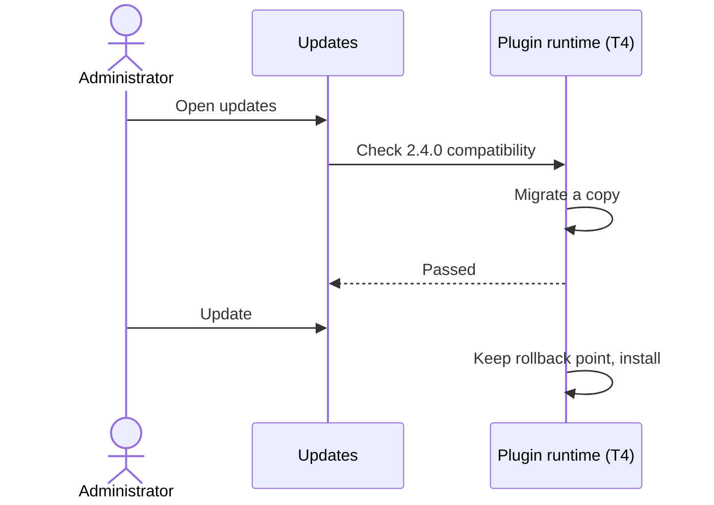

🏠 [Specs](../../../../README.md) › 🧩 [Functional capabilities](../../../README.md) ›
🧰 [F14 Plugin store](../../README.md) › 📝 [Use cases](../README.md) ›
📝 [Use cases: FL-F14-01 Find and install](README.md) › 📝 UC-F14-03 Update with compatibility checks

# 📝 UC-F14-03 Update with compatibility checks

**Status:** ✅ specified

## Summary

The administrator sees the updates of installed plugins; each is checked for compatibility and migrated on a copy first,
and a new permission is asked before installing.

## Personas

- [U07 Administrator](../../../../01-users/personas/u07-administrator.md)

## Goal

Plugins up to date without breaking work.

## Trigger

An update published or reaching the company's rollout stage (UC-F14-25).

## Frequency

Weekly.

## Preconditions

- The plugin is installed.

## Postconditions

- Success: the update installed; a rollback point kept (BR-F14-23).
- Failure: the old version stays.

## Main flow

1. The administrator opens Updates (S-F14-03); SimpleERP lists updates with their notes.
2. SimpleERP checks compatibility with the running version (BR-F14-03).
3. SimpleERP runs the migration on a copy of the plugin's data.
4. The administrator confirms; SimpleERP keeps a rollback point and installs.
5. The plugin runs the new version.

## Alternative flows

- 1a. Automatic updates are on: steps 2 to 4 run alone at night, except when a new permission is asked.

## Error flows

- 2e. A new permission: consent is asked before the update (BR-F14-02).
- 3e. The migration fails on the copy: the update is not installed and the publisher receives the report.
- Any step: a service does not answer; the call is retried first (BR-F3-32), then the message follows the error pattern
  (D122) and what was typed stays on the screen.

## Business rules

- [BR-F14-03 Updates only when compatible](../../business-rules/br-f14-03-updates-only-when-compatible.md)
- [BR-F14-02 Permissions shown before install](../../business-rules/br-f14-02-permissions-shown-before-install.md)
- [BR-F14-23 Rollback restores the previous version and data](../../business-rules/br-f14-23-rollback-restores-the-previous-version-and-data.md)
- [BR-F14-20 Staged rollout pauses on failures](../../business-rules/br-f14-20-staged-rollout-pauses-on-failures.md)

## Entities

- [E-F14-02 Plugin installation](../../data/e-f14-02-plugin-installation.md)
- [E-F14-03 Plugin version](../../data/e-f14-03-plugin-version.md)
- [E-F14-20 Rollback point](../../data/e-f14-20-rollback-point.md)

## Permissions

Administrator.

## Notifications

- The administrator when updates are available or a new permission is asked.

## Audit events

Update checked, installed or refused, with versions.

## AI involvement

The AI assistant may summarise the release notes.

## API, MCP and A2A exposure

Through T5 and T6 with the caller's rights (BR-F3-34).

## Screens

- [S-F14-03 Updates](../../screens/01-find-and-install/s-f14-03-updates.md)

## Flowchart

See [FL-F14-01 Find and install](../../flows/fl-f14-01-find-and-install.md#flowchart).

## Sequence diagram

## Acceptance criteria

1. **Given** Gate Booking 2.4.0 compatible **when** the administrator updates **then** a rollback point of 2.3.1 is kept
   and 2.4.0 installed.
2. **Given** 2.4.0 asking a new permission **when** automatic updates are on **then** it waits for the administrator's
   consent.
3. **Given** a failed migration on the copy **when** the update runs **then** 2.3.1 stays and the publisher gets the
   report.

## Non-functional notes

D408's targets ([Performance](../../../../05-non-functional/performance.md)): 95 % of screens within 1 second; lists
paged on the server, the first page within 1 second; reports within 5 seconds or in the background.

## Regulatory references

Store rules of the France country pack:
[CR-FR-188 Reporting sellers' income (DAC7)](../../../../10-country-packs/france/digital/cr-fr-188-dac7-seller-reporting.md),
[CR-FR-189 Platform-to-business terms](../../../../10-country-packs/france/digital/cr-fr-189-p2b-platform-terms.md),
[CR-FR-190 Traceability of traders on a marketplace](../../../../10-country-packs/france/digital/cr-fr-190-marketplace-trader-traceability.md),
[CR-FR-191 Marketplace information to buyers](../../../../10-country-packs/france/consumer/cr-fr-191-marketplace-consumer-information.md),
[CR-FR-168 Cyber Resilience Act reporting](../../../../10-country-packs/france/digital/cr-fr-168-cyber-resilience-reporting.md),
[CR-FR-071 VAT on distance sales in the EU](../../../../10-country-packs/france/tax-and-vat/cr-fr-071-distance-sales-vat-oss.md),
[CR-FR-100 VAT on services to clients abroad](../../../../10-country-packs/france/tax-and-vat/cr-fr-100-vat-on-services-abroad.md),
[CR-FR-049 Processors and transfers outside the EU](../../../../10-country-packs/france/data-protection/cr-fr-049-processors-and-transfers.md),
[CR-FR-016 Electronic invoicing](../../../../10-country-packs/france/invoicing/cr-fr-016-electronic-invoicing.md).

## Related use cases

- [UC-F14-28 Roll back to the previous version](../06-release-channels-and-rollback/uc-f14-28-roll-back-to-the-previous-version.md)
- [UC-F14-11 Publish versions and release notes](../03-publish/uc-f14-11-publish-versions-and-release-notes.md)

## Open questions

None.

---

⬅️ [UC-F14-02 Install a plugin or sector pack](uc-f14-02-install-a-plugin-or-sector-pack.md) · ⬆️ [Up](README.md) ·
➡️ [UC-F14-04 Uninstall and export the plugin's data](uc-f14-04-uninstall-and-export-the-plugin-s-data.md)
