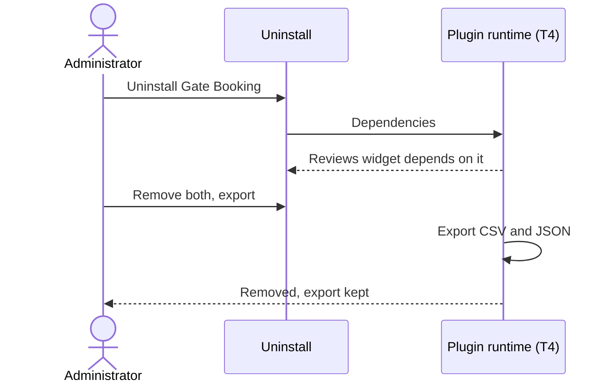

🏠 [Specs](../../../../README.md) › 🧩 [Functional capabilities](../../../README.md) ›
🧰 [F14 Plugin store](../../README.md) › 📝 [Use cases](../README.md) ›
📝 [Use cases: FL-F14-01 Find and install](README.md) › 📝 UC-F14-04 Uninstall and export the plugin's data

# 📝 UC-F14-04 Uninstall and export the plugin's data

**Status:** 🔄 waiting for the owner

## Summary

The administrator uninstalls a plugin; simple-ERP checks the plugins that depend on it, exports its data in an open
format and keeps the export for the set period before removing it.

## Personas

- [U07 Administrator](../../../../01-users/personas/u07-administrator.md)

## Goal

The plugin removed with its data kept and nothing left broken.

## Trigger

The plugin is no longer needed, or its end of life (UC-F14-22).

## Frequency

A few a year.

## Preconditions

- The plugin is installed.

## Postconditions

- Success: plugin removed, export kept (BR-F14-04).
- Failure: the plugin stays installed.

## Main flow

1. The administrator chooses "Uninstall" on the plugin (S-F14-04).
2. simple-ERP lists the plugins and record types that depend on it.
3. simple-ERP shows the export, in the (Proposed) format of one CSV per record type and a JSON with the settings, and
   the period it is kept.
4. The administrator confirms; simple-ERP exports, then removes the plugin and its menu entries.
5. The export is downloadable from the company's exports during the period.

## Alternative flows

- 3a. Keep data for reinstall: the data stays in the company, hidden, for the same period.

## Error flows

- 2e. Other plugins depend on it: uninstall is refused until they are removed, or both are removed together after
  confirmation.
- 4e. The export fails: the plugin is not removed.
- Any step: a service does not answer; the call is retried first (BR-F3-32), then the message follows the error pattern
  (D122) and what was typed stays on the screen.

## Business rules

- [BR-F14-04 Uninstall keeps an export](../../business-rules/br-f14-04-uninstall-keeps-an-export.md)

## Entities

- [E-F14-02 Plugin installation](../../data/e-f14-02-plugin-installation.md)

## Permissions

Administrator.

## Notifications

- Users of the plugin's roles when it is removed.

## Audit events

Uninstall with the export file, who and when.

## AI involvement

The AI assistant may list what depends on the plugin.

## API, MCP and A2A exposure

Through T5 and T6 with the caller's rights (BR-F3-34).

## Screens

- [S-F14-04 Uninstall](../../screens/01-find-and-install/s-f14-04-uninstall.md)

## Flowchart

See [FL-F14-01 Find and install](../../flows/fl-f14-01-find-and-install.md#flowchart).

## Sequence diagram

## Acceptance criteria

1. **Given** Gate Booking with 3 record types **when** uninstalled **then** 3 CSV files and a settings JSON are exported
   before removal.
2. **Given** a plugin that depends on it **when** the administrator uninstalls **then** the dependency is shown and both
   must be removed together.
3. **Given** the export fails **when** confirmed **then** nothing is removed.
4. **Given** "keep data for reinstall" **when** reinstalled **then** the data comes back.

## Non-functional notes

D408's targets ([Performance](../../../../05-non-functional/performance.md)): 95 % of screens within 1 second; lists
paged on the server, the first page within 1 second; reports within 5 seconds or in the background.

## Regulatory references

Store rules of the France country pack:
[CR-FR-188 Reporting sellers' income (DAC7)](../../../../10-country-packs/france/digital/cr-fr-188-dac7-seller-reporting.md),
[CR-FR-189 Platform-to-business terms](../../../../10-country-packs/france/digital/cr-fr-189-p2b-platform-terms.md),
[CR-FR-190 Traceability of traders on a marketplace](../../../../10-country-packs/france/digital/cr-fr-190-marketplace-trader-traceability.md),
[CR-FR-191 Marketplace information to buyers](../../../../10-country-packs/france/consumer/cr-fr-191-marketplace-consumer-information.md),
[CR-FR-168 Cyber Resilience Act reporting](../../../../10-country-packs/france/digital/cr-fr-168-cyber-resilience-reporting.md),
[CR-FR-071 VAT on distance sales in the EU](../../../../10-country-packs/france/tax-and-vat/cr-fr-071-distance-sales-vat-oss.md),
[CR-FR-100 VAT on services to clients abroad](../../../../10-country-packs/france/tax-and-vat/cr-fr-100-vat-on-services-abroad.md),
[CR-FR-049 Processors and transfers outside the EU](../../../../10-country-packs/france/data-protection/cr-fr-049-processors-and-transfers.md),
[CR-FR-016 Electronic invoicing](../../../../10-country-packs/france/invoicing/cr-fr-016-electronic-invoicing.md).

## Related use cases

- [UC-F14-22 Deprecate a plugin and announce its end of life](../07-plugin-end-of-life/uc-f14-22-deprecate-a-plugin-and-announce-its-end-of-life.md)
- [UC-F14-02 Install a plugin or sector pack](uc-f14-02-install-a-plugin-or-sector-pack.md)

## Open questions

None.

---

⬅️ [UC-F14-03 Update with compatibility checks](uc-f14-03-update-with-compatibility-checks.md) · ⬆️ [Up](README.md) ·
➡️ [UC-F14-05 Buy a paid plugin or subscription](../02-buy-and-licence/uc-f14-05-buy-a-paid-plugin-or-subscription.md)
