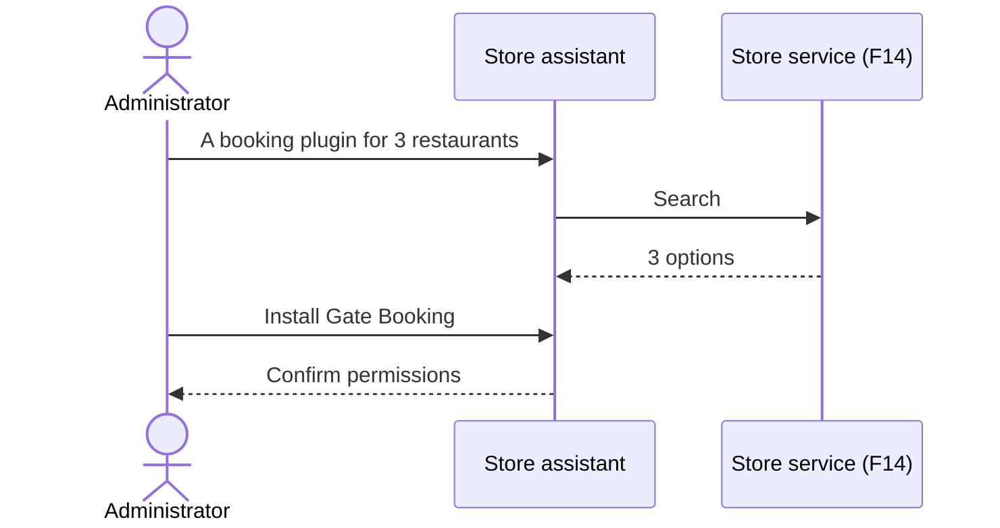

🏠 [Specs](../../../../README.md) › 🧩 [Functional capabilities](../../../README.md) ›
🧰 [F14 Plugin store](../../README.md) › 📝 [Use cases](../README.md) ›
📝 [Use cases: FL-F14-01 Find and install](README.md) › 📝 UC-F14-20 Ask the AI assistant to find or set up a plugin

# 📝 UC-F14-20 Ask the AI assistant to find or set up a plugin

**Status:** ✅ specified

## Summary

The administrator or the owner asks the AI assistant for a plugin for a need, compares options, and confirms an install
within their rights.

## Personas

- [U07 Administrator](../../../../01-users/personas/u07-administrator.md)
- [U13 Owner](../../../../01-users/personas/u13-owner.md)

## Goal

The right plugin found and set up by asking.

## Trigger

A question.

## Frequency

Occasional.

## Preconditions

- The user is signed in.

## Postconditions

- Success: options shown, install prepared.
- Failure: refused beyond rights.

## Main flow

1. The user opens the store assistant (S-F14-20) and describes the need.
2. The AI assistant lists plugins with permissions and plans.
3. The user compares two.
4. The user asks to install; the install is confirmed (BR-F3-07).

## Alternative flows

- 3a. Compare two plugins.

## Error flows

- 4e. Install beyond rights: refused.
- Any step: a service does not answer; the call is retried first (BR-F3-32), then the message follows the error pattern
  (D122) and what was typed stays on the screen.

## Business rules

- [BR-F14-02 Permissions shown before install](../../business-rules/br-f14-02-permissions-shown-before-install.md)

## Entities

- [E-F14-01 Store listing](../../data/e-f14-01-store-listing.md)

## Permissions

Within the user's rights.

## Notifications

- None.

## Audit events

Questions and actions.

## AI involvement

Answers from the store's listings only.

## API, MCP and A2A exposure

Through T5 and T6 with the caller's rights (BR-F3-34).

## Screens

- [S-F14-20 Store assistant](../../screens/01-find-and-install/s-f14-20-store-assistant.md)

## Flowchart

See [FL-F14-01 Find and install](../../flows/fl-f14-01-find-and-install.md#flowchart).

## Sequence diagram

## Acceptance criteria

1. **Given** a need for bookings **when** asked **then** 3 plugins are listed with permissions and plans.
2. **Given** the owner asks to install **when** they lack the right **then** it is refused.
3. **Given** an install asked **when** confirmed **then** the install of UC-F14-02 starts.

## Non-functional notes

D408's targets ([Performance](../../../../05-non-functional/performance.md)): 95 % of screens within 1 second; lists
paged on the server, the first page within 1 second; reports within 5 seconds or in the background.

## Regulatory references

Store rules of the France country pack:
[CR-FR-188 Reporting sellers' income (DAC7)](../../../../10-country-packs/france/digital/cr-fr-188-dac7-seller-reporting.md),
[CR-FR-189 Platform-to-business terms](../../../../10-country-packs/france/digital/cr-fr-189-p2b-platform-terms.md),
[CR-FR-190 Traceability of traders on a marketplace](../../../../10-country-packs/france/digital/cr-fr-190-marketplace-trader-traceability.md),
[CR-FR-191 Marketplace information to buyers](../../../../10-country-packs/france/consumer/cr-fr-191-marketplace-consumer-information.md),
[CR-FR-168 Cyber Resilience Act reporting](../../../../10-country-packs/france/digital/cr-fr-168-cyber-resilience-reporting.md),
[CR-FR-071 VAT on distance sales in the EU](../../../../10-country-packs/france/tax-and-vat/cr-fr-071-distance-sales-vat-oss.md),
[CR-FR-100 VAT on services to clients abroad](../../../../10-country-packs/france/tax-and-vat/cr-fr-100-vat-on-services-abroad.md),
[CR-FR-049 Processors and transfers outside the EU](../../../../10-country-packs/france/data-protection/cr-fr-049-processors-and-transfers.md),
[CR-FR-016 Electronic invoicing](../../../../10-country-packs/france/invoicing/cr-fr-016-electronic-invoicing.md).

## Related use cases

- [UC-F14-01 Browse and search the store](uc-f14-01-browse-and-search-the-store.md)
- [UC-F14-02 Install a plugin or sector pack](uc-f14-02-install-a-plugin-or-sector-pack.md)

## Open questions

None.

---

⬅️ [UC-F14-19](../05-store-operations/uc-f14-19-moderate-the-store-with-transparent-ranking.md) · ⬆️ [Up](README.md) ·
➡️ [UC-F14-21](../03-publish/uc-f14-21-check-a-plugins-bill-of-materials-and-licences.md)
