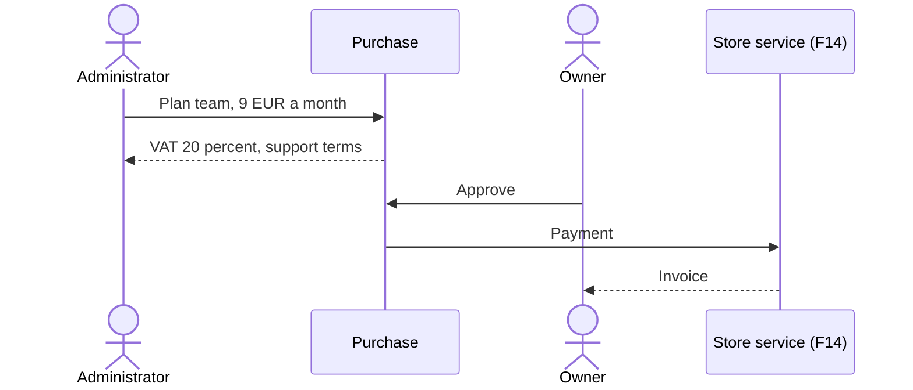

🏠 [Specs](../../../../README.md) › 🧩 [Functional capabilities](../../../README.md) ›
🧰 [F14 Plugin store](../../README.md) › 📝 [Use cases](../README.md) ›
📝 [Use cases: FL-F14-02 Buy and licence](README.md) › 📝 UC-F14-05 Buy a paid plugin or subscription

# 📝 UC-F14-05 Buy a paid plugin or subscription

**Status:** ✅ specified

## Summary

The owner or the administrator buys a paid plan of a plugin, which sells support, updates and hosting (D443), after
seeing its price, VAT and support terms; no licence is checked and no seat counted.

## Personas

- [U13 Owner](../../../../01-users/personas/u13-owner.md)
- [U07 Administrator](../../../../01-users/personas/u07-administrator.md)

## Goal

The company subscribed to the plan it needs.

## Trigger

A paid plugin chosen.

## Frequency

A few a year.

## Preconditions

- A payment method is set.

## Postconditions

- Success: a subscription and an invoice.
- Failure: no subscription; the plugin can stay installed in its free form.

## Main flow

1. The administrator opens the purchase screen (S-F14-05) from the listing.
2. SimpleERP shows the plans with price, VAT by the company's country (BR-F14-15) and support terms (BR-F14-22).
3. The administrator chooses a plan; the owner approves.
4. SimpleERP takes payment and issues the invoice.
5. The subscription starts; support requests open from the plugin.

## Alternative flows

- 3a. Trial: the plan starts without payment for its trial period.

## Error flows

- 4e. Payment fails: no subscription; the owner is told.
- Any step: a service does not answer; the call is retried first (BR-F3-32), then the message follows the error pattern
  (D122) and what was typed stays on the screen.

## Business rules

- [BR-F14-15 VAT on store sales](../../business-rules/br-f14-15-vat-on-store-sales.md)
- [BR-F14-01 The store follows the country pack](../../business-rules/br-f14-01-store-follows-the-country-pack.md)
- [BR-F14-22 Support terms shown before purchase and measured](../../business-rules/br-f14-22-support-terms-shown-before-purchase-and-measured.md)

## Entities

- [E-F14-04 Plugin price plan](../../data/e-f14-04-plugin-price-plan.md)
- [E-F14-05 Plugin licence](../../data/e-f14-05-plugin-licence.md)
- [E-F14-19 Support terms](../../data/e-f14-19-support-terms.md)

## Permissions

Administrator prepares; the owner approves.

## Notifications

- The owner when a purchase waits for approval; both when paid.

## Audit events

Purchase, approval, payment, invoice.

## AI involvement

The AI assistant may compare plans.

## API, MCP and A2A exposure

Through T5 and T6 with the caller's rights (BR-F3-34).

## Screens

- [S-F14-05 Purchase](../../screens/02-buy-and-licence/s-f14-05-purchase.md)

## Flowchart

See [FL-F14-02 Buy and licence](../../flows/fl-f14-02-buy-and-licence.md#flowchart).

## Sequence diagram

## Acceptance criteria

1. **Given** plan "team" at 9.00 EUR a month for a French company **when** shown **then** 1.80 EUR VAT and the support
   terms are shown.
2. **Given** the owner's approval **when** paid **then** the subscription starts and an invoice is issued.
3. **Given** a failed payment **when** paid **then** no subscription starts.

## Non-functional notes

D408's targets ([Performance](../../../../05-non-functional/performance.md)): 95 % of screens within 1 second; lists
paged on the server, the first page within 1 second; reports within 5 seconds or in the background.

## Regulatory references

Store rules of the France country pack:
[CR-FR-188 Reporting sellers' income (DAC7)](../../../../10-country-packs/france/digital/cr-fr-188-dac7-seller-reporting.md),
[CR-FR-189 Platform-to-business terms](../../../../10-country-packs/france/digital/cr-fr-189-p2b-platform-terms.md),
[CR-FR-190 Traceability of traders on a marketplace](../../../../10-country-packs/france/digital/cr-fr-190-marketplace-trader-traceability.md),
[CR-FR-191 Marketplace information to buyers](../../../../10-country-packs/france/consumer/cr-fr-191-marketplace-consumer-information.md),
[CR-FR-168 Cyber Resilience Act reporting](../../../../10-country-packs/france/digital/cr-fr-168-cyber-resilience-reporting.md),
[CR-FR-071 VAT on distance sales in the EU](../../../../10-country-packs/france/tax-and-vat/cr-fr-071-distance-sales-vat-oss.md),
[CR-FR-100 VAT on services to clients abroad](../../../../10-country-packs/france/tax-and-vat/cr-fr-100-vat-on-services-abroad.md),
[CR-FR-049 Processors and transfers outside the EU](../../../../10-country-packs/france/data-protection/cr-fr-049-processors-and-transfers.md),
[CR-FR-016 Electronic invoicing](../../../../10-country-packs/france/invoicing/cr-fr-016-electronic-invoicing.md).

## Related use cases

- [UC-F14-27 Set and honour support terms of a paid plan](uc-f14-27-set-and-honour-support-terms-of-a-paid-plan.md)
- [UC-F14-06 Manage licences and seats](uc-f14-06-manage-licences-and-seats.md)

## Open questions

None.

---

⬅️ [UC-F14-04](../01-find-and-install/uc-f14-04-uninstall-and-export-the-plugin-s-data.md) · ⬆️ [Up](README.md) ·
➡️ [UC-F14-06 Manage licences and seats](uc-f14-06-manage-licences-and-seats.md)
