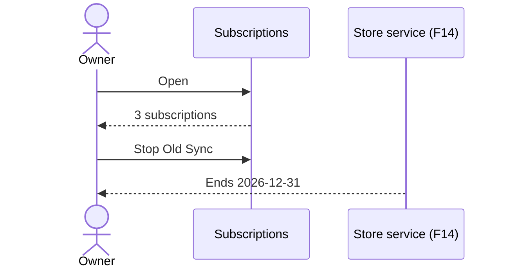

🏠 [Specs](../../../../README.md) › 🧩 [Functional capabilities](../../../README.md) ›
🧰 [F14 Plugin store](../../README.md) › 📝 [Use cases](../README.md) ›
📝 [Use cases: FL-F14-02 Buy and licence](README.md) › 📝 UC-F14-06 Manage licences and seats

# 📝 UC-F14-06 Manage licences and seats

**Status:** ✅ specified

## Summary

The administrator and the owner see the company's subscriptions to paid plugins (support, updates and hosting since
D443), renew or stop them; seats are withdrawn and no licence is checked.

## Personas

- [U07 Administrator](../../../../01-users/personas/u07-administrator.md)
- [U13 Owner](../../../../01-users/personas/u13-owner.md)

## Goal

Subscriptions known and renewed or stopped on purpose.

## Trigger

A renewal date, a review.

## Frequency

Monthly review.

## Preconditions

- The company has subscriptions.

## Postconditions

- Success: renewals and stops recorded.
- Failure: a lapsed subscription; the plugin keeps running without support and updates.

## Main flow

1. The administrator opens Subscriptions (S-F14-06).
2. SimpleERP lists each plan with its price, renewal date and support record.
3. The owner renews or stops a subscription.
4. A stopped subscription ends at the period's end; the plugin keeps running, without support and paid updates.

## Alternative flows

- 2a. An IT provider manages several client companies: subscriptions are listed per client.

## Error flows

- 3e. Renewal payment fails: the owner is told and retried after 3 days.
- Any step: a service does not answer; the call is retried first (BR-F3-32), then the message follows the error pattern
  (D122) and what was typed stays on the screen.

## Business rules

- [BR-F14-05 Licences checked, offline tolerant](../../business-rules/br-f14-05-licences-checked-offline-tolerant.md)
- [BR-F14-22 Support terms shown before purchase and measured](../../business-rules/br-f14-22-support-terms-shown-before-purchase-and-measured.md)

## Entities

- [E-F14-05 Plugin licence](../../data/e-f14-05-plugin-licence.md)

## Permissions

Administrator reads; owner renews and stops.

## Notifications

- Administrator and owner 30 days before renewal.

## Audit events

Renewals and stops.

## AI involvement

The AI assistant may list subscriptions little used.

## API, MCP and A2A exposure

Through T5 and T6 with the caller's rights (BR-F3-34).

## Screens

- [S-F14-06 Licences](../../screens/02-buy-and-licence/s-f14-06-licences.md)

## Flowchart

See [FL-F14-02 Buy and licence](../../flows/fl-f14-02-buy-and-licence.md#flowchart).

## Sequence diagram

## Acceptance criteria

1. **Given** 3 subscriptions **when** the owner opens the list **then** each shows price, renewal and support record.
2. **Given** Old Sync stopped **when** the period ends **then** the plugin still runs without support.
3. **Given** a renewal 30 days away **when** the day comes **then** administrator and owner are told.

## Non-functional notes

D408's targets ([Performance](../../../../05-non-functional/performance.md)): 95 % of screens within 1 second; lists
paged on the server, the first page within 1 second; reports within 5 seconds or in the background.

## Regulatory references

Store rules of the France country pack:
[CR-FR-188 Reporting sellers' income (DAC7)](../../../../10-country-packs/france/digital/cr-fr-188-dac7-seller-reporting.md),
[CR-FR-189 Platform-to-business terms](../../../../10-country-packs/france/digital/cr-fr-189-p2b-platform-terms.md),
[CR-FR-190 Traceability of traders on a marketplace](../../../../10-country-packs/france/digital/cr-fr-190-marketplace-trader-traceability.md),
[CR-FR-191 Marketplace information to buyers](../../../../10-country-packs/france/consumer/cr-fr-191-marketplace-consumer-information.md),
[CR-FR-168 Cyber Resilience Act reporting](../../../../10-country-packs/france/digital/cr-fr-168-cyber-resilience-reporting.md),
[CR-FR-071 VAT on distance sales in the EU](../../../../10-country-packs/france/tax-and-vat/cr-fr-071-distance-sales-vat-oss.md),
[CR-FR-100 VAT on services to clients abroad](../../../../10-country-packs/france/tax-and-vat/cr-fr-100-vat-on-services-abroad.md),
[CR-FR-049 Processors and transfers outside the EU](../../../../10-country-packs/france/data-protection/cr-fr-049-processors-and-transfers.md),
[CR-FR-016 Electronic invoicing](../../../../10-country-packs/france/invoicing/cr-fr-016-electronic-invoicing.md).

## Related use cases

- [UC-F14-05 Buy a paid plugin or subscription](uc-f14-05-buy-a-paid-plugin-or-subscription.md)
- [UC-F14-27 Set and honour support terms of a paid plan](uc-f14-27-set-and-honour-support-terms-of-a-paid-plan.md)

## Open questions

None.

---

⬅️ [UC-F14-05 Buy a paid plugin or subscription](uc-f14-05-buy-a-paid-plugin-or-subscription.md) · ⬆️ [Up](README.md) ·
➡️ [UC-F14-07 Rate and review](uc-f14-07-rate-and-review.md)
