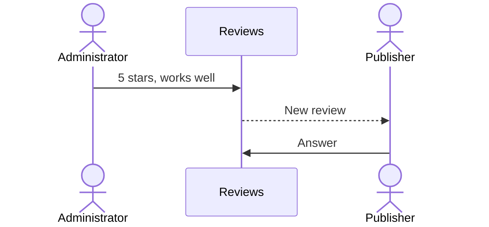

🏠 [Specs](../../../../README.md) › 🧩 [Functional capabilities](../../../README.md) ›
🧰 [F14 Plugin store](../../README.md) › 📝 [Use cases](../README.md) ›
📝 [Use cases: FL-F14-02 Buy and licence](README.md) › 📝 UC-F14-07 Rate and review

# 📝 UC-F14-07 Rate and review

**Status:** ✅ specified

## Summary

Users of an installed plugin rate and review it; the publisher answers; reviews can be reported for moderation.

## Personas

- [U07 Administrator](../../../../01-users/personas/u07-administrator.md)
- [U46 Plugin publisher](../../../../01-users/personas/u46-plugin-publisher.md)

## Goal

Honest reviews that help others choose.

## Trigger

After using a plugin.

## Frequency

Occasional.

## Preconditions

- The plugin is installed in the user's company.

## Postconditions

- Success: a published review and maybe an answer.
- Failure: the review is refused.

## Main flow

1. The administrator opens Reviews (S-F14-07) on an installed plugin.
2. They rate from 1 to 5 and write a review.
3. SimpleERP publishes it with "verified install" (BR-F14-10).
4. The publisher answers publicly.

## Alternative flows

- 4a. Someone reports a review: it goes to moderation (UC-F14-19).

## Error flows

- 1e. Plugin not installed: cannot review.
- Any step: a service does not answer; the call is retried first (BR-F3-32), then the message follows the error pattern
  (D122) and what was typed stays on the screen.

## Business rules

- [BR-F14-10 Ranking explained](../../business-rules/br-f14-10-ranking-explained.md)

## Entities

- [E-F14-06 Plugin review](../../data/e-f14-06-plugin-review.md)

## Permissions

Administrators and owners of installing companies review; publisher answers.

## Notifications

- The publisher at each new review.

## Audit events

Review and answer, with who and when.

## AI involvement

None.

## API, MCP and A2A exposure

Through T5 and T6 with the caller's rights (BR-F3-34).

## Screens

- [S-F14-07 Reviews](../../screens/02-buy-and-licence/s-f14-07-reviews.md)

## Flowchart

See [FL-F14-02 Buy and licence](../../flows/fl-f14-02-buy-and-licence.md#flowchart).

## Sequence diagram

## Acceptance criteria

1. **Given** Gate Booking installed **when** the administrator rates 5 **then** the review shows "verified install".
2. **Given** the plugin not installed **when** a user tries **then** reviewing is refused.
3. **Given** a reported review **when** reported **then** it goes to moderation.

## Non-functional notes

D408's targets ([Performance](../../../../05-non-functional/performance.md)): 95 % of screens within 1 second; lists
paged on the server, the first page within 1 second; reports within 5 seconds or in the background.

## Regulatory references

Store rules of the France country pack:
[CR-FR-188 Reporting sellers' income (DAC7)](../../../../10-country-packs/france/digital/cr-fr-188-dac7-seller-reporting.md),
[CR-FR-189 Platform-to-business terms](../../../../10-country-packs/france/digital/cr-fr-189-p2b-platform-terms.md),
[CR-FR-190 Traceability of traders on a marketplace](../../../../10-country-packs/france/digital/cr-fr-190-marketplace-trader-traceability.md),
[CR-FR-191 Marketplace information to buyers](../../../../10-country-packs/france/consumer/cr-fr-191-marketplace-consumer-information.md),
[CR-FR-168 Cyber Resilience Act reporting](../../../../10-country-packs/france/digital/cr-fr-168-cyber-resilience-reporting.md),
[CR-FR-071 VAT on distance sales in the EU](../../../../10-country-packs/france/tax-and-vat/cr-fr-071-distance-sales-vat-oss.md),
[CR-FR-100 VAT on services to clients abroad](../../../../10-country-packs/france/tax-and-vat/cr-fr-100-vat-on-services-abroad.md),
[CR-FR-049 Processors and transfers outside the EU](../../../../10-country-packs/france/data-protection/cr-fr-049-processors-and-transfers.md),
[CR-FR-016 Electronic invoicing](../../../../10-country-packs/france/invoicing/cr-fr-016-electronic-invoicing.md).

## Related use cases

- [UC-F14-19 Moderate the store with transparent ranking](../05-store-operations/uc-f14-19-moderate-the-store-with-transparent-ranking.md)

## Open questions

None.

---

⬅️ [UC-F14-06 Manage licences and seats](uc-f14-06-manage-licences-and-seats.md) · ⬆️ [Up](README.md) ·
➡️ [UC-F14-08 Submit a plugin](../03-publish/uc-f14-08-submit-a-plugin.md)
