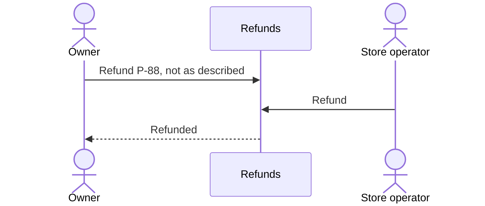

🏠 [Specs](../../../../README.md) › 🧩 [Functional capabilities](../../../README.md) ›
🧰 [F14 Plugin store](../../README.md) › 📝 [Use cases](../README.md) ›
📝 [Use cases: FL-F14-02 Buy and licence](README.md) › 📝 UC-F14-17 Handle refunds and disputes

# 📝 UC-F14-17 Handle refunds and disputes

**Status:** ✅ specified

## Summary

A company asks for a refund; the store operator decides by the policy, refunds fully or partly, and the publisher's
payout is adjusted.

## Personas

- [U11 IT provider administrator](../../../../01-users/personas/u11-provider-admin.md)
- [U13 Owner](../../../../01-users/personas/u13-owner.md)

## Goal

Fair refunds decided quickly.

## Trigger

A refund request.

## Frequency

Occasional.

## Preconditions

- A purchase exists.

## Postconditions

- Success: refunded or refused with reasons.
- Failure: escalated.

## Main flow

1. The owner asks for a refund on Refunds (S-F14-17).
2. The store operator reads the reason and the history.
3. They decide by the policy.
4. SimpleERP refunds and adjusts the payout.

## Alternative flows

- 3a. Partial refund.

## Error flows

- 3e. Outside the policy: refused with reasons.
- Any step: a service does not answer; the call is retried first (BR-F3-32), then the message follows the error pattern
  (D122) and what was typed stays on the screen.

## Business rules

- [BR-F14-13 Payouts reconciled](../../business-rules/br-f14-13-payouts-reconciled.md)

## Entities

- [E-F14-12 Refund](../../data/e-f14-12-refund.md)

## Permissions

Owner asks; store operator decides.

## Notifications

- Owner and publisher of the decision.

## Audit events

Request and decision.

## AI involvement

None.

## API, MCP and A2A exposure

Through T5 and T6 with the caller's rights (BR-F3-34).

## Screens

- [S-F14-17 Refunds](../../screens/02-buy-and-licence/s-f14-17-refunds.md)

## Flowchart

See [FL-F14-02 Buy and licence](../../flows/fl-f14-02-buy-and-licence.md#flowchart).

## Sequence diagram

## Acceptance criteria

1. **Given** P-88 not as described **when** refunded **then** the owner is refunded and the payout adjusted.
2. **Given** outside the policy **when** refused **then** reasons are given.
3. **Given** a partial refund **when** decided **then** that amount is refunded.

## Non-functional notes

D408's targets ([Performance](../../../../05-non-functional/performance.md)): 95 % of screens within 1 second; lists
paged on the server, the first page within 1 second; reports within 5 seconds or in the background.

## Regulatory references

Store rules of the France country pack:
[CR-FR-188 Reporting sellers' income (DAC7)](../../../../10-country-packs/france/digital/cr-fr-188-dac7-seller-reporting.md),
[CR-FR-189 Platform-to-business terms](../../../../10-country-packs/france/digital/cr-fr-189-p2b-platform-terms.md),
[CR-FR-190 Traceability of traders on a marketplace](../../../../10-country-packs/france/digital/cr-fr-190-marketplace-trader-traceability.md),
[CR-FR-191 Marketplace information to buyers](../../../../10-country-packs/france/consumer/cr-fr-191-marketplace-consumer-information.md),
[CR-FR-168 Cyber Resilience Act reporting](../../../../10-country-packs/france/digital/cr-fr-168-cyber-resilience-reporting.md),
[CR-FR-071 VAT on distance sales in the EU](../../../../10-country-packs/france/tax-and-vat/cr-fr-071-distance-sales-vat-oss.md),
[CR-FR-100 VAT on services to clients abroad](../../../../10-country-packs/france/tax-and-vat/cr-fr-100-vat-on-services-abroad.md),
[CR-FR-049 Processors and transfers outside the EU](../../../../10-country-packs/france/data-protection/cr-fr-049-processors-and-transfers.md),
[CR-FR-016 Electronic invoicing](../../../../10-country-packs/france/invoicing/cr-fr-016-electronic-invoicing.md).

## Related use cases

- [UC-F14-13 Receive payouts and statements](../04-money-and-taxes/uc-f14-13-receive-payouts-and-statements.md)

## Open questions

None.

---

⬅️ [UC-F14-16](../05-store-operations/uc-f14-16-withdraw-a-vulnerable-or-harmful-plugin.md) · ⬆️ [Up](README.md) ·
➡️ [UC-F14-18 Follow usage and revenue](../04-money-and-taxes/uc-f14-18-follow-usage-and-revenue.md)
