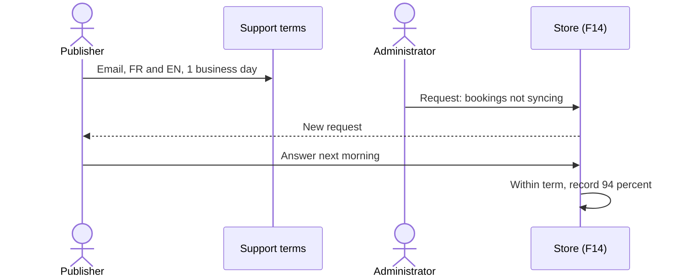

🏠 [Specs](../../../../README.md) › 🧩 [Functional capabilities](../../../README.md) ›
🧰 [F14 Plugin store](../../README.md) › 📝 [Use cases](../README.md) ›
📝 [Use cases: FL-F14-02 Buy and licence](README.md) › 📝 UC-F14-27 Set and honour support terms of a paid plan

# 📝 UC-F14-27 Set and honour support terms of a paid plan

**Status:** 🔄 waiting for the owner

## Summary

A publisher states the support terms of each paid plan (channels, languages, hours, first-response time); buyers see
them before purchase, open support requests from the plugin, and the store measures how the terms are kept.

## Personas

- [U46 Plugin publisher](../../../../01-users/personas/u46-plugin-publisher.md)
- [U07 Administrator](../../../../01-users/personas/u07-administrator.md), who opens support requests

## Goal

Buyers know what support they pay for, and get it.

## Trigger

A paid plan published; a support request opened.

## Frequency

At each plan change; support requests daily for popular plugins.

## Preconditions

- The plan is paid (D443).

## Postconditions

- Success: terms shown; each request's first response measured; the record shown on the listing.
- Failure: a plan with no terms cannot be published.

## Main flow

1. The publisher sets the terms of the plan on Support terms (S-F14-25).
2. The buyer sees them on the purchase screen before paying (UC-F14-05).
3. An administrator opens a support request from the installed plugin.
4. The publisher answers in the publisher portal; simple-ERP measures the first-response time.
5. The listing shows the share of requests answered within the term.

## Alternative flows

- 1a. Free plans: "community support only" is shown.

## Error flows

- 1e. A paid plan with no terms: publishing is refused (BR-F14-22).
- 4e. The term is missed: the request is marked late and counted on the record.
- Any step: a service does not answer; the call is retried first (BR-F3-32), then the message follows the error pattern
  (D122) and what was typed stays on the screen.

## Business rules

- [BR-F14-22 Support terms shown before purchase and measured](../../business-rules/br-f14-22-support-terms-shown-before-purchase-and-measured.md)

## Entities

- [E-F14-19 Support terms](../../data/e-f14-19-support-terms.md)
- [E-F14-04 Plugin price plan](../../data/e-f14-04-plugin-price-plan.md)

## Permissions

Publisher: terms and answers; administrator: requests for their company.

## Notifications

- The publisher at each new request; the administrator when answered; (Proposed) the publisher 2 business hours before a
  term is missed.

## Audit events

Terms published and changed; requests, answers and times.

## AI involvement

The AI assistant may draft an answer for the publisher from the plugin's documentation.

## API, MCP and A2A exposure

Through the API (T5) and as AI assistant tools (T6), with the caller's rights (BR-F3-34).

## Screens

- [S-F14-25 Support terms](../../screens/02-buy-and-licence/s-f14-25-support-terms.md)

## Flowchart

See [FL-F14-02 Buy and licence](../../flows/fl-f14-02-buy-and-licence.md#flowchart).

## Sequence diagram

## Acceptance criteria

1. **Given** plan "team" with a first response within 1 business day **when** a buyer opens the purchase screen **then**
   the terms are shown before paying.
2. **Given** a request opened on Monday 10:00 **when** answered on Tuesday 09:30 **then** it counts within the term.
3. **Given** a request answered after 3 business days **when** measured **then** it counts as missed.
4. **Given** a paid plan without terms **when** published **then** it is refused.

## Non-functional notes

D408's targets ([Performance](../../../../05-non-functional/performance.md)): 95 % of screens within 1 second; lists
paged on the server, the first page within 1 second; reports within 5 seconds or in the background.

## Regulatory references

None.

## Related use cases

- [UC-F14-05 Buy a paid plugin or subscription](uc-f14-05-buy-a-paid-plugin-or-subscription.md)
- [UC-F14-12 Set prices and plans](../04-money-and-taxes/uc-f14-12-set-prices-and-plans.md)

## Open questions

None.

---

⬅️ [UC-F14-26 Translate a listing and a plugin](../03-publish/uc-f14-26-translate-a-listing-and-a-plugin.md) ·
⬆️ [Up](README.md) ·
➡️ [UC-F14-28](../06-release-channels-and-rollback/uc-f14-28-roll-back-to-the-previous-version.md)
