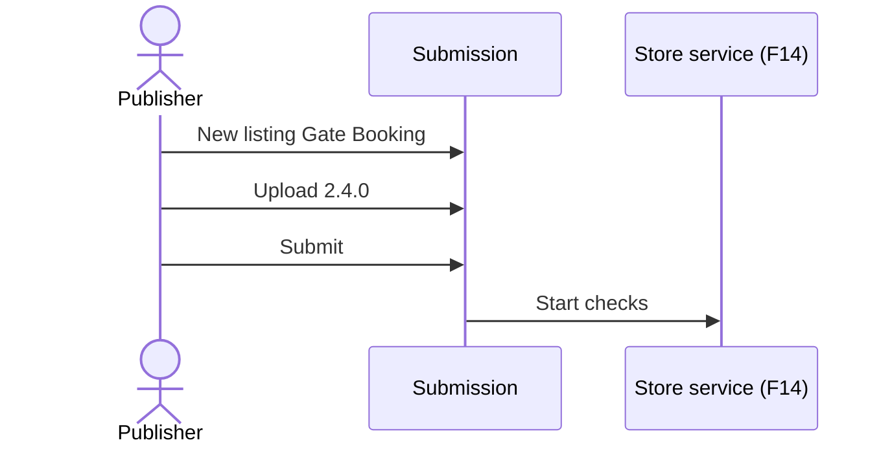

🏠 [Specs](../../../../README.md) › 🧩 [Functional capabilities](../../../README.md) ›
🧰 [F14 Plugin store](../../README.md) › 📝 [Use cases](../README.md) › 📝 [Use cases: FL-F14-03 Publish](README.md) ›
📝 UC-F14-08 Submit a plugin

# 📝 UC-F14-08 Submit a plugin

**Status:** ✅ specified

## Summary

A publisher creates a listing, uploads a version with its manifest and submits it for the automated checks and the
security review.

## Personas

- [U46 Plugin publisher](../../../../01-users/personas/u46-plugin-publisher.md)

## Goal

The plugin on its way to the store.

## Trigger

A new plugin or version ready.

## Frequency

Each release.

## Preconditions

- The publisher is verified (BR-F14-09).

## Postconditions

- Success: the version submitted.
- Failure: refused with the missing items.

## Main flow

1. The publisher opens Submission (S-F14-08) and creates or opens the listing.
2. They fill name, description, category, languages, permissions and plans.
3. They upload the version package with its manifest.
4. They submit; SimpleERP starts the checks (UC-F14-09).

## Alternative flows

- 2a. A sector pack: the plugins it groups are listed.
- 2b. Translations are added (UC-F14-26).

## Error flows

- 4e. Missing metadata: refused with the fields.
- 1e. The publisher is not verified: submission is closed.
- Any step: a service does not answer; the call is retried first (BR-F3-32), then the message follows the error pattern
  (D122) and what was typed stays on the screen.

## Business rules

- [BR-F14-06 Automated checks before review](../../business-rules/br-f14-06-automated-checks-before-review.md)
- [BR-F14-09 Traders verified](../../business-rules/br-f14-09-traders-verified.md)

## Entities

- [E-F14-01 Store listing](../../data/e-f14-01-store-listing.md)
- [E-F14-03 Plugin version](../../data/e-f14-03-plugin-version.md)

## Permissions

Verified publishers, for their listings.

## Notifications

- The publisher when checks start.

## Audit events

Listing and version submitted.

## AI involvement

The AI assistant may draft the description.

## API, MCP and A2A exposure

Through T5 and T6 with the caller's rights (BR-F3-34).

## Screens

- [S-F14-08 Submission](../../screens/03-publish/s-f14-08-submission.md)

## Flowchart

See [FL-F14-03 Publish](../../flows/fl-f14-03-publish.md#flowchart).

## Sequence diagram

## Acceptance criteria

1. **Given** a verified publisher **when** it submits a complete listing **then** the checks start.
2. **Given** no category **when** submitted **then** it is refused naming the field.
3. **Given** an unverified publisher **when** it opens Submission **then** it is closed.

## Non-functional notes

D408's targets ([Performance](../../../../05-non-functional/performance.md)): 95 % of screens within 1 second; lists
paged on the server, the first page within 1 second; reports within 5 seconds or in the background.

## Regulatory references

Store rules of the France country pack:
[CR-FR-188 Reporting sellers' income (DAC7)](../../../../10-country-packs/france/digital/cr-fr-188-dac7-seller-reporting.md),
[CR-FR-189 Platform-to-business terms](../../../../10-country-packs/france/digital/cr-fr-189-p2b-platform-terms.md),
[CR-FR-190 Traceability of traders on a marketplace](../../../../10-country-packs/france/digital/cr-fr-190-marketplace-trader-traceability.md),
[CR-FR-191 Marketplace information to buyers](../../../../10-country-packs/france/consumer/cr-fr-191-marketplace-consumer-information.md),
[CR-FR-168 Cyber Resilience Act reporting](../../../../10-country-packs/france/digital/cr-fr-168-cyber-resilience-reporting.md),
[CR-FR-071 VAT on distance sales in the EU](../../../../10-country-packs/france/tax-and-vat/cr-fr-071-distance-sales-vat-oss.md),
[CR-FR-100 VAT on services to clients abroad](../../../../10-country-packs/france/tax-and-vat/cr-fr-100-vat-on-services-abroad.md),
[CR-FR-049 Processors and transfers outside the EU](../../../../10-country-packs/france/data-protection/cr-fr-049-processors-and-transfers.md),
[CR-FR-016 Electronic invoicing](../../../../10-country-packs/france/invoicing/cr-fr-016-electronic-invoicing.md).

## Related use cases

- [UC-F14-09 Pass automated checks](uc-f14-09-pass-automated-checks.md)
- [UC-F14-21 Check a plugin's bill of materials and licences](uc-f14-21-check-a-plugins-bill-of-materials-and-licences.md)
- [UC-F14-26 Translate a listing and a plugin](uc-f14-26-translate-a-listing-and-a-plugin.md)

## Open questions

None.

---

⬅️ [UC-F14-07 Rate and review](../02-buy-and-licence/uc-f14-07-rate-and-review.md) · ⬆️ [Up](README.md) ·
➡️ [UC-F14-09 Pass automated checks](uc-f14-09-pass-automated-checks.md)
