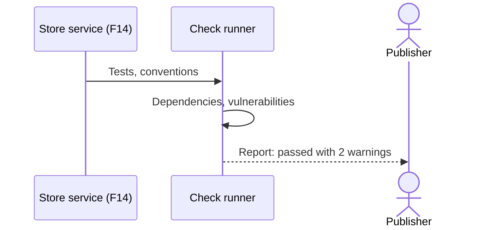

🏠 [Specs](../../../../README.md) › 🧩 [Functional capabilities](../../../README.md) ›
🧰 [F14 Plugin store](../../README.md) › 📝 [Use cases](../README.md) › 📝 [Use cases: FL-F14-03 Publish](README.md) ›
📝 UC-F14-09 Pass automated checks

# 📝 UC-F14-09 Pass automated checks

**Status:** ✅ specified

## Summary

Each submitted version passes automated checks (tests, conventions, licence and dependency scans with the bill of
materials, vulnerability scan) before human review.

## Personas

- [U46 Plugin publisher](../../../../01-users/personas/u46-plugin-publisher.md)

## Goal

Only clean versions reach the review.

## Trigger

A submission.

## Frequency

Each submission.

## Preconditions

- A version is submitted.

## Postconditions

- Success: passed; queued for review.
- Failure: rejected with the report.

## Main flow

1. SimpleERP runs the tests and the conventions check (S-F14-09).
2. It runs the dependency check (UC-F14-21).
3. It runs the vulnerability scan.
4. The publisher reads the report; a pass queues the version for review.

## Alternative flows

- 4a. Warnings only: the version passes with the warnings shown to the reviewer.

## Error flows

- 3e. Vulnerable dependency: rejected.
- 1e. A test fails: rejected with the failing test.
- Any step: a service does not answer; the call is retried first (BR-F3-32), then the message follows the error pattern
  (D122) and what was typed stays on the screen.

## Business rules

- [BR-F14-06 Automated checks before review](../../business-rules/br-f14-06-automated-checks-before-review.md)

## Entities

- [E-F14-03 Plugin version](../../data/e-f14-03-plugin-version.md)
- [E-F14-07 Plugin check report](../../data/e-f14-07-plugin-check-report.md)

## Permissions

Publisher reads its reports.

## Notifications

- The publisher with the result.

## Audit events

Each run and result.

## AI involvement

The AI assistant may explain a failing check.

## API, MCP and A2A exposure

Through T5 and T6 with the caller's rights (BR-F3-34).

## Screens

- [S-F14-09 Automated checks](../../screens/03-publish/s-f14-09-automated-checks.md)

## Flowchart

See [FL-F14-03 Publish](../../flows/fl-f14-03-publish.md#flowchart).

## Sequence diagram

## Acceptance criteria

1. **Given** 2.4.0 with all tests passing **when** checked **then** it is queued for review.
2. **Given** a high vulnerability **when** scanned **then** it is rejected.
3. **Given** 2 warnings **when** checked **then** it passes and the reviewer sees them.

## Non-functional notes

D408's targets ([Performance](../../../../05-non-functional/performance.md)): 95 % of screens within 1 second; lists
paged on the server, the first page within 1 second; reports within 5 seconds or in the background.

## Regulatory references

Store rules of the France country pack:
[CR-FR-188 Reporting sellers' income (DAC7)](../../../../10-country-packs/france/digital/cr-fr-188-dac7-seller-reporting.md),
[CR-FR-189 Platform-to-business terms](../../../../10-country-packs/france/digital/cr-fr-189-p2b-platform-terms.md),
[CR-FR-190 Traceability of traders on a marketplace](../../../../10-country-packs/france/digital/cr-fr-190-marketplace-trader-traceability.md),
[CR-FR-191 Marketplace information to buyers](../../../../10-country-packs/france/consumer/cr-fr-191-marketplace-consumer-information.md),
[CR-FR-168 Cyber Resilience Act reporting](../../../../10-country-packs/france/digital/cr-fr-168-cyber-resilience-reporting.md),
[CR-FR-071 VAT on distance sales in the EU](../../../../10-country-packs/france/tax-and-vat/cr-fr-071-distance-sales-vat-oss.md),
[CR-FR-100 VAT on services to clients abroad](../../../../10-country-packs/france/tax-and-vat/cr-fr-100-vat-on-services-abroad.md),
[CR-FR-049 Processors and transfers outside the EU](../../../../10-country-packs/france/data-protection/cr-fr-049-processors-and-transfers.md),
[CR-FR-016 Electronic invoicing](../../../../10-country-packs/france/invoicing/cr-fr-016-electronic-invoicing.md).

## Related use cases

- [UC-F14-21 Check a plugin's bill of materials and licences](uc-f14-21-check-a-plugins-bill-of-materials-and-licences.md)
- [UC-F14-10 Pass the security review and sign](uc-f14-10-pass-the-security-review-and-sign.md)

## Open questions

None.

---

⬅️ [UC-F14-08 Submit a plugin](uc-f14-08-submit-a-plugin.md) · ⬆️ [Up](README.md) ·
➡️ [UC-F14-10 Pass the security review and sign](uc-f14-10-pass-the-security-review-and-sign.md)
